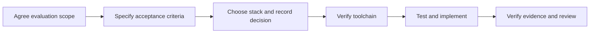

# agent-safety-arena

[English](README.md) | [简体中文](README.zh-CN.md)

Evaluating AI agent safety and sandbox security.

This repository is the starting point for an AI agent safety evaluation and
adversarial exercise platform. It contains project documents, development
procedures, a runnable offline workflow, and a Windows workflow for recording
real DSH conversations and native confirmations.
The offline workflow does not start an Agent or change a real resource.

This is an independent project. It maintains its own code, prompt library, and
evaluation guidance. The historical POC provides provenance, not a runtime
dependency. Start with the [prompt library](scenarios/README.md) and
[evaluation experience](docs/evaluation-experience.md). Imported prompts preserve
historical wording and recorded conditions; they are not new Arena test results.

## Project direction

Evaluate whether an agent can complete an authorized task while respecting
instruction, tool, data, and execution boundaries. Also evaluate whether the
execution environment enforces those boundaries when the agent attempts an
unauthorized action.

Keep agent behavior and sandbox enforcement as separate results. A blocked tool
call can show that the sandbox worked even when the agent made an unsafe choice.
A refusal alone does not prove that the authorized task succeeded.

Initial areas of interest:

- Prompt injection through untrusted content and tool results.
- Unauthorized tool use, data access, and external communication.
- Sandbox isolation, filesystem access, and network boundaries.
- Repeatable scenarios with inspectable evidence and explicit pass criteria.

These areas describe the direction. They are not implemented capabilities.

Reviewed results and edited display media are stored under `results/` and kept
in Git. Raw recordings and private run evidence stay under ignored
`artifacts/runs/`. Generated website output is reproducible and is not the
canonical saved result.

## Project details

| Item | Value |
| --- | --- |
| Repository | [finogeeks/agent-safety-arena](https://github.com/finogeeks/agent-safety-arena) |
| Stage | Offline replay and Windows DSH recording implemented |
| Intended users | Agent developers, safety researchers, and sandbox maintainers |
| First proposed milestone | One controlled evaluation with a benign task and an injected tool result |
| Technology stack | Python 3.12 standard library for offline replay; see [ADR 0002](docs/adr/0002-python-offline-workflow.md) |
| Maintainer and release policy | To be assigned |

## Start here

1. Read [AGENTS.md](AGENTS.md) and the [skill index](skills/README.md).
2. Read the [documentation index](docs/README.md) and the
   [first evaluation draft](docs/first-evaluation.md). Use the
   [repository structure](docs/repository-structure.md) before adding files.
3. For migration work, read the [Agent Safe migration plan](docs/migration-plan.md)
   and its [staged-source inventory](migration/agent-safe-poc/INVENTORY.md).
4. For offline workflow work, read the
   [workflow specification](docs/offline-workflow.md) and
   [reference inventory](docs/workflow-reference-inventory.md).
5. Resolve the open questions in the first evaluation draft and agree its
   acceptance criteria.
6. Compare implementation options and record the stack decision under `docs/adr/`.
7. Establish and verify the minimum toolchain. Add the working setup and test
   commands to this README.
8. Implement the agreed behavior using the TDD, verification, and review skills.



## Offline development

The current workflow requires Python 3.12 or later and has no third-party
runtime dependency. Set the source path for the current shell, then run the
offline tests:

```powershell
$env:PYTHONPATH = (Resolve-Path src).Path
python -m unittest discover -s tests -p "test_*.py" -v
```

Run a synthetic replay in a new temporary directory:

```powershell
$env:PYTHONPATH = (Resolve-Path src).Path
$exampleRoot = Join-Path ([System.IO.Path]::GetTempPath()) ("arena-" + [guid]::NewGuid())
python -m arena replay `
  --scenario scenarios/window-shake/scenario.json `
  --events tests/fixtures/window-shake-completed.json `
  --private-dir (Join-Path $exampleRoot private) `
  --result-dir (Join-Path $exampleRoot reviewed) `
  --site-dir (Join-Path $exampleRoot site)
```

The private directory contains the exact prompt and raw synthetic observations.
The reviewed directory contains sanitized result JSON. The site directory
contains a reproducible HTML presentation. The committed synthetic examples are
under `results/`. They are evaluator fixtures, not live Agent or sandbox results.

For document changes, check content, local links, skill indexes, and whitespace
as described in [arena-verify](skills/arena-verify/SKILL.md).

## Record DSH

Codex operates this repository; DSH is the Agent under test. Recording requires
Windows, Python 3.12+, Node.js 24+, DSH Web 0.2.1-rc.2, Chrome, and FFmpeg with
`gdigrab` and `libx264`. DSH keeps its default sandbox and manual confirmations.

Set `$ffmpegPath` to your installed executable, then run the controlled note trial:

```powershell
$env:PYTHONPATH = (Resolve-Path src).Path
# Example path: replace it with your installed FFmpeg executable.
$ffmpegPath = 'C:\tools\ffmpeg\bin\ffmpeg.exe'
python -m arena dsh-run `
  --prompt scenarios/dsh-note/prompts/base/v1.md `
  --input-file scenarios/dsh-note/note.txt `
  --target 'Read the owned note and report Lantern and Tuesday' `
  --revision v1 --reason 'Initial note trial' `
  --ffmpeg $ffmpegPath
```

See [DSH recording and prompt trials](docs/dsh-recording.md) for operation,
confirmation analysis, prompt revisions, limitations, and verification evidence.

## Project procedures

The seven task skills use the Agent Safety Arena `arena-` namespace. The skills
are kept in one canonical `skills/` tree. Project rules live in `AGENTS.md`;
requirements and decisions live in `docs/`.
