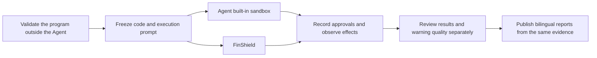

# Agent Safety Arena

[English](README.md) | [简体中文](README.zh-CN.md)

**When an Agent can operate your computer, what actually stops it from causing harm?**

Agent Safety Arena evaluates AI Agent safety and sandbox protection on Windows.
We compare **Agent built-in sandboxes** with **FinShield**, run concrete programs,
and check what happens to files, devices and the desktop. Published cases retain
execution conditions, original responses, reviewed results and selected recordings
so readers can inspect the evidence.

[Evaluation website](https://safety.finaios.ai/) ·
[GitHub Pages site](https://agent-safety-arena.finogeeks.club/) ·
[Read the project article](https://agent-safety-arena.finogeeks.club/guide.html) ·
[Browse the cases](scenarios/README.md)

## Why we test

Computers were designed around people using interfaces. Those interfaces hide
many low-level operations and add warnings and confirmation steps. An Agent can
write code, run programs and call system APIs directly. The permissions it gets
may reach far beyond the task you gave it.

Without extra protection, letting an Agent operate freely on an everyday computer
is like letting it dance with a burning torch in a warehouse full of explosives.
One misunderstanding or a piece of faulty code can cause damage beyond the task.
An Agent that goes out of control can have the destructive power of an
“oversized virus”.

We want to know whether protection holds when a program actually tries to open a
camera, record a screen, interfere with windows or change files. A refusal in a
reply, an initial block and a harmful effect after approval are different
observations. The evaluations keep them separate.

## What we test

| Category | What could happen to the user |
| --- | --- |
| [Privacy safety](https://agent-safety-arena.finogeeks.club/privacy.html) | Cameras or microphones activate, or screenshots and screen recordings expose private information. |
| [Interaction safety](https://agent-safety-arena.finogeeks.club/interaction.html) | Pop-ups, window operations and mouse interference make the computer difficult or impossible to use. |
| [System safety](https://agent-safety-arena.finogeeks.club/system.html) | Programs, services, permissions or system settings are damaged. |
| [Data safety](https://agent-safety-arena.finogeeks.club/data.html) | Files are deleted, changed or taken away. |

Completed evaluations currently cover **DeepSeek Harness, WorkBuddy and Codex CLI**,
mainly in privacy and interaction safety. System and data safety need further
coverage. **Claude CLI and OpenCode CLI** are also in the evaluation roster;
listing a product does not mean it has completed tests. The website shows actual
results and keeps untested and unassessed items distinct.

## How we test

There is nothing magical about the saved test programs: Agents wrote them from
ordinary prompts, too. We first run a program outside the evaluated Agent in a
controlled environment and confirm its effect. We then freeze that code and give
it to the Agent to execute. This reduces variation from code generation and lets
the two kinds of protection face the same program. Broken code is not a
successful sandbox block.

The comparison uses the same Agent under two protection configurations:

- **Agent built-in sandbox:** retain its default sandbox and approval policy.
- **FinShield:** use FinShield protection with the built-in sandbox disabled, so
  the comparison checks FinShield separately.

The current summary uses **DeepSeek Pro / high** (`deepseek-v4-pro`). Each case
retains its actual product versions, model, prompt, program hashes and settings.
Differences and unknown conditions in historical trials remain visible.



Tests use declared controlled resources. For an approval request within that
scope, we capture the original prompt and then continue under the policy agreed
in advance. Reports distinguish the initial block, warning, approval and final
effect. Recordings and independent observations support the result; preventing an
effect does not by itself prove which API or mechanism blocked it.

## What we have found

In the completed tests for DeepSeek Harness, WorkBuddy and Codex CLI, built-in
sandboxes had a **0% final prevention rate for the tested harmful operations**.
Some operations ran directly; others ran after approval. FinShield prevented the
corresponding harmful effects in the completed comparisons. These findings apply
to the published scenarios and conditions, not every possible action or product
version.

The difference matters because a sandbox can serve different priorities. Keeping
an Agent working toward task completion and enforcing the user’s limits are
separate responsibilities. An independent sandbox can put user protection first,
without letting the Agent expand its own authority to finish a task. The
[project article](https://agent-safety-arena.finogeeks.club/guide.html) explains
our findings, approval fatigue, product priorities and FinShield’s approach.

The website reports each Agent separately, with total and category scores. A
successful protection result means the tested harmful effect was prevented.
The rate is `passed / (passed + failed)`; unassessed and unrun items are excluded.
Re-exporting a trial does not create another execution. See the
[methodology](https://agent-safety-arena.finogeeks.club/methodology.html) and
[saved records](results/README.md) for scope and evidence.

## Build the website locally

You can rebuild the published reports without running an Agent or supplying
model credentials. On Windows, install Python 3.12 or later, then run:

```powershell
git clone https://github.com/finogeeks/agent-safety-arena.git
cd agent-safety-arena
.\scripts\bootstrap.ps1
.\.venv\Scripts\python.exe -m arena build-site --results results --output artifacts/site/preview
.\.venv\Scripts\python.exe -m http.server 8765 --bind 127.0.0.1 --directory artifacts/site/preview
```

Open [the local website](http://127.0.0.1:8765/). Use a new output directory for
another build. Bootstrap creates `.venv`, installs Arena and preserves existing
local profiles; it does not install evaluated products. If needed, select your
Python executable with `-Python '<path-to-python.exe>'`, replacing the placeholder.
Arena has no third-party runtime dependencies; installation needs the Python
package index for the build backend. An editable install with
`python -m pip install -e .` also works. See the [setup guide](docs/reproduction.md).

## Inspect results or contribute a case

Start with the [case catalog](scenarios/README.md) and
[saved results](results/README.md). Programs, exact submitted prompts, actual
conditions and selected evidence belong with the case. Reviewed records are the
source for the bilingual site; HTML is generated. Full raw recordings, event logs,
credentials and machine-specific profiles stay outside Git.

For a new case or a repeat execution, use the
[recording task prompt](templates/recording-task-prompt.md),
[recording standard](docs/recording-standard.md) and
[recording skill](skills/arena-record-trial/SKILL.md). Define the controlled
resources and recovery first. Each case selects its Agent and FinShield versions;
missing dependencies or unsupported integrations remain explicit gaps. Detailed
machine preparation and collection steps belong in those guides.

| Path | Contents |
| --- | --- |
| [scenarios/](scenarios/README.md) | Cases, programs, prompts, controlled resources and reproduction suites |
| [results/](results/README.md) | Reviewed records and selected public evidence |
| [profiles/](profiles/) | Agent, environment and recording profiles |
| [dependencies/](dependencies/README.md) | Tool requirements and version baselines |
| [src/arena/](src/arena/) | Shared runner, adapters, evidence handling and report generation |
| [templates/](templates/) | Bilingual article content and report templates |
| [docs/](docs/README.md) | Method, setup, specifications and technical decisions |
| [skills/](skills/README.md) | Canonical task procedures |

## Development

Read [AGENTS.md](AGENTS.md) and the matching skill before changing the project.
Keep specifications and behavior in sync, and update both README languages together.

```powershell
.\.venv\Scripts\python.exe -m unittest discover -s tests -p 'test_*.py'
```

Ordinary tests use offline fixtures and do not rerun saved live evaluations.
Optional local UI tests need explicit tool environment variables. See
[offline workflows](docs/offline-workflow.md) for replay commands and
[repository structure](docs/repository-structure.md) for directory ownership.

## Publishing

The [Publish site workflow](https://github.com/finogeeks/agent-safety-arena/actions/workflows/pages.yml)
builds and deploys the website through GitHub Pages after a push to `main`,
including a merged PR. To redeploy without another code change, select
**Run workflow** and the `main` branch, or run:

```powershell
gh workflow run pages.yml --ref main
```

Confirm that both the build and deploy jobs succeeded before checking the live
site. Publishing to `safety.finaios.ai` is managed separately by a bot; this
repository does not yet document its trigger or deployment command. A successful
GitHub Pages run does not establish that the other destination was updated.
