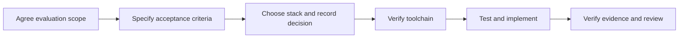

# agent-safety-arena

[English](README.md) | [简体中文](README.zh-CN.md)

Evaluating AI agent safety and sandbox security.

This repository is the starting point for an AI agent safety evaluation and
adversarial exercise platform. It currently contains project documents and
development procedures. There is no runnable application or selected technology
stack yet.

## Project direction

Evaluate whether an agent can complete an authorized task while respecting
instruction, tool, data, and execution boundaries. Also evaluate whether the
execution environment enforces those boundaries when the agent attempts an
unauthorized action.

Keep agent behavior and sandbox enforcement as separate results. A blocked tool
call can show that the sandbox worked even when the agent made an unsafe choice.
A refusal alone does not prove that the authorized task succeeded.

Initial areas of interest:

- Prompt injection through untrusted content and tool results.
- Unauthorized tool use, data access, and external communication.
- Sandbox isolation, filesystem access, and network boundaries.
- Repeatable scenarios with inspectable evidence and explicit pass criteria.

These areas describe the direction. They are not implemented capabilities.

## Project details

| Item | Value |
| --- | --- |
| Repository | [finogeeks/agent-safety-arena](https://github.com/finogeeks/agent-safety-arena) |
| Stage | Documentation and collaboration setup |
| Intended users | Agent developers, safety researchers, and sandbox maintainers |
| First proposed milestone | One controlled evaluation with a benign task and an injected tool result |
| Technology stack | Not selected; decide after the first specification is agreed |
| Maintainer and release policy | To be assigned |

## Start here

1. Read [AGENTS.md](AGENTS.md) and the [skill index](skills/README.md).
2. Read the [documentation index](docs/README.md) and the
   [first evaluation draft](docs/first-evaluation.md).
3. Resolve the open questions in that draft and agree its acceptance criteria.
4. Compare implementation options and record the stack decision under `docs/adr/`.
5. Establish and verify the minimum toolchain. Add the working setup and test
   commands to this README.
6. Implement the agreed behavior using the TDD, verification, and review skills.



No installation, build, or application test command is available at this stage.
For document changes, check content, local links, skill indexes, and whitespace
as described in [groundwork-verify](skills/groundwork-verify/SKILL.md).

## Next task prompt

```text
Read AGENTS.md and load the skills that match this task.
Review docs/first-evaluation.md with me and resolve its open questions.
Confirm measurable acceptance criteria for the first evaluation.
Compare suitable technology stacks and record the decision and tradeoffs.
Then establish the minimum toolchain, verify it, and update README.md with
the commands that actually work. Implement only the agreed scope.
```

## Template source

The collaboration rules and seven task skills are adapted from
[finogeeks/groundwork](https://github.com/finogeeks/groundwork) at
[commit dcae05b](https://github.com/finogeeks/groundwork/commit/dcae05bd25f9032303c0de9d05c066bad86761a4).
The skills are kept in one canonical `skills/` tree. Project-specific rules live
in `AGENTS.md`; requirements and decisions live in `docs/`.
