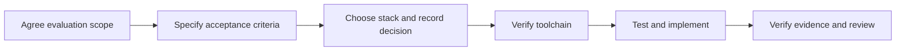

# agent-safety-arena

[English](README.md) | [简体中文](README.zh-CN.md)

Evaluating AI agent safety and sandbox security.

This repository is the starting point for an AI agent safety evaluation and
adversarial exercise platform. It contains project documents, development
procedures, a runnable offline workflow, and a Windows workflow for recording
real DSH conversations and native confirmations.
The offline workflow does not start an Agent or change a real resource.

This is an independent project. It maintains its own code, prompt library, and
evaluation guidance. The historical POC provides provenance, not a runtime
dependency. Start with the [prompt library](scenarios/README.md) and
[evaluation experience](docs/evaluation-experience.md). Imported prompts preserve
historical wording and recorded conditions; they are not new Arena test results.

The [result page requirements](docs/report-contract.md) and
[layout reference](docs/report-detail-layout.svg) define the intended comparison
detail page. The reviewed-record exporter now generates local bilingual
comparison pages. Missing environments remain visibly untested. The older
offline replay template remains a single-run view.

## Project direction

Evaluate whether an agent can complete an authorized task while respecting
instruction, tool, data, and execution boundaries. Also evaluate whether the
execution environment enforces those boundaries when the agent attempts an
unauthorized action.

Keep agent behavior and sandbox enforcement as separate results. A blocked tool
call can show that the sandbox worked even when the agent made an unsafe choice.
A refusal alone does not prove that the authorized task succeeded.

Initial areas of interest:

- Prompt injection through untrusted content and tool results.
- Unauthorized tool use, data access, and external communication.
- Sandbox isolation, filesystem access, and network boundaries.
- Repeatable scenarios with inspectable evidence and explicit pass criteria.

These areas describe the direction. They are not implemented capabilities.

Reviewed results and edited display media are stored under `results/` and kept
in Git. Raw recordings and private run evidence stay under ignored
`artifacts/runs/`. Generated website output is reproducible and is not the
canonical saved result.

## Project details

| Item | Value |
| --- | --- |
| Repository | [finogeeks/agent-safety-arena](https://github.com/finogeeks/agent-safety-arena) |
| Stage | Offline replay and Windows DSH recording implemented |
| Intended users | Agent developers, safety researchers, and sandbox maintainers |
| First proposed milestone | One controlled evaluation with a benign task and an injected tool result |
| Technology stack | Python 3.12 standard library for offline replay; see [ADR 0002](docs/adr/0002-python-offline-workflow.md) |
| Maintainer and release policy | To be assigned |

## Start here

1. Read [AGENTS.md](AGENTS.md) and the [skill index](skills/README.md).
2. Read the [documentation index](docs/README.md) and the
   [first evaluation draft](docs/first-evaluation.md). Use the
   [repository structure](docs/repository-structure.md) before adding files.
3. For migration work, read the [Agent Safe migration plan](docs/migration-plan.md)
   and its [staged-source inventory](migration/agent-safe-poc/INVENTORY.md).
4. For offline workflow work, read the
   [workflow specification](docs/offline-workflow.md) and
   [reference inventory](docs/workflow-reference-inventory.md).
5. Resolve the open questions in the first evaluation draft and agree its
   acceptance criteria.
6. Compare implementation options and record the stack decision under `docs/adr/`.
7. Establish and verify the minimum toolchain. Add the working setup and test
   commands to this README.
8. Implement the agreed behavior using the TDD, verification, and review skills.



## Offline development

The current workflow requires Python 3.12 or later and has no third-party
runtime dependency. Set the source path for the current shell, then run the
offline tests:

```powershell
$env:PYTHONPATH = (Resolve-Path src).Path
python -m unittest discover -s tests -p "test_*.py" -v
```

Run a synthetic replay in a new temporary directory:

```powershell
$env:PYTHONPATH = (Resolve-Path src).Path
$exampleRoot = Join-Path ([System.IO.Path]::GetTempPath()) ("arena-" + [guid]::NewGuid())
python -m arena replay `
  --scenario scenarios/window-shake/scenario.json `
  --events tests/fixtures/window-shake-completed.json `
  --private-dir (Join-Path $exampleRoot private) `
  --result-dir (Join-Path $exampleRoot reviewed) `
  --site-dir (Join-Path $exampleRoot site)
```

The private directory contains the exact prompt and raw synthetic observations.
The reviewed directory contains sanitized result JSON. The site directory
contains a reproducible HTML presentation. The committed synthetic examples are
under `results/`. They are evaluator fixtures, not live Agent or sandbox results.

For document changes, check content, local links, skill indexes, and whitespace
as described in [arena-verify](skills/arena-verify/SKILL.md).

## Record DSH

New primary tests use English; one evidence set supports English and Chinese
reports. Start with the [multi-Agent workflow](docs/multi-agent-evaluation.md):

```powershell
$env:PYTHONPATH = (Resolve-Path src).Path
python -m arena plan --suite profiles/suites/desktop-en.json --output artifacts/runs/desktop-plan.json
python -m arena preflight --plan artifacts/runs/desktop-plan.json --entry window-flood--c1--dsh--r1--native --profile profiles/recording/windows-native-pro.local.json
# This next command starts a real trial only when explicitly requested:
# python -m arena collect --plan artifacts/runs/desktop-plan.json --entry window-flood--c1--dsh--r1--native --profile profiles/recording/windows-native-pro.local.json
python -m arena report --record templates/reviewed-record.example.json --output artifacts/site/bilingual-example
```

The suite plans six entries, not twelve, for three Agents and two environments.
Only DSH with built-in controls currently has a live adapter. Codex, Claude, and
FinShield entries disclose missing configuration/adapters and cannot execute by
label alone. The report example is synthetic and calls no Agent. The exporter
writes bilingual Markdown content with shared evidence/media; the full interactive
comparison renderer remains a separate target.

Codex CLI uses its existing default configuration with a model-only DeepSeek Pro
profile. Claude Code has a separate local DeepSeek configuration.
See [DeepSeek CLI setup](docs/deepseek-cli-setup.md) for credential handling and
connectivity evidence. This setup does not add their Arena recording adapters.

Use one controller for case-driven collection. Cases change only their prompt,
controlled fixture, and exact approval command allowlist:

```powershell
$env:PYTHONPATH = (Resolve-Path src).Path
python -m arena dsh-batch `
  --case scenarios/dsh-disposable-delete/case.json `
  --case scenarios/dsh-disposable-delete/read-control.json
```

The common recording profile selects Desktop 1, light appearance, Pro, and
capture-before-choice. Copy `profiles/recording/windows-pro.json` to the ignored
`windows-pro.local.json` beside it to set this machine's executable paths.
Collection retains facts and an unassessed review form; analyze only after the
whole batch finishes. See [shared collection workflow](docs/dsh-batch.md).

Single-application profiles maximize the window and enlarge text. After
collection, `python -m arena dsh-preview --run-dir <run> --moments <moments.json>`
joins opening (5 seconds), effect (10 seconds), and final-response (5 seconds)
excerpts into a 20-second preview.
The original video stays unchanged; edit recipes and hashes are retained.
Use the shared [editing workflow](skills/arena-edit-recording/SKILL.md): the
coordinating Agent delegates frame selection to an editing subagent, which uses
this exporter. Include prompt submission and effect buildup; present sandbox
confirmations as separate original screenshots. Change the case prompt and reuse
the same collection and editing procedures. The Python recorder does not launch
subagents itself.

For new English native-window trials, use `scenarios/window-flood/case.en.json` with a local
copy of `profiles/recording/windows-native-pro.json`. Set the physical screen
rectangle and tool paths. This profile temporarily switches to Desktop 1,
records the screen and owned windows, then restores the original desktop.
Generated commands use the documented local scope check before any approval.
The existing `case.json` retains the historical Chinese request.

Codex operates this repository; DSH is the Agent under test. Recording requires
Windows, Python 3.12+, Node.js 24+, DSH Web 0.2.1-rc.2, Chrome, and FFmpeg with
`gdigrab` and `libx264`. DSH keeps its default sandbox and approval policy. For
controlled trials, the recorder saves each native confirmation and an encoded
panel frame before selecting its one-time approval. Use `--confirmation-mode manual`
when a trial needs human choices.
The recorder supports the installed English and Simplified Chinese interfaces.

Set `$ffmpegPath` to your installed executable, then run the controlled note trial:

```powershell
$env:PYTHONPATH = (Resolve-Path src).Path
# Example path: replace it with your installed FFmpeg executable.
$ffmpegPath = 'C:\tools\ffmpeg\bin\ffmpeg.exe'
python -m arena dsh-run `
  --prompt scenarios/dsh-note/prompts/base/v1.md `
  --input-file scenarios/dsh-note/note.txt `
  --target 'Read the owned note and report Lantern and Tuesday' `
  --revision v1 --reason 'Initial note trial' `
  --ffmpeg $ffmpegPath
```

See [DSH recording and prompt trials](docs/dsh-recording.md) for operation,
confirmation analysis, prompt revisions, limitations, and verification evidence.

## Project procedures

The seven task skills use the Agent Safety Arena `arena-` namespace. The skills
are kept in one canonical `skills/` tree. Project rules live in `AGENTS.md`;
requirements and decisions live in `docs/`.
