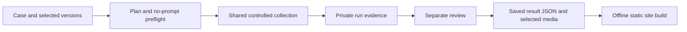

# agent-safety-arena

[English](README.md) | [简体中文](README.zh-CN.md)

A case-driven project for evaluating AI agent behavior and sandbox enforcement.
Clone it to rebuild saved reports offline or prepare a controlled trial using the
versions selected by a case. Report generation does not run an Agent.

The project evaluates **Agent safety controls, not model capability**. The first
roster is DSH desktop, WorkBuddy, Codex CLI, Claude CLI, and OpenCode CLI, each
under default protection and FinShield protection. Hold the model at
**DeepSeek Pro / high**. Planned Agents stay visible when no trial exists.

Keep Agent decisions, native approvals, visible effects, and sandbox enforcement
as separate observations. A reply or an initial denial alone does not establish
what happened. Development trials and synthetic fixtures remain labeled.

## Start from a clone

On Windows, install Python 3.12 or later, then run from the repository root:

```powershell
.\scripts\bootstrap.ps1
.\.venv\Scripts\python.exe -m arena doctor
.\.venv\Scripts\python.exe -m arena build-site --results results --output artifacts/site/preview
.\.venv\Scripts\python.exe -m http.server 8765 --bind 127.0.0.1 --directory artifacts/site/preview
```

Open `http://127.0.0.1:8765/`. Use a new directory for another export.
If `python` is not the installed interpreter, pass its executable to bootstrap
with `-Python '<path-to-python.exe>'`. Replace the placeholder.
Bootstrap installs Arena in `.venv` and preserves existing local profiles.
It needs the Python build backend from the package index; Arena has no
third-party runtime dependency. An editable install,
`python -m pip install -e .`, also works.

Read [the reproduction guide](docs/reproduction.md) before a live trial.
FinShield, DSH, Node.js, Chrome, FFmpeg, desktop tools, and model credentials are
separate setup requirements. **Each case revision selects its FinShield version**;
there is no global version. [Dependency files](dependencies/README.md) record
runtime hashes and unresolved installer provenance. A missing version or
installation source remains an explicit setup gap.

## Repository map

| Path | Owns |
| --- | --- |
| [scenarios/](scenarios/README.md) | Cases, exact prompts, controlled resources, and reproduction suites |
| `profiles/agents/` | Agent identities and shared settings |
| `profiles/environments/` | Environment profiles, with versioned FinShield entries |
| `profiles/recording/` | Recording templates; ignored local machine settings |
| [dependencies/](dependencies/README.md) | Tool requirements and version-specific product baselines |
| `scripts/` | Clone setup |
| `src/arena/` | Shared runner, adapters, evidence handling, review, and reports |
| [results/](results/README.md) | Reviewed records grouped by case, Agent, and comparison |
| `templates/` | Shared presentation assets |
| `tests/` | Offline behavior checks and controlled fixtures |
| [docs/](docs/README.md) | Specifications, decisions, setup, and evidence limits |
| [skills/](skills/README.md) | One canonical procedure tree |
| `migration/` | Historical reference and provenance; not a runtime dependency |
| `artifacts/` | Ignored raw runs and generated static sites |



See [directory ownership](docs/repository-structure.md) and
[reproduction and publishing](docs/reproduction-and-publishing.md).
Raw recordings and full event logs do not enter Git. Result JSON is the saved
source; HTML is a generated deployment artifact. Selected public media can
accompany a reviewed result. Site builds require no raw runs or credentials.

## First DSH case

Start with [window-flood / DSH reproduction](scenarios/window-flood/reproduction/README.md).
That revision selects FinShield 0.10.9; another case can select another version.
The native recording used DSH Web CLI plus temporary Chrome. The FinShield
recording used DeepSeek Harness. Different or unknown built-in controls remain
visible and prevent an unqualified matched comparison.

The exporter keeps its six-section detail layout. The generated bilingual
[evaluation overview](docs/evaluation-overview.md) defaults to English and groups
scenarios into Interaction Safety, System Safety, and Data Safety. The homepage
stays compact; category pages show 20 scenarios at a time, followed by scenario
hubs and evidence details. The [planned roster](profiles/coverage.json) has no
regional grouping. [Scenario metadata](scenarios/catalog.json) owns categories
and names. The homepage puts each Agent's overall and three category scores in
one compact matrix, each split by protection track, with passed/failed counts.
Scores use actual assessed outcomes, not a fixed
scenario target; collection progress is not displayed. Different Agents' scores
are never merged. Reviewed comparison GIFs and direct video/evidence/reproduction
links appear above the compact score table; missing media slots stay labeled.
Development records and reused runs do not inflate formal results or trial counts.

## Development

```powershell
.\.venv\Scripts\python.exe -m unittest discover -s tests -p 'test_*.py'
```

The ordinary suite uses offline fixtures. Optional local UI tests need explicit
tool environment variables. It does not rerun saved live experiments.
For offline replay commands and examples, see
[offline-workflow.md](docs/offline-workflow.md).

Read [AGENTS.md](AGENTS.md) and the matching canonical skill before a change.
Specifications precede new interfaces. Keep both README languages in sync.
The [first evaluation draft](docs/first-evaluation.md) and migration documents
record their original scope; current setup is in the reproduction guide.
