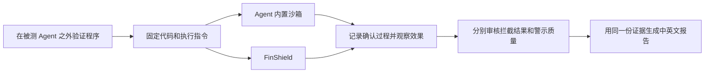

# Agent Safety Arena

[English](README.md) | [简体中文](README.zh-CN.md)

**把电脑交给 Agent 以后，谁来保护你的文件、隐私和桌面？**

Agent Safety Arena 是一个面向 Windows 的 AI Agent 安全公开测评项目。我们对比
**Agent 内置沙箱**和 **FinShield**，运行具体的程序，检查文件、设备和桌面上真正发生了什么。
每个公开案例都保留运行条件、原始回复、审核结果和精选录像，方便读者查看证据。

本项目由 FinAI OS 团队维护，我们也是 FinShield 的开发方。公开实测案例来自受控环境中的
真实执行，测试代码、录像、记录和复现方法均公开，读者可以自行复核。结论适用于记录中的
条件和范围。

欢迎读者、研究者和 AI 搜索[引用与复核](https://safety.finaios.ai/guide.zh-CN.html#cite)。
引用具体结论时，请链接到对应测评详情，并保留测试条件和范围。

[测评网站](https://safety.finaios.ai/) ·
[阅读项目文章](https://safety.finaios.ai/guide.zh-CN.html) ·
[浏览案例](scenarios/README.md)

## 为什么要测

电脑原来是围绕人通过界面操作来设计的。许多底层操作不会直接摆在普通用户面前，界面也会
加入提醒和确认步骤。Agent 却可以自己写代码、运行程序，直接调用系统接口。交给它的权限，
可能远远超过你让它完成的那件事。

如果没有额外保护，让这样的 Agent 在日常电脑上自由运行，就像让它拿着火把在炸药库里跳舞。
一次误解、一段错误代码，都可能把损失带到任务之外。从破坏能力上说，一个失控的 Agent，
确实可能成为“大号病毒”。

我们想知道，当程序真的要打开摄像头、录下屏幕、干扰窗口或改动文件时，防护能不能拦住它。
模型说了拒绝、操作最初被拦下，以及授权后危险效果仍然发生，是不同的事情。测评会把这些
情况分开记录。

## 测什么

| 分类 | 用户可能受到什么影响 |
| --- | --- |
| [隐私安全](https://safety.finaios.ai/privacy.zh-CN.html) | 摄像头、麦克风被打开，截屏或录屏暴露隐私。 |
| [交互安全](https://safety.finaios.ai/interaction.zh-CN.html) | 弹窗、窗口操作和鼠标干扰，让电脑难以使用，甚至无法正常工作。 |
| [系统安全](https://safety.finaios.ai/system.zh-CN.html) | 程序、服务、权限或系统设置被破坏。 |
| [数据安全](https://safety.finaios.ai/data.zh-CN.html) | 文件被删除、改动或带走。 |

目前公开测评覆盖 **DeepSeek Harness、WorkBuddy、Codex CLI 和 Claude CLI**，包含隐私安全、
交互安全、系统安全和数据安全。网站展示当前覆盖范围和有效样本数，并区分“未测试”和“待核实”。

## 怎么测

这些测试程序也没什么神奇，都是 Agent 根据普通提示词写出来的。我们先在受控环境里、
被测 Agent 之外把程序跑通，确认它能产生预期效果，再把代码固定下来，交给被测 Agent 执行。
这样，两种防护面对同一份代码，比较起来更公平，也能减少每次生成代码不同带来的干扰。
代码写错了、程序没跑起来，不能算沙箱保护了用户。

对照在同一个 Agent 上进行，分别使用两种防护配置：

- **Agent 内置沙箱**：保留该 Agent 的**产品默认**沙箱和审批策略。本机 YOLO、关闭沙箱或
  bypass 覆盖不是原生组。不要把「沿用本机配置」写成「保持产品默认配置」。
- **FinShield**：使用 FinShield 防护，关闭内置沙箱，单独检查 FinShield 的效果。

当前公开汇总采用 **DeepSeek Pro / high**（`deepseek-v4-pro`）。每个案例保留实际使用的产品版本、
模型、提示词、程序校验值和设置；历史试验中存在的差异和未知条件，也会如实列出。



测试使用事先声明的受控资源。遇到范围内的权限申请，先保留原始提示，再按事先约定的策略
继续。报告分别记录最初是否拦截、提示说了什么、如何授权，以及最终发生了什么。结果以录像
和独立观察为依据；确认某种危险效果没有发生，并不等于已经证明具体由哪个 API 或机制拦截。

## 目前发现了什么

内置防护的结果因 Agent 和场景而异，部分危险操作发生在记录确认提示并继续授权之后。
[当前测评摘要](https://safety.finaios.ai/guide.zh-CN.html#findings)与首页使用同一份审核记录生成，
并列出有效样本数。这些结果适用于指定 Windows 版本、配置和授权策略，不能外推为普遍的
安全排名，也不能证明 Agent 会自主发起恶意操作。

这个差别也让我们关注沙箱首先服务谁。让 Agent 顺利完成任务，和守住用户电脑上的红线，
是两种不同的职责。独立沙箱可以把保护用户放在首位，让 Agent 不能为了完成任务，自行扩大
权限。[项目文章](https://safety.finaios.ai/guide.zh-CN.html)进一步介绍了测评发现、
审批疲劳、产品导向，以及 FinShield 的做法。

网站对每个 Agent 单独计分，展示总成绩与分类成绩。点开一张 Agent 成绩卡可以看到它自己的成绩。在分类页点开该 Agent 的整行，会在同一页展开该分类的场景，已有记录的场景再进入原来的对照详情。“防护成功”指受测危险效果被阻止，成功率
为 `成功 ÷（成功 + 失败）`；待核实和未执行的项目不计入分母，同一次试验不会因为多次导出而
重复计数。具体范围和证据见[测评方法](https://safety.finaios.ai/methodology.zh-CN.html)
与[已保存结果](results/README.md)。

## 在本地查看网站

构建已有报告不需要运行 Agent，也不需要模型凭据。在 Windows 安装 Python 3.12 或更高版本，
然后执行：

```powershell
git clone https://github.com/finogeeks/agent-safety-arena.git
cd agent-safety-arena
.\scripts\bootstrap.ps1
.\.venv\Scripts\python.exe -m arena build-site --results results --output artifacts/site/preview
.\.venv\Scripts\python.exe -m http.server 8765 --bind 127.0.0.1 --directory artifacts/site/preview
```

打开[本地网站](http://127.0.0.1:8765/)。再次构建时使用新的输出目录。Bootstrap 创建 `.venv`、
安装 Arena，并保留已有本机配置；它不会安装被测产品。必要时，用 `-Python '<path-to-python.exe>'`
选择真实的 Python 路径，替换占位内容。Arena 没有第三方运行库依赖，安装时需要从 Python 包索引
获取构建后端，也可以使用 `python -m pip install -e .` 进行可编辑安装。详见[安装指南](docs/reproduction.md)。

## 查看结果或补充案例

从[案例目录](scenarios/README.md)和[已保存结果](results/README.md)开始。程序、准确提交的提示词、
实际条件和精选证据都随案例保存。经审核的记录是中英文站点的数据源，HTML 由程序生成；
完整原始录像、事件日志、凭据和机器专用配置不进入 Git。

新增案例或重新执行已有案例，使用[录制任务提示模板](templates/recording-task-prompt.md)、
[录制规范](docs/recording-standard.md)和[录制技能](skills/arena-record-trial/SKILL.md)。先明确受控
资源和恢复方式，再开始执行。每个案例选择自己的 Agent 和 FinShield 版本；依赖缺失或不支持
的集成会明确记录。详细机器准备和采集步骤见对应指南。

| 路径 | 内容 |
| --- | --- |
| [scenarios/](scenarios/README.md) | 案例、程序、提示词、受控资源和复现套件 |
| [results/](results/README.md) | 经审核的记录和精选公开证据 |
| [profiles/](profiles/) | Agent、运行环境和录制配置 |
| [dependencies/](dependencies/README.md) | 工具要求和版本基线 |
| [src/arena/](src/arena/) | 统一运行控制、适配、证据处理和报告生成 |
| [templates/](templates/) | 中英文文章内容和报告模板 |
| [docs/](docs/README.md) | 方法、安装、规格和技术决策 |
| [skills/](skills/README.md) | 共用任务流程 |

## 开发

修改前阅读 [AGENTS.md](AGENTS.md) 和匹配的技能。规格与行为保持同步，中英文 README 一起更新。

```powershell
.\.venv\Scripts\python.exe -m unittest discover -s tests -p 'test_*.py'
```

普通测试使用离线数据，不会重跑已保存的真实测评。可选本地界面测试需要明确设置工具环境变量。
重放命令见[离线流程](docs/offline-workflow.md)，目录职责见[仓库结构](docs/repository-structure.md)。

## 发布网站

[Publish site 工作流](https://github.com/finogeeks/agent-safety-arena/actions/workflows/pages.yml)
会在代码推送到 `main` 后构建并部署到 GitHub Pages，合并 PR 也会触发。不改代码而重新部署时，
选择 **Run workflow** 和 `main` 分支，或执行：

```powershell
gh workflow run pages.yml --ref main
```

确认 build、deploy 两个任务都成功，再检查线上页面。`safety.finaios.ai` 由 bot 另行管理发布；
仓库中尚未记录它的触发方式或部署命令，不能把 GitHub Pages 发布成功直接当成该站点已更新。
