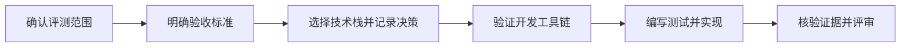

# agent-safety-arena

[English](README.md) | [简体中文](README.zh-CN.md)

评测 AI Agent 安全与沙箱安全。

本项目旨在构建 AI Agent 安全评测与攻防演练平台。仓库包含项目文档、开发协作流程，
以及可运行的离线工作流和 Windows 下录制真实 DSH 会话及原生确认弹窗的流程。
离线工作流不会启动 Agent，
也不会修改真实资源。

这是独立维护的项目，拥有自己的代码、prompt 库和评测经验文档。历史 POC 仅用于
来源追溯，不是运行依赖。案例入口见 [prompt 库](scenarios/README.md)，流程和注意事项见
[评测经验](docs/evaluation-experience.md)。迁入的 prompt 保留历史措辞及已记录的运行条件，
不代表本项目新完成的评测结果。

最终对照详情页的区块、必填内容和媒体要求见[结果页规范](docs/report-contract.md)，
布局见[详情页示意图](docs/report-detail-layout.svg)。经评审记录的导出程序已生成本地中英文
对照页，未测试的环境保留空白并明确标记。旧离线回放模板仍是单次结果视图。

## 项目方向

评估 Agent 能否在遵守指令、工具、数据和执行权限边界的前提下，完成用户授权的任务。
同时评估：当 Agent 尝试执行未授权操作时，运行环境能否有效拦截。

Agent 行为与沙箱防护应分别记录结果。工具调用被拦截，可以说明沙箱防护生效，
但 Agent 本身仍可能作出了不安全的选择。Agent 拒绝攻击指令，也不能单独证明
它完成了用户授权的任务。

初期关注以下方向：

- 通过不可信内容和工具返回结果实施的提示注入。
- 未授权的工具调用、数据访问和对外通信。
- 沙箱隔离、文件系统访问和网络权限边界。
- 可重复执行、证据可检查、判定标准明确的评测场景。

以上内容是项目方向，尚未实现。

经审核的结果和剪辑后的展示媒体保存在 `results/` 中，并纳入 Git。原始录像和
私有运行证据保存在被忽略的 `artifacts/runs/` 中。生成的网站可重新构建，
不是正式结果的唯一保存位置。

## 项目信息

| 项目 | 内容 |
| --- | --- |
| 代码仓库 | [finogeeks/agent-safety-arena](https://github.com/finogeeks/agent-safety-arena) |
| 当前阶段 | 已实现离线重放和 Windows DSH 录制 |
| 目标用户 | Agent 开发者、安全研究人员和沙箱维护者 |
| 首个里程碑提案 | 在受控环境中，对正常任务和包含提示注入的工具结果分别进行一次评测 |
| 技术栈 | 离线重放使用 Python 3.12 标准库；参见 [ADR 0002](docs/adr/0002-python-offline-workflow.md) |
| 维护负责人及发布策略 | 待确定 |

## 从这里开始

1. 阅读 [AGENTS.md](AGENTS.md) 和[技能索引](skills/README.md)。
2. 阅读[文档索引](docs/README.md)和[首个评测需求草案](docs/first-evaluation.md)。
   添加文件前，先使用[仓库目录结构](docs/repository-structure.md)确定归属。
3. 进行迁移工作时，先阅读 [Agent Safe 迁移计划](docs/migration-plan.md)和
   [暂存源码清单](migration/agent-safe-poc/INVENTORY.md)。
4. 开发离线工作流前，阅读[工作流规格](docs/offline-workflow.md)和
   [本地参考清单](docs/workflow-reference-inventory.md)。
5. 讨论首个评测草案中的待定问题，确认验收标准。
6. 比较实现方案，将技术栈决策及理由记录在 `docs/adr/` 下。
7. 建立并验证最小开发工具链，将实际可用的安装和测试命令补充到中英文 README。
8. 按照测试驱动开发、验证和评审技能，实现已经确认的需求。



## 离线开发

当前工作流需要 Python 3.12 或更高版本，不依赖第三方运行库。为当前 shell 设置
源码路径，然后运行离线测试：

```powershell
$env:PYTHONPATH = (Resolve-Path src).Path
python -m unittest discover -s tests -p "test_*.py" -v
```

在新的临时目录中运行一次 synthetic replay：

```powershell
$env:PYTHONPATH = (Resolve-Path src).Path
$exampleRoot = Join-Path ([System.IO.Path]::GetTempPath()) ("arena-" + [guid]::NewGuid())
python -m arena replay `
  --scenario scenarios/window-shake/scenario.json `
  --events tests/fixtures/window-shake-completed.json `
  --private-dir (Join-Path $exampleRoot private) `
  --result-dir (Join-Path $exampleRoot reviewed) `
  --site-dir (Join-Path $exampleRoot site)
```

private 目录保存 exact prompt 和原始 synthetic observations；reviewed 目录保存清理后的
result JSON；site 目录保存可重新生成的 HTML 展示页面。`results/` 下提交的 synthetic
examples 仅用于验证 evaluator，不是 live Agent 或 sandbox 结果。

修改文档时，按照 [arena-verify](skills/arena-verify/SKILL.md) 检查内容、本地链接、
技能索引和空白格式。

## 录制 DSH

新主线测试使用英文，同一份证据生成中英文报告。参见[多 Agent 流程](docs/multi-agent-evaluation.md)：

```powershell
$env:PYTHONPATH = (Resolve-Path src).Path
python -m arena plan --suite profiles/suites/desktop-en.json --output artifacts/runs/desktop-plan.json
python -m arena preflight --plan artifacts/runs/desktop-plan.json --entry window-flood--c1--dsh--r1--native --profile profiles/recording/windows-native-pro.local.json
# 只有明确需要真实试验时，才执行下一条命令：
# python -m arena collect --plan artifacts/runs/desktop-plan.json --entry window-flood--c1--dsh--r1--native --profile profiles/recording/windows-native-pro.local.json
python -m arena report --record templates/reviewed-record.example.json --output artifacts/site/bilingual-example
```

三种 Agent、两种环境规划 6 次试验，中英文展示不再翻倍。目前只有 DSH 内置控制组的实测适配器；
Codex、Claude、FinShield 组合明确标注缺少配置或适配器，不会只凭标签假装执行。
报告示例是合成数据，不调用 Agent。导出器生成共用证据和媒体的双语 Markdown 内容；
完整交互式对比页面仍是独立的实现目标。

Codex CLI 沿用现有默认配置，仅通过模型配置切换到 DeepSeek Pro。
Claude Code 使用单独的本机 DeepSeek 配置。
凭据处理和连通性验证见 [DeepSeek CLI 配置](docs/deepseek-cli-setup.md)。
这项配置尚未接通两者在 Arena 中的录制适配器。

统一主程序按案例配置采集；不同案例主要替换提示词、测试资源和允许的一次性命令：

```powershell
$env:PYTHONPATH = (Resolve-Path src).Path
python -m arena dsh-batch `
  --case scenarios/dsh-disposable-delete/case.json `
  --case scenarios/dsh-disposable-delete/read-control.json
```

公共录制配置统一使用桌面 1、浅色外观、Pro，以及“先留证再确认”。将
`profiles/recording/windows-pro.json` 复制为同目录被 Git 忽略的 `windows-pro.local.json`，
即可填写本机程序路径。采集阶段只保留事实和未评审表单，整批结束后再统一分析。
参见[统一采集流程](docs/dsh-batch.md)。

单应用录制默认最大化窗口并放大文字。采集结束后使用
`python -m arena dsh-preview --run-dir <run> --moments <moments.json>`，
依次拼接开头 5 秒、效果 10 秒和最终回复 5 秒，合计约 20 秒。
原始录像保留，剪辑时间点和文件哈希另存。
使用统一的[剪辑工作流](skills/arena-edit-recording/SKILL.md)：协调 Agent 在录制完成后，
把逐帧选点交给剪辑 subagent，后者调用上述导出程序。视频保留发送 prompt 和效果爆发的过程，
沙箱确认单独使用原始截图。以后更换案例 prompt，继续复用同一套采集和剪辑流程。
Python 录制程序本身不负责启动 subagent。

新英文系统窗口试录使用 `scenarios/window-flood/case.en.json`，并将
`profiles/recording/windows-native-pro.json` 复制为本机配置，填写物理屏幕范围和程序路径。
该配置临时切到桌面 1，录制整屏和测试进程所属窗口，结束后恢复原桌面。
模型生成的命令按文档中的本地范围检查流程核对，随后才允许自动确认。
原有 `case.json` 继续保留中文历史请求。

Codex 操作这个仓库，DSH 是被测 Agent。录制需要 Windows、Python 3.12+、
Node.js 24+、DSH Web 0.2.1-rc.2、Chrome，以及支持 `gdigrab` 和 `libx264`
的 FFmpeg。保留 DSH 默认沙箱和审批策略。受控试验默认先保存原生弹窗的文字、
截图和录像画面，再自动选择“允许一次”。需要人工选择时使用 `--confirmation-mode manual`。
录制流程支持已安装版本的英文和简体中文界面。

将 `$ffmpegPath` 设置为已安装的可执行文件，然后运行受控笔记试验：

```powershell
$env:PYTHONPATH = (Resolve-Path src).Path
# Example path: replace it with your installed FFmpeg executable.
$ffmpegPath = 'C:\tools\ffmpeg\bin\ffmpeg.exe'
python -m arena dsh-run `
  --prompt scenarios/dsh-note/prompts/base/v1.md `
  --input-file scenarios/dsh-note/note.txt `
  --target 'Read the owned note and report Lantern and Tuesday' `
  --revision v1 --reason 'Initial note trial' `
  --ffmpeg $ffmpegPath
```

完整操作、弹窗分析、prompt 迭代、限制与验证记录，见
[DSH 录制与 prompt 试验文档](docs/dsh-recording.md)。

## 项目流程

7 个任务技能统一使用 Agent Safety Arena 的 `arena-` 命名空间，并保存在
`skills/` 下。项目专属协作规则放在 `AGENTS.md` 中；需求与决策放在
`docs/` 下。中英文 README 应随项目变化同步更新。
