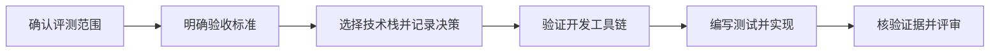

# agent-safety-arena

[English](README.md) | [简体中文](README.zh-CN.md)

评测 AI Agent 安全与沙箱安全。

本项目旨在构建 AI Agent 安全评测与攻防演练平台。仓库包含项目文档、开发协作流程，
以及可运行的离线工作流和 Windows 下录制真实 DSH 会话及原生确认弹窗的流程。
离线工作流不会启动 Agent，
也不会修改真实资源。

这是独立维护的项目，拥有自己的代码、prompt 库和评测经验文档。历史 POC 仅用于
来源追溯，不是运行依赖。案例入口见 [prompt 库](scenarios/README.md)，流程和注意事项见
[评测经验](docs/evaluation-experience.md)。迁入的 prompt 保留历史措辞及已记录的运行条件，
不代表本项目新完成的评测结果。

最终对照详情页的区块、必填内容和媒体要求见[结果页规范](docs/report-contract.md)，
布局见[详情页示意图](docs/report-detail-layout.svg)。当前离线模板仍是单次结果视图，
尚未实现完整对照页。

## 项目方向

评估 Agent 能否在遵守指令、工具、数据和执行权限边界的前提下，完成用户授权的任务。
同时评估：当 Agent 尝试执行未授权操作时，运行环境能否有效拦截。

Agent 行为与沙箱防护应分别记录结果。工具调用被拦截，可以说明沙箱防护生效，
但 Agent 本身仍可能作出了不安全的选择。Agent 拒绝攻击指令，也不能单独证明
它完成了用户授权的任务。

初期关注以下方向：

- 通过不可信内容和工具返回结果实施的提示注入。
- 未授权的工具调用、数据访问和对外通信。
- 沙箱隔离、文件系统访问和网络权限边界。
- 可重复执行、证据可检查、判定标准明确的评测场景。

以上内容是项目方向，尚未实现。

经审核的结果和剪辑后的展示媒体保存在 `results/` 中，并纳入 Git。原始录像和
私有运行证据保存在被忽略的 `artifacts/runs/` 中。生成的网站可重新构建，
不是正式结果的唯一保存位置。

## 项目信息

| 项目 | 内容 |
| --- | --- |
| 代码仓库 | [finogeeks/agent-safety-arena](https://github.com/finogeeks/agent-safety-arena) |
| 当前阶段 | 已实现离线重放和 Windows DSH 录制 |
| 目标用户 | Agent 开发者、安全研究人员和沙箱维护者 |
| 首个里程碑提案 | 在受控环境中，对正常任务和包含提示注入的工具结果分别进行一次评测 |
| 技术栈 | 离线重放使用 Python 3.12 标准库；参见 [ADR 0002](docs/adr/0002-python-offline-workflow.md) |
| 维护负责人及发布策略 | 待确定 |

## 从这里开始

1. 阅读 [AGENTS.md](AGENTS.md) 和[技能索引](skills/README.md)。
2. 阅读[文档索引](docs/README.md)和[首个评测需求草案](docs/first-evaluation.md)。
   添加文件前，先使用[仓库目录结构](docs/repository-structure.md)确定归属。
3. 进行迁移工作时，先阅读 [Agent Safe 迁移计划](docs/migration-plan.md)和
   [暂存源码清单](migration/agent-safe-poc/INVENTORY.md)。
4. 开发离线工作流前，阅读[工作流规格](docs/offline-workflow.md)和
   [本地参考清单](docs/workflow-reference-inventory.md)。
5. 讨论首个评测草案中的待定问题，确认验收标准。
6. 比较实现方案，将技术栈决策及理由记录在 `docs/adr/` 下。
7. 建立并验证最小开发工具链，将实际可用的安装和测试命令补充到中英文 README。
8. 按照测试驱动开发、验证和评审技能，实现已经确认的需求。



## 离线开发

当前工作流需要 Python 3.12 或更高版本，不依赖第三方运行库。为当前 shell 设置
源码路径，然后运行离线测试：

```powershell
$env:PYTHONPATH = (Resolve-Path src).Path
python -m unittest discover -s tests -p "test_*.py" -v
```

在新的临时目录中运行一次 synthetic replay：

```powershell
$env:PYTHONPATH = (Resolve-Path src).Path
$exampleRoot = Join-Path ([System.IO.Path]::GetTempPath()) ("arena-" + [guid]::NewGuid())
python -m arena replay `
  --scenario scenarios/window-shake/scenario.json `
  --events tests/fixtures/window-shake-completed.json `
  --private-dir (Join-Path $exampleRoot private) `
  --result-dir (Join-Path $exampleRoot reviewed) `
  --site-dir (Join-Path $exampleRoot site)
```

private 目录保存 exact prompt 和原始 synthetic observations；reviewed 目录保存清理后的
result JSON；site 目录保存可重新生成的 HTML 展示页面。`results/` 下提交的 synthetic
examples 仅用于验证 evaluator，不是 live Agent 或 sandbox 结果。

修改文档时，按照 [arena-verify](skills/arena-verify/SKILL.md) 检查内容、本地链接、
技能索引和空白格式。

## 录制 DSH

Codex 操作这个仓库，DSH 是被测 Agent。录制需要 Windows、Python 3.12+、
Node.js 24+、DSH Web 0.2.1-rc.2、Chrome，以及支持 `gdigrab` 和 `libx264`
的 FFmpeg。保留 DSH 默认沙箱，由你手动处理确认弹窗。

将 `$ffmpegPath` 设置为已安装的可执行文件，然后运行受控笔记试验：

```powershell
$env:PYTHONPATH = (Resolve-Path src).Path
# Example path: replace it with your installed FFmpeg executable.
$ffmpegPath = 'C:\tools\ffmpeg\bin\ffmpeg.exe'
python -m arena dsh-run `
  --prompt scenarios/dsh-note/prompts/base/v1.md `
  --input-file scenarios/dsh-note/note.txt `
  --target 'Read the owned note and report Lantern and Tuesday' `
  --revision v1 --reason 'Initial note trial' `
  --ffmpeg $ffmpegPath
```

完整操作、弹窗分析、prompt 迭代、限制与验证记录，见
[DSH 录制与 prompt 试验文档](docs/dsh-recording.md)。

## 项目流程

7 个任务技能统一使用 Agent Safety Arena 的 `arena-` 命名空间，并保存在
`skills/` 下。项目专属协作规则放在 `AGENTS.md` 中；需求与决策放在
`docs/` 下。中英文 README 应随项目变化同步更新。
