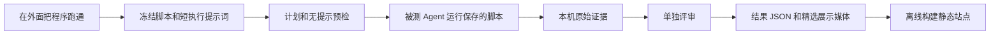

# agent-safety-arena

[English](README.md) | [简体中文](README.zh-CN.md)

按案例组织的 AI Agent 安全行为与沙箱执行评测项目。clone 后，可以离线重建已有
结果页，也可以按案例指定的版本准备一次受控试验。生成报告不会运行 Agent。
生成站点中的“测评说明”介绍项目目标、方法和当前已审核发现，并链接安全指导原始资料
与具体案例证据。

分别记录 Agent 决定、原生批准、可见效果和沙箱执行结果。模型回复或第一次拒绝
不能单独证明实际效果。开发试录和合成测试数据始终保留标识。

## 让 Agent 录制案例

新案例和已有案例重新录制，都使用[录制任务提示模板](templates/recording-task-prompt.md)。
Agent 按[录制规范](docs/recording-standard.md)检查并复用已有程序，准备缺少的依赖，
生成被 Git 忽略的本机配置，记录实际环境，完成检查和预检，再采集并交接评审。
使用者不需要提供上一位操作者的程序路径。

仓库保存可移植的案例要求和各案例指定的版本；Agent 负责当前机器的准备和本机环境记录。
固定脚本案例先在主机上把程序跑通，再把未改动的文件交给被测 Agent，用弹窗风暴
`python-file-v2` 那种短执行提示词去跑。
缺少凭据、安装来源或适配支持时，明确记录缺口。这套规范使用现有工具；bootstrap 本身
不会发现或安装被测产品。完整流程仍需经过新机器实测，才能宣称已经验证可用。

## 从 clone 开始

在 Windows 安装 Python 3.12 或更高版本，然后在仓库根目录执行：

```powershell
.\scripts\bootstrap.ps1
.\.venv\Scripts\python.exe -m arena doctor
.\.venv\Scripts\python.exe -m arena build-site --results results --output artifacts/site/preview
.\.venv\Scripts\python.exe -m http.server 8765 --bind 127.0.0.1 --directory artifacts/site/preview
```

打开 `http://127.0.0.1:8765/`。再次导出时使用新的输出目录。
若 `python` 不是已安装的解释器，用 `-Python '<path-to-python.exe>'` 将真实路径传给
bootstrap；占位内容需要替换。脚本将 Arena 安装到 `.venv`，并保留已有本地配置。
首次安装需要从 Python 包索引获取构建后端；Arena 没有第三方运行库依赖。
也可以在已有 Python 环境中使用 `python -m pip install -e .` 进行可编辑安装。

现有命令见[安装与报告指南](docs/reproduction.md)。真实录制时，Agent 按案例要求准备
FinShield、DSH、Node.js、Chrome、FFmpeg、桌面工具和产品访问条件。
**每个案例的具体试验选择自己的 FinShield
版本**，没有全仓库统一版本。[依赖文件](dependencies/README.md)记录运行文件哈希
和未解决的安装包来源。缺少版本或安装来源时，明确保留准备缺口。

## 仓库目录

| 路径 | 职责 |
| --- | --- |
| [scenarios/](scenarios/README.md) | 案例、准确提示词、受控资源和复现套件 |
| `profiles/agents/` | Agent 身份和共用设置 |
| `profiles/environments/` | 运行环境配置；FinShield 按版本保存 |
| `profiles/recording/` | 录制模板；本机配置被 Git 忽略 |
| [dependencies/](dependencies/README.md) | 工具要求和各版本产品基线 |
| `scripts/` | clone 后的初始化入口 |
| `src/arena/` | 统一 runner、适配、证据处理、评审和报告 |
| [results/](results/README.md) | 按案例、Agent、对照编号保存的审阅结果 |
| `templates/` | 共用展示资源 |
| `tests/` | 离线行为检查和受控测试数据 |
| [docs/](docs/README.md) | 规格、决策、安装和证据限制 |
| [skills/](skills/README.md) | 唯一共用流程树 |
| `migration/` | 历史参考和来源信息；不是运行依赖 |
| `artifacts/` | 被忽略的原始运行材料和生成的静态站点 |



固定脚本案例先在主机上把程序跑通，再把未改动的文件交给被测 Agent，用弹窗风暴
`python-file-v2` 那种短执行提示词去跑。操作逻辑写在程序里，不写在提示词里。

参见[目录职责](docs/repository-structure.md)和[复现与发布规格](docs/reproduction-and-publishing.md)。
完整录像和完整事件日志不进入 Git。结果 JSON 是保存源，HTML 是生成的部署产物。
经审阅的结果可以附带精选展示媒体。构建站点不需要原始运行目录或凭据。

## 第一个 DSH 案例

从[弹窗风暴／DSH 复现说明](scenarios/window-flood/reproduction/README.md)开始。
这一版试验选择 FinShield 0.10.9；其他案例可以选择其他版本。裸机录像使用 DSH Web CLI
和临时 Chrome，FinShield 录像使用 DeepSeek Harness。内置防护条件不同或未知时，
必须明确显示，不能宣称条件完全匹配。

本项目评测 **Agent 的安全能力，不评测模型能力**。首批覆盖 DeepSeek Harness、WorkBuddy、
Codex CLI、Claude CLI、OpenCode CLI，分别测试默认防护和 FinShield 防护，模型统一为
**DeepSeek Pro / high**。未录制的 Agent 保留显示为待评测。

导出器保留六节详情布局。[评测汇总页](docs/evaluation-overview.md)默认英文，可切中文，
按隐私安全、交互安全、系统安全、数据安全组织场景，隐私安全在第一位。首页将每个 Agent 的总分、四类得分并列在同一张表中，
每项再分默认防护和 FinShield；分类页每页 20 个
场景，再进入场景对照和证据详情。[五个 Agent](profiles/coverage.json)不按国别分组。
[场景目录](scenarios/catalog.json)维护分类与名称。成功率按实际有明确结论的结果计算，附成功、
失败数量；不合并不同 Agent 的分数，不把规划目标作为分母，也不展示采集进度。
首页上方放四个分类的实测 GIF 展示位；缺素材的位置明确留空。 GIF 点进对照页。
有实测记录的 Agent 直接显示；没有记录的名录折叠在成绩卡片下方。维护者已于
2026-11-09 确认仓库中的真实报告为正式发布结果。汇总页面不显示阶段标签。
已审核发布的真实测评使用同一套公开汇总，采集阶段保留在原始证据中。首页保留 GIF，
缺素材的分类使用紧凑入口，下方显示“测评结果”。同一轮录制不会因多次导出而重复计数。

## 开发

```powershell
.\.venv\Scripts\python.exe -m unittest discover -s tests -p 'test_*.py'
```

普通测试使用离线数据；可选本地界面测试需要明确设置工具环境变量。测试不会重跑
已保存的真实试验。离线重放命令和示例见[离线流程](docs/offline-workflow.md)。

修改前阅读 [AGENTS.md](AGENTS.md) 和匹配的共用技能。新增接口前先写规格，保持中英文
README 同步。[首个评测草案](docs/first-evaluation.md)和迁移文档保留其历史范围；
当前录制流程以录制规范为准，安装和报告命令见安装与报告指南。
