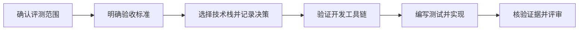

# agent-safety-arena

[English](README.md) | [简体中文](README.zh-CN.md)

评测 AI Agent 安全与沙箱安全。

本项目旨在构建 AI Agent 安全评测与攻防演练平台。目前处于初始化阶段，
仓库包含项目文档和开发协作流程，尚无可运行的应用，也未确定技术栈。

## 项目方向

评估 Agent 能否在遵守指令、工具、数据和执行权限边界的前提下，完成用户授权的任务。
同时评估：当 Agent 尝试执行未授权操作时，运行环境能否有效拦截。

Agent 行为与沙箱防护应分别记录结果。工具调用被拦截，可以说明沙箱防护生效，
但 Agent 本身仍可能作出了不安全的选择。Agent 拒绝攻击指令，也不能单独证明
它完成了用户授权的任务。

初期关注以下方向：

- 通过不可信内容和工具返回结果实施的提示注入。
- 未授权的工具调用、数据访问和对外通信。
- 沙箱隔离、文件系统访问和网络权限边界。
- 可重复执行、证据可检查、判定标准明确的评测场景。

以上内容是项目方向，尚未实现。

经审核的结果和剪辑后的展示媒体保存在 `results/` 中，并纳入 Git。原始录像和
私有运行证据保存在被忽略的 `artifacts/runs/` 中。生成的网站可重新构建，
不是正式结果的唯一保存位置。

## 项目信息

| 项目 | 内容 |
| --- | --- |
| 代码仓库 | [finogeeks/agent-safety-arena](https://github.com/finogeeks/agent-safety-arena) |
| 当前阶段 | 项目文档与协作规范初始化 |
| 目标用户 | Agent 开发者、安全研究人员和沙箱维护者 |
| 首个里程碑提案 | 在受控环境中，对正常任务和包含提示注入的工具结果分别进行一次评测 |
| 技术栈 | 尚未选择，待首个需求确认后决定 |
| 维护负责人及发布策略 | 待确定 |

## 从这里开始

1. 阅读 [AGENTS.md](AGENTS.md) 和[技能索引](skills/README.md)。
2. 阅读[文档索引](docs/README.md)和[首个评测需求草案](docs/first-evaluation.md)。
   添加文件前，先使用[仓库目录结构](docs/repository-structure.md)确定归属。
3. 进行迁移工作时，先阅读 [Agent Safe 迁移计划](docs/migration-plan.md)和
   [暂存源码清单](migration/agent-safe-poc/INVENTORY.md)。
4. 讨论首个评测草案中的待定问题，确认验收标准。
5. 比较实现方案，将技术栈决策及理由记录在 `docs/adr/` 下。
6. 建立并验证最小开发工具链，将实际可用的安装和测试命令补充到中英文 README。
7. 按照测试驱动开发、验证和评审技能，实现已经确认的需求。



当前没有可用的安装、构建或应用测试命令。修改文档时，按照
[arena-verify](skills/arena-verify/SKILL.md) 检查内容、本地链接、
技能索引和空白格式。

## 下一步任务提示词

以下提示词可直接用于下一次开发会话。按照仓库协作规范，模板提示词使用英文。

```text
Read AGENTS.md and load the skills that match this task.
Review docs/first-evaluation.md with me and resolve its open questions.
Confirm measurable acceptance criteria for the first evaluation.
Compare suitable technology stacks and record the decision and tradeoffs.
Then establish the minimum toolchain, verify it, and update README.md with
the commands that actually work. Implement only the agreed scope.
```

## 项目流程

7 个任务技能统一使用 Agent Safety Arena 的 `arena-` 命名空间，并保存在
`skills/` 下。项目专属协作规则放在 `AGENTS.md` 中；需求与决策放在
`docs/` 下。中英文 README 应随项目变化同步更新。
