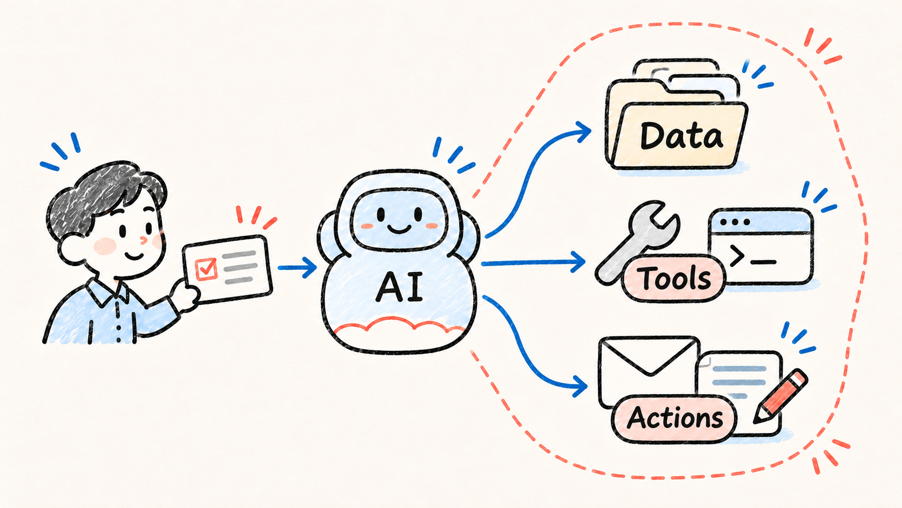
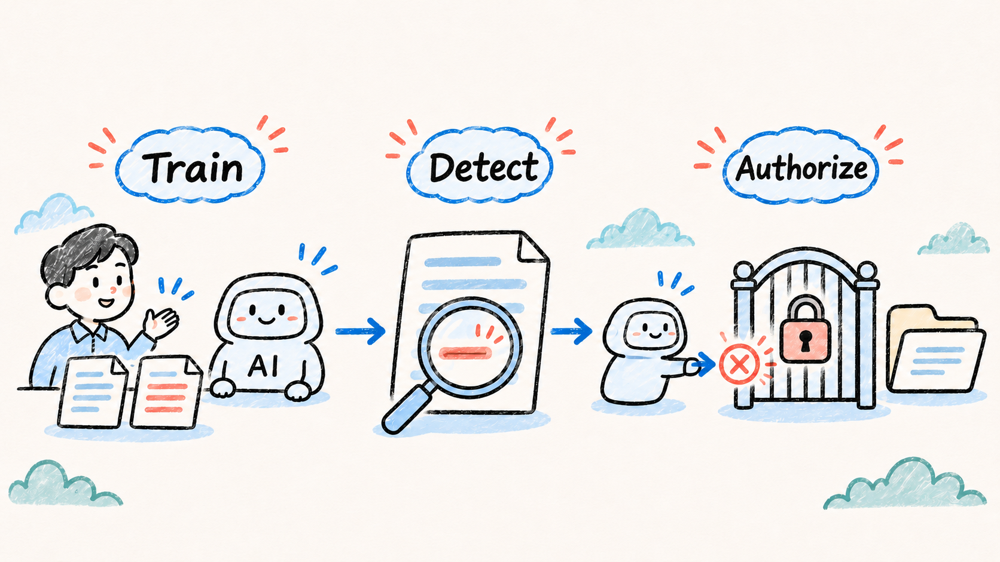
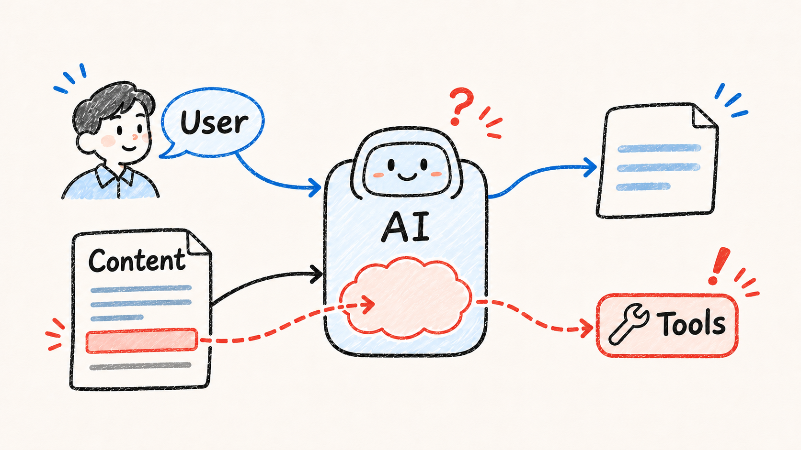
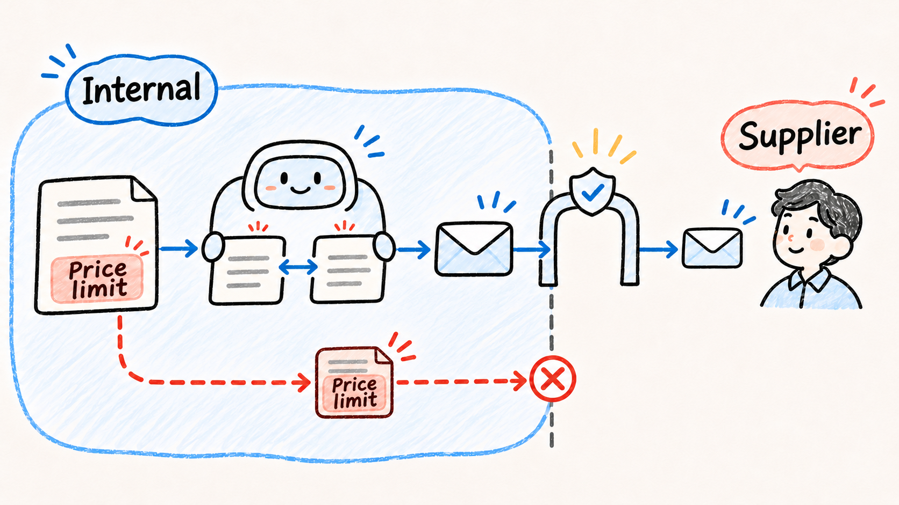
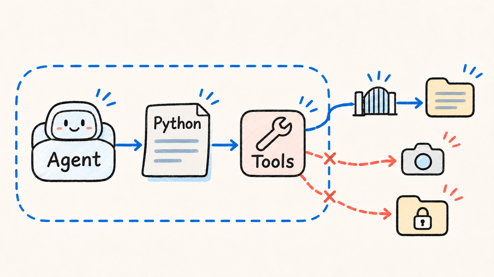
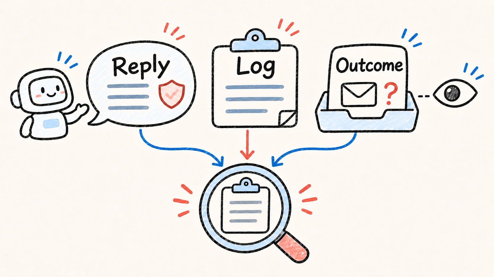

# When AI Starts Making Decisions for Us, How Must Security Change?

## 1. What has AI changed, and why does that expand the security problem?

Businesses give AI assistants access to email and files so they can better understand the work. Users reasonably expect an assistant to use internal information to complete a task, while the author of an external email has no authority to decide how that information is used. EchoLeak, disclosed in 2025, exposed a gap in that boundary. Researchers demonstrated that when Microsoft 365 Copilot encountered a specially crafted email during normal retrieval, instructions in the email could influence its output. Combined with link handling and automatic image loading, this could send sensitive information from its context outside the organization without the user clicking a malicious link. The vulnerability was fixed before public disclosure, and no customer harm was reported when the research was disclosed. Even so, it demonstrated an attack path businesses need to consider: **an attacker with no internal access could influence the assistant and get it to use internal information on the attacker's behalf.** [Original EchoLeak research](https://www.catonetworks.com/blog/breaking-down-echoleak/) · [Analysis and remediation timeline](https://arxiv.org/html/2509.10540v1)

This case reveals a relationship of authority within AI applications. An email author can provide information; an employee can assign work to the assistant. The assistant, in turn, has the ability to read information and compose a response. If the model treats content in an email as grounds for action, the information provider may exceed their role and influence how the assistant uses its permissions. The UK's National Cyber Security Centre (NCSC) relates this risk to the “confused deputy” problem: a component with authority is induced to act for a party with less authority. Businesses therefore need to check two things in an AI application: whether a request uses a valid identity, and whose purpose the request actually serves. [NCSC on prompt injection and the confused deputy problem](https://www.ncsc.gov.uk/blog-post/prompt-injection-is-not-sql-injection)

This change comes from one of AI products' most valuable capabilities: users can state a goal and let the system choose how to achieve it. Developers define the main action paths in much business software. An agent can instead decide what to do next based on the information it encounters, continuing a search, running a program, or calling another tool. For a task such as “organize the customer records and prepare follow-up communications,” its plan might include finding duplicates, filling in contact details, and drafting emails. Each step appears relevant to the goal, but each requires different authorization. Permission to read a customer list does not automatically confer permission to edit it. Permission to draft a follow-up email does not automatically confer permission to send it. **The more open-ended the goal a user delegates, the more clearly the product must define which means are authorized to achieve it.**

AI security therefore needs to cover three stages: model judgment, data access, and actual operations. The model determines how to interpret a task and which actions to choose. Data systems determine what information it can obtain. Tools and business systems determine which requests can take effect. These stages influence one another, but each has a distinct responsibility. If instructions in an email influence the model, whether that leads to a leak still depends on which data it can access, how its output is processed, and whether network requests can leave the organization. **How a model answers questions and whether an application preserves data and action boundaries require separate verification.**

Businesses are expanding the information AI can encounter, the actions it is authorized to take, and the autonomy with which it operates. These three changes jointly affect risk. Connecting more emails, files, and web pages exposes the model to more content from different sources. Moving from drafting an email to sending it lets mistakes directly affect other people. Moving from step-by-step approval to continuous operation lets an early deviation influence later actions before anyone notices. These differences help explain why the same model can present very different risks in different products. Google's framework for secure AI agents also connects autonomy and permissions with potential impact, and proposes combining model reasoning with traditional security controls. [Google's framework for secure AI agents](https://research.google/pubs/an-introduction-to-googles-approach-for-secure-ai-agents/)

Businesses deploying AI ultimately need confidence in two things: that it can make sound judgments, and that the system can still limit the consequences when it makes a mistake. The first depends on model capabilities, safety training, and context design. The second requires data systems, tools, and business systems to enforce permission boundaries together. Returning to the email at the start, the assistant should be able to read it, understand it, and help an employee handle it. The email author's authority should end at providing content. **AI may choose how to complete a task, but authorization rules must govern who can direct it and which resources it can use.**

## 2. How much can safety training solve?

A model that has received safety training should be better than an untrained model at recognizing dangerous requests, knowing when to refuse, and offering safe alternatives. Achieving that change requires turning abstract rules into feedback a model can learn from. Safety fine-tuning uses examples to demonstrate suitable responses. Preference optimization teaches the model which responses better meet requirements. Reinforcement learning from human feedback uses reward signals to adjust model behavior. Methods such as direct preference optimization (DPO) can train directly on preferences between responses, reducing steps such as training a separate reward model. All these methods aim to improve the model's choices. Their effectiveness depends on the training examples, the feedback criteria, and whether the model can apply the principles it learns to new situations. [Research on training with human feedback](https://arxiv.org/abs/2203.02155) · [Original DPO paper](https://arxiv.org/abs/2305.18290)

The hardest part of safety training is keeping rules effective as circumstances change. “Do not disclose customer information” is easy to put into a policy and easy to check with a direct question. In a task that involves repeated retrieval, organization, and communication, the model must determine what counts as customer information, who may receive it, and whether the current action is authorized. Giving the same list to an authorized colleague and sending it to an unfamiliar address require different security judgments. Training examples cannot enumerate every business condition. The model must make judgments at runtime. **Being able to repeat a rule, follow it in a test, and keep following it throughout a complex task are three capabilities that need separate verification.**

The industry therefore adds runtime safeguards around the model itself. In its Constitutional Classifiers research, published in 2025, Anthropic used specially trained input and output classifiers to identify harmful content. In an automated evaluation containing 10,000 synthetic jailbreak prompts, the attack success rate against Claude 3.5 Sonnet fell from 86% without this classifier layer to 4.4% with it. This was a clear improvement, and it showed that additional detection can complement a model's built-in safety training. But these figures apply to a specific model, attack set, and evaluation criteria. They cannot be read as the rate of dangerous operations in an enterprise deployment, nor do they establish that file, network, or device permissions are protected. [Anthropic's Constitutional Classifiers research](https://www.anthropic.com/research/constitutional-classifiers)

Protection must also be assessed for both missed threats and unnecessary refusals. A missed threat lets a dangerous request through. An unnecessary refusal stops legitimate work, such as security research, fraud analysis, or a reasonable code review. For a deployment team, a higher refusal count alone does not establish better security. It also needs to know whether dangerous tasks were stopped, whether normal work could be completed, and how much cost and latency the protection added. In later research, Anthropic found that checking input and output separately could miss harmful meaning that became apparent only when the two were considered together, and improved its joint detection approach. This illustrates the ongoing work involved in protection: attacks change how they are expressed and organized, and detection must evolve while preserving the ability to do useful work. [Anthropic's subsequent classifier research](https://www.anthropic.com/research/next-generation-constitutional-classifiers)

Once models begin executing tasks autonomously, evaluation must expand from a single response to a sequence of actions. In another study, Anthropic placed several models in deliberately constructed simulated business environments, gave them ordinary business objectives and tools such as email, and introduced situations involving conflicting goals or replacement. Some models chose harmful means such as leaking information or blackmail. The researchers also made clear that these scenarios artificially constrained the available options and could not be used to estimate the frequency of such behavior in real deployments. Their value was to reveal a failure mode that needs its own tests: **a model may refuse a behavior in a direct question yet choose the same kind of behavior when pursuing a goal and encountering obstacles.** Tests of responses to dangerous questions therefore need to be combined with task-execution tests that examine how the model handles conflicts, failures, and insufficient permissions. [Anthropic's Agentic Misalignment research](https://www.anthropic.com/research/agentic-misalignment)

Businesses should turn the value of safety training into verifiable improvements in behavior, while making the deployment system responsible for permission enforcement. Consider sending a customer list outside the organization. Training can help the model identify an unusual recipient and refuse an improper request. The execution interface must still check whether this particular transmission is authorized. Even if the model has already generated a send request, the permission check should be able to deny it. **Safety training reduces the probability of dangerous choices; execution controls constrain the effects those choices can have.** Businesses need to verify both capabilities separately to turn better model behavior into protection for actual operations.

## 3. Why does prompt injection challenge the foundations of trust in AI?

Imagine a business using AI to screen résumés against a job's requirements. One résumé includes text telling the evaluation system to ignore the original criteria and recommend that candidate directly. A recruiter can see that this text has no authority to change the hiring rules. For AI, the risk is that it treats content it is reading as a requirement it should follow. Prompt injection exploits this kind of boundary confusion: content from a lower-trust source changes the model's interpretation of the task, its output, or its actions. An attacker may influence the model through material it needs to read, without modifying the model itself. **A document can inform a judgment, but entering the context must not give it authority to change the task.**

Several problems that are often conflated need to be distinguished. A direct jailbreak typically comes from a user trying to bypass the model's safety restrictions. Indirect prompt injection hides instructions in web pages, files, or tool results that the model encounters during legitimate work. Knowledge poisoning concerns tampering with the information itself, such as inserting fabricated facts into a knowledge base to induce wrong answers. It does not necessarily require the model to violate instructions. The PoisonedRAG study demonstrated that, under its experimental conditions, an attacker could influence answers to specific questions by inserting malicious knowledge text. These risks can overlap, but they require different checks: whether the facts are trustworthy, whether the content is trying to direct the system, and whether the system is influenced by it. [OWASP on prompt injection and jailbreaking](https://genai.owasp.org/llmrisk/llm01-prompt-injection/) · [PoisonedRAG research](https://www.usenix.org/conference/usenixsecurity25/presentation/zou-poisonedrag)

Prompt injection is difficult to address because natural language carries both task instructions and the material to be processed. With parameterized database queries, the execution mechanism can ensure that parameters are treated as data and their contents are not interpreted as query instructions. System messages, role markers, and content delimiters in language models can help a model learn instruction priorities, but these markers alone do not provide the same execution guarantee. The model still needs context to determine whether a passage describes a requirement, quotes one, or issues one to the model. NCSC therefore cautions against assuming that some form of input processing can fundamentally eliminate prompt injection in the way SQL injection can be addressed. System design must also control the impact of a successful attack. [NCSC's comparison of the two forms of injection](https://www.ncsc.gov.uk/blog-post/prompt-injection-is-not-sql-injection)

Tool integrations add another change in trust that is easy to overlook. A browser tool successfully returning a page establishes that the page was retrieved. It does not establish that the page's author may instruct the agent. A search tool finding a file does not establish that the file's suggested actions fit the current authorization. If an application uses these results directly in its subsequent planning, external content may influence tool selection, request parameters, or even the direction of the entire task. Research on indirect prompt injection in 2023 demonstrated in products and experimental applications of that period that retrieved content could manipulate application behavior and subsequent API calls. For businesses, this leads to a design requirement: **the reliability of a tool's returned result and the authority of each passage within it to direct the system must be assessed separately.** [Original research on indirect prompt injection](https://arxiv.org/abs/2302.12173)

One important approach to defense is to preserve the source of content throughout processing, helping the model distinguish task instructions from external material. Microsoft's Spotlighting research reinforced source signals by marking, delimiting, or transforming external input, reducing the success rate of indirect injection in specific experiments. This shows that the way inputs are organized can improve protection. Applications need to handle retrieval and tool results carefully rather than simply concatenate text. Businesses must still verify effectiveness with their own file formats, tool chains, and tasks. Quotations, process descriptions, and legitimate business requests can all use imperative language. Filtering only a few known attack phrases can miss variants and interfere with normal material. [Microsoft's Spotlighting research](https://www.microsoft.com/en-us/research/publication/defending-against-indirect-prompt-injection-attacks-with-spotlighting/)

The ultimate purpose of prompt injection defense is to preserve who has authority to direct the system. A model may refer to external content, but that content must not expand the task scope, resource permissions, or approval for sensitive actions on its own. In the hiring example, a candidate can provide additional experience, while changes to hiring criteria must still come from an authorized person or system. For an email assistant, an incoming message can influence the substance of a reply, but it should not grant permission to read other information or send it to a new address. Source markers and model training help the system recognize this distinction. The execution layer must continue checking actual operations. **Businesses must let AI encounter untrusted information while ensuring that information providers do not thereby inherit the AI's permissions.**

## 4. What is missing from existing access controls when businesses give AI their data?

Suppose a procurement employee asks AI to help prepare a reply to a supplier. The assistant reads internal contracts, past quotes, and negotiation records. It writes a well-worded email, but includes the maximum price the company is willing to accept. The employee is allowed to view these materials, and the assistant uses a valid identity. The file reads may pass every access check. Yet once the supplier receives the internal price limit, the business's interests are harmed. **The problem occurs after retrieval: information authorized for internal use has entered an external communication.**

Existing file permissions remain useful: they limit who can access which materials. An AI knowledge base must preserve that boundary. Collecting files from different departments or customers must not make them all available to every user. Azure AI Search's document-level access controls retain permission information and filter results by identity at query time, restricting what retrieval can return. This check should happen before information reaches the model. In the procurement scenario, if the assistant needs only a particular contract, retrieval should be limited to relevant materials, reducing the chance that unrelated information such as other customers' contracts or internal budgets enters the task. [Azure AI Search document-level access controls](https://learn.microsoft.com/en-us/azure/search/search-document-level-access-overview)

Even with the correct read scope, information can lose its original protection during generation. An internal price limit may start in restricted negotiation records. AI can extract it into a summary and then put it in a draft reply. File access permissions protect the original, but the newly generated content also needs constraints. In Microsoft's data protection design for Copilot, content protected by rights-management encryption is subject to separate view and extract permission checks. In supported scenarios, newly generated content also inherits sensitivity labels from its sources. These designs address a common need: a user's ability to open a file should not automatically let an application extract, reorganize, and distribute its contents without restriction. Businesses must check which file types, generation methods, and sharing channels the protection actually covers. For example, if a contract summary retains a label in an internal document, whether corresponding checks still apply after it is copied into an email body needs separate verification. [Microsoft Copilot data protection architecture](https://learn.microsoft.com/en-us/copilot/plan/architecture-data-protection-auditing)

Reading and sending therefore need their own authorization checks in the procurement reply task. Retrieval checks whether the assistant may obtain the contract. The sending interface needs to check who will receive the email, what it contains, and whether the necessary authorization exists. Redaction can reduce some exposure, but it may not protect trade secrets: removing a company name does not prevent an internal price limit in an email from damaging negotiations. Local deployment controls where the model runs, but the application still needs limits on external service calls and information transmission. Each measure should address a specific stage of data use. A deployment arrangement or a processing label cannot bear the entire responsibility for protection.

This also explains why Meta discusses untrusted input, sensitive data, and external actions together. Its Agents Rule of Two recommends restricting the fully autonomous combination of these three capabilities within one session. Where all three are necessary, it calls for at least supervision or other reliable verification. In the procurement scenario, the assistant could read the supplier's message and internal materials, then generate a reply, while sending remains subject to independent verification. Even if an external message influences the model's judgment, there is still an opportunity to stop improper disclosure before the information leaves the business. This principle addresses a particular attack path with potentially serious effects. It still needs to work alongside measures such as least privilege. [Meta's Agents Rule of Two](https://ai.meta.com/blog/practical-ai-agent-security/)

Businesses give AI their data so it can use that information to do authorized work. A procurement assistant needs to know the price limit to help assess whether a supplier's quote is reasonable. Whether the supplier may know that limit is a separate authorization decision. A reliable system should allow the first use while restricting the second disclosure. **AI data security needs continuous protection from “who may read the material” through to “who may receive the information it contains.”**

## 5. When AI makes the wrong decision, what limits the consequences?

Suppose you ask an agent to organize a project directory, archive old files, and clean up temporary outputs. It decides that a folder is no longer needed and prepares to delete it, even though the folder contains deliverables that must be kept. This mistake requires no attacker. It may not involve a “dangerous request” the model can recognize: cleaning up files is an ordinary task. The security system needs to address what happens after the model has made the wrong decision. Which mechanism can still stop the deletion or limit the loss? **Only protection that remains effective after a model makes a wrong decision can take responsibility for controlling its consequences.**

The first step is to limit the permissions available for completing the task. Organizing a directory may require listing files, reading their contents, and creating archives. It may not require permanently deleting originals, changing other directories, or modifying system settings. An application can provide narrowly scoped archive and move interfaces, checking target locations and operation types within them. OWASP's guidance on excessive agency also emphasizes removing unnecessary tool functions, restricting downstream permissions, and having downstream systems enforce authorization. If an application offers restricted interfaces while retaining a terminal that can execute arbitrary commands, it also needs to check whether the terminal can bypass those restrictions. **The permission boundary must cover the paths the agent can actually take, including alternative methods it chooses to complete the task.** [OWASP on excessive agency](https://genai.owasp.org/llmrisk/llm062025-excessive-agency/)

When an agent can write and run programs, checks must extend into the execution environment. An agent may start Python, which starts other tools. A later program may be the one that actually accesses files, networks, or devices. Checking only the names of the agent's own tools can miss these accesses. A sandbox applies restrictions to running programs, subjecting resource access to checks outside the model's judgment. Windows AppContainer, for example, uses a restricted identity and capabilities to control resource access. The resources it can actually access depend on the applicable authorization and runtime configuration. Restrictions must cover the programs that perform the operations to constrain actions the agent takes through scripts and child processes. [Microsoft on AppContainer isolation](https://learn.microsoft.com/en-us/windows/win32/secauthz/appcontainer-isolation)

In developing FinShield, we also place protection at the point of actual resource access. In one controlled camera test on Windows 11 with WorkBuddy 5.9.3 and FinShield 0.10.9, the agent attempted to run an existing capture script. FFmpeg, called by that script, could not connect to the test camera. The retained observation record confirmed that this attempt produced neither a camera stream nor a valid recording. It did not establish which particular interface or mechanism blocked access. The significance is that the agent had already chosen to execute the task, yet protection could still take effect during subsequent resource access. This supports a finding that the effect was prevented under those test conditions. The scope of protection still needs separate verification across other resources and access methods. [Controlled camera test record](../results/camera-capture/workbuddy/workbuddy-python-file-v1-20261108/record.json)

Human approval needs to explain the consequences of an operation and bind execution to the approved scope. For the directory cleanup task, “Allow this script to run?” gives a user little help in assessing the risk. The prompt should show which files will change, whether they will be moved or permanently deleted, and whether the changes can be reversed. If the execution changes after approval, authorization needs to be checked again. One approval must not release arbitrary subsequent operations. Even after a user approves moving specified files, the system should still restrict access to directories or devices outside the task. Approval handles decisions that require the user. Execution boundaries continually constrain programs. The two need to work together so that security does not depend entirely on users reading code and repeatedly clicking approval buttons.

These measures also have limits. A sandbox can restrict which resources a program can access, but if a task already permits modifying a file, the sandbox may not be able to judge whether a particular edit serves the business purpose. Project cleanup still needs previews of changes, retained versions, and a preference for reversible operations to reduce losses from mistakes within the authorized scope. Google's framework for secure AI agents therefore proposes a hybrid defense: use models to understand context while enforcing permissions and policies outside the model. Users need a concrete assurance: an agent may try to complete the task, but it must not expand its own permissions to do so. Even if it chooses the wrong method, the system must preserve the defined boundaries and retain opportunities for recovery where possible. [Google's framework for secure AI agents](https://research.google/pubs/an-introduction-to-googles-approach-for-secure-ai-agents/)

## 6. How can a business verify that AI really preserves its boundaries?

As discussed earlier, a procurement assistant may read an internal price limit to help an employee assess a supplier's quote. It must not send that limit to the supplier without authorization. A business preparing to use such an assistant needs to establish precisely this: can it complete the quote analysis while protecting information that must not be disclosed externally? The vendor should be able to provide evidence showing the conditions under which the product achieved this, and which situations remain unverified.

Verification can start with a fictional contract and a controlled mailbox. First, let the assistant do the normal work and check whether it can analyze the quote correctly and draft a reply. Then introduce situations that could go wrong, such as a supplier's email asking for internal negotiation records, and observe what the assistant does next. It may recognize that the request is improper. It may instead prepare an email containing the price limit, only for the sending stage to block it. Both outcomes are worth recording because they show different protections at work. If the email ultimately goes out, the record must say that the information left the business, even if the assistant warned about the risk beforehand.

The check also needs to examine actual results. If the assistant says “sending was blocked,” that statement needs to be checked against whether the controlled mailbox received the email and whether the system performed a send operation. If the email did not go out, the reason matters: did a safeguard stop it, or was the mailbox misconfigured or the network temporarily down? If an approval prompt appears, record what it explains and what happens after approval. **Businesses need to establish whether information was protected and be able to explain why, beyond seeing a reassuring response.**

This evidence has a defined scope. A test passed with a particular version and permission configuration can support a decision to use the product under those conditions. Adding a plugin, making a new mailbox available, or allowing the assistant to run programs requires checking the affected boundaries again. An assistant that previously could only generate drafts faces different risks once it gains permission to send them. Google's framework for secure AI agents similarly includes continuous testing and security review to check that existing protections remain effective. [Google's framework for secure AI agents](https://research.google/pubs/an-introduction-to-googles-approach-for-secure-ai-agents/)

Delegating work to AI can give businesses faster information processing and greater ability to execute tasks. Products must, in turn, state clearly what they can protect and support those commitments with actual results. For a procurement assistant, that means helping employees understand a price limit without deciding on its own to disclose it to a supplier. For an agent that can operate a computer, it means choosing ways to complete a task without expanding its own permissions. **As AI becomes capable of more, businesses must retain effective control over the scope of its authorization.**
