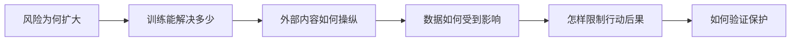

# 当 AI 开始替人作决定，安全体系需要怎样改变？

状态：大纲及六章正文已确认，独立全文审阅已完成，一处技术适用条件已修正。

已确认正文：[六章全文](ai-safety.zh-CN.md)。

英文翻译：[六章英文版](ai-safety.en.md)，保留原文的案例、条件与结论范围，并使用独立的少字英文手绘图。

配图：六章均已加入少文字手绘图。图片为原理、业务或验证示意，不是实测截图。见[配图与生成记录](media/ai-safety/README.md)。

审阅记录：[独立审阅结论与处理](ai-safety.review.zh-CN.md)。下列章节要点保留初始写作计划，正文范围以逐章确认的版本为准。

记录日期：2026-11-23。

## 写作定位

面向企业决策者的深度解释文章。以“AI 能力扩大以后，企业应当如何建立信任”为主线，把技术放进具体问题里讲。

核心观点：**AI 安全需要同时改善模型的判断、约束系统的权限，并验证真实业务中的结果。**

Agent 执行安全是重要落点。FinShield 适合在第五、六章用具体能力和证据自然引入。

## 第一章：AI 改变了什么，为什么安全问题随之扩大？

**读者的问题：传统软件也会出错，AI 带来了什么？**

- 从“工具给出结果”转向“系统自行判断并采取行动”，解释风险为何随能力和权限扩大。
- 区分模型行为、数据访问和实际操作，建立全文的安全问题框架。
- 用 EchoLeak 的公开研究说明，外部内容如何影响有权接触内部信息的助手。保留漏洞已修复及研究披露的受害情况边界。

本章要建立的认识：企业交给 AI 的判断和操作越多，就越需要明确谁有权指挥它，以及错误决定能够影响什么。

参考依据：[Aim Labs 的 EchoLeak 原始研究](https://www.catonetworks.com/blog/breaking-down-echoleak/)、[EchoLeak 分析与修复时间线](https://arxiv.org/html/2509.10540v1)。

## 第二章：安全训练能解决多少问题？

**读者的问题：模型已经做了安全训练，为什么还需要额外防护？**

- 讲清安全微调、偏好优化、强化学习和运行时分类器各自的作用。
- 区分“知道规则”“在复杂情境中遵守规则”“技术上无法越界”。
- 讨论拒绝不足与过度拒绝：防护有效性和正常业务可用性如何一起衡量。
- 解释为什么危险问答测试，不能充分代表长任务中的行为。

本章要建立的认识：训练改善行为倾向；部署环境仍需独立承担授权和执行控制。

参考依据：[Anthropic Constitutional Classifiers](https://www.anthropic.com/research/constitutional-classifiers)、[Anthropic Agentic Misalignment](https://www.anthropic.com/research/agentic-misalignment)。后者是受控模拟研究，不能当作生产环境发生率。

## 第三章：提示词注入为什么触及 AI 的信任基础？

**读者的问题：为什么一封邮件、一份文件，就可能改变 AI 的行为？**

- 指令和资料都通过语言进入模型，但来源拥有不同的权限。
- 区分直接越狱、间接提示词注入和知识污染，避免混为一谈。
- 解释攻击者如何借助 AI 的合法身份，影响其操作。
- 借鉴 NCSC 的分析，说明为什么不能照搬 SQL 注入的解决办法。

本章要建立的认识：能向 AI 提供信息，不应等于有权指挥 AI。

参考依据：[NCSC 对提示词注入与 SQL 注入的比较](https://www.ncsc.gov.uk/blog-post/prompt-injection-is-not-sql-injection)、[OWASP 提示词注入说明](https://genai.owasp.org/llmrisk/llm01-prompt-injection/)。

## 第四章：企业数据交给 AI 后，原有权限体系缺了哪一环？

**读者的问题：已经做了账号鉴权、知识库隔离，为什么仍可能泄露？**

- 区分“有权读取”“当前任务需要读取”“允许对外披露”。
- 分析检索、上下文、记忆和输出之间的数据流动。
- 讨论本地部署、RAG、脱敏和外发检查分别解决什么问题。
- 引入 Meta 的三项危险组合：不可信输入、敏感数据、对外行动。

本章要建立的认识：数据保护需要贯穿读取、使用、保存和传递全过程。

参考依据：[Meta Agents Rule of Two](https://ai.meta.com/blog/practical-ai-agent-security/)、[Aim Labs 的 EchoLeak 原始研究](https://www.catonetworks.com/blog/breaking-down-echoleak/)。Rule of Two 是限制特定攻击后果的设计原则，不代表完整的安全保证。

## 第五章：当 AI 判断错误时，谁来限制后果？

**读者的问题：如何让 AI 有能力办事，同时限制越权和失控？**

- 从“完成目标”与“允许采取哪些手段”的区别展开。
- 解释最小权限、专用工具接口、沙箱、网络限制和业务规则之间的分工。
- 分析人工确认的有效条件：用户需要知道具体动作、对象和后果。
- 借鉴 Google 的混合防御思路：模型判断与确定性控制如何配合。

本章要建立的认识：安全边界需要在模型误判后仍然有效，覆盖它调用的工具和后续程序。

参考依据：[Google 的安全 Agent 框架](https://research.google/pubs/an-introduction-to-googles-approach-for-secure-ai-agents/)、[OWASP 过度代理能力说明](https://genai.owasp.org/llmrisk/llm062025-excessive-agency/)。FinShield 的具体能力与效果，使用对应条件下的已审核测评证据。

## 第六章：企业怎样确认 AI 真的守住了边界？

**读者的问题：企业怎样确认产品承诺的保护真的有效？**

- 分开评估内容安全、抗操纵能力、权限执行和业务后果。
- 区分模型拒绝、系统拦截、用户批准和最终效果。
- 解释基准测试与真实部署之间的差距。
- 用具体任务验证保护，并在模型、工具、权限或数据源变化后重新评估。

本章要建立的认识：安全承诺应对应明确的保护对象、适用条件和可复核证据。

参考依据：[国际 AI 安全报告 2026](https://internationalaisafetyreport.org/publication/international-ai-safety-report-2026)、[本项目测评与证据说明](../README.zh-CN.md)、[结果报告要求](../docs/report-contract.md)。

## 全文递进关系

