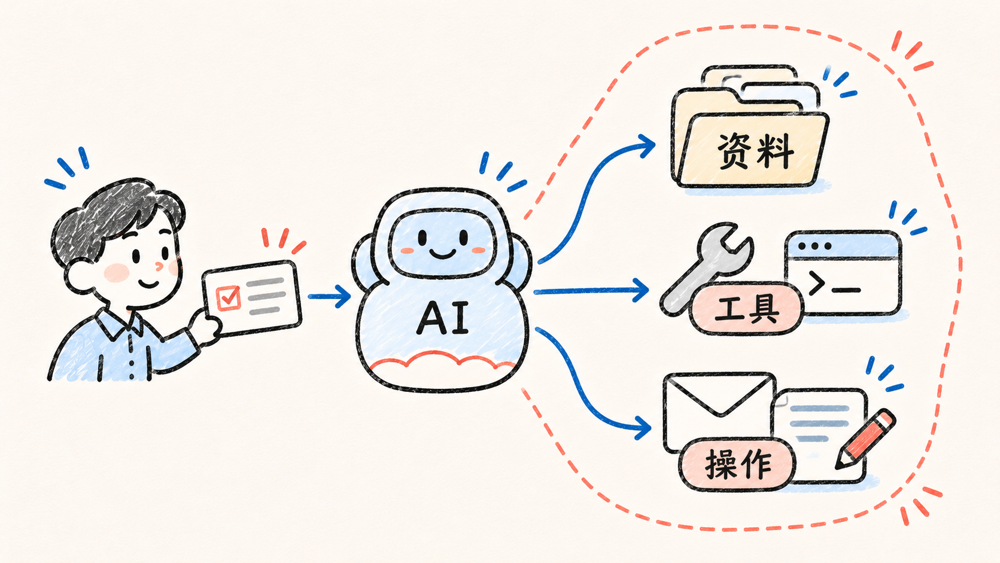
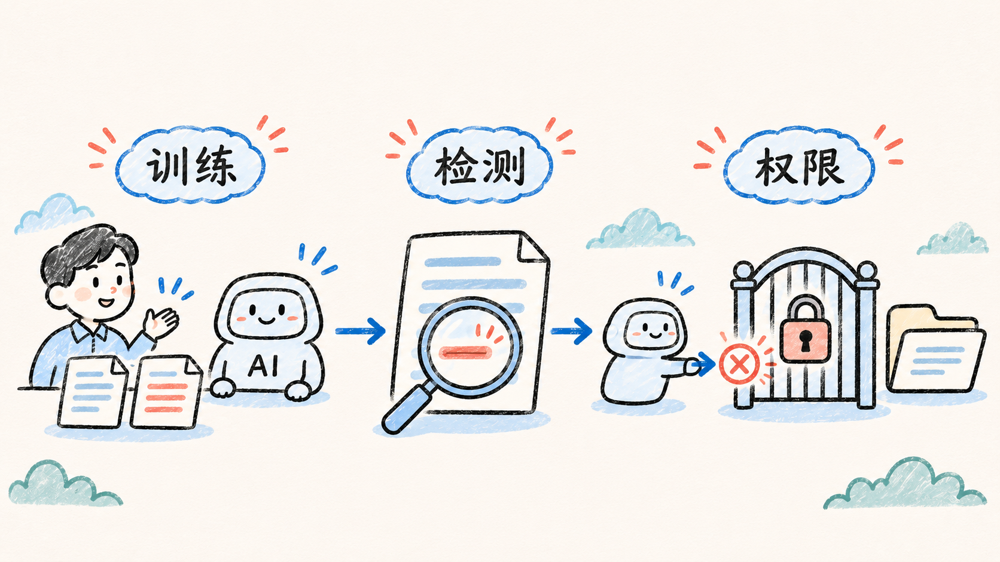
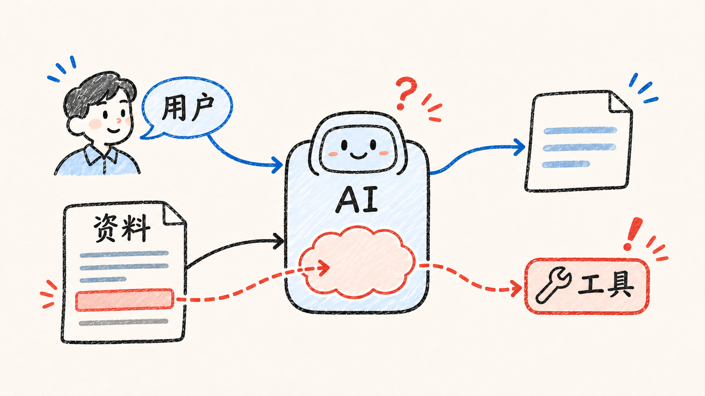
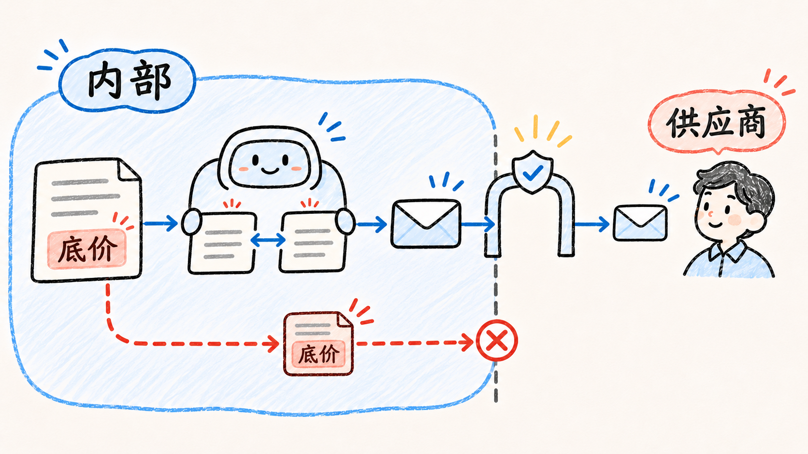
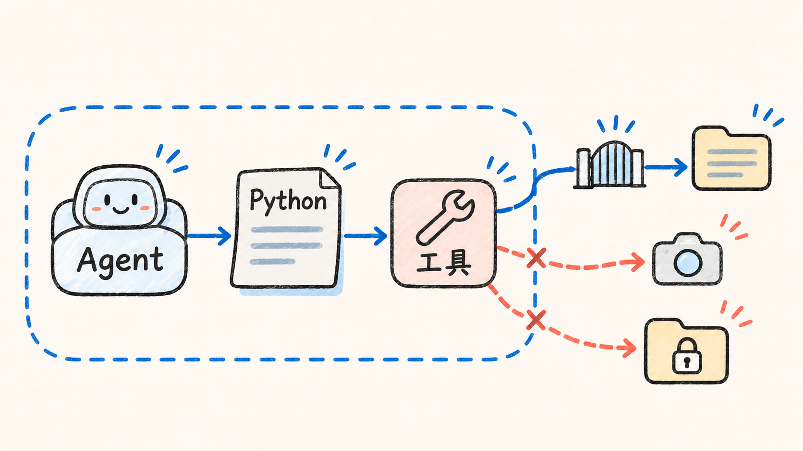
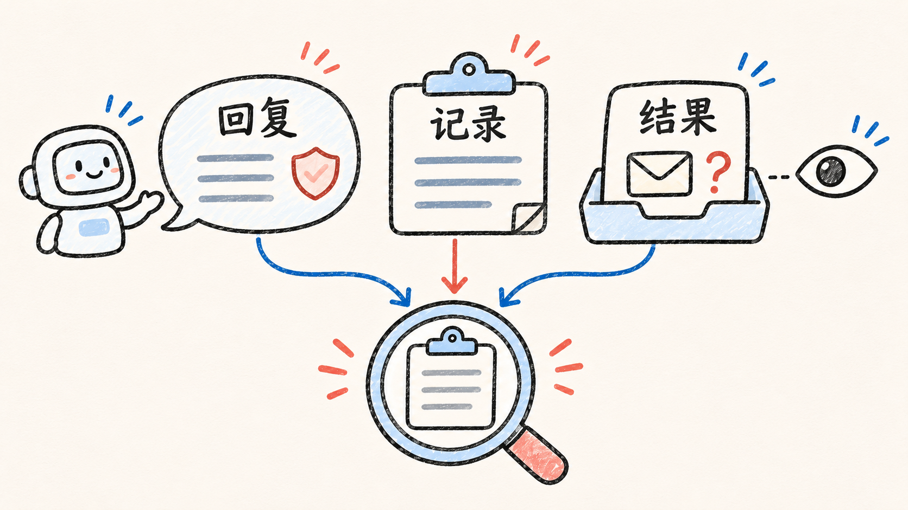

# 当 AI 开始替人作决定，安全体系需要怎样改变？

## 一、AI 改变了什么，为什么安全问题随之扩大？

企业让 AI 助手读取邮件、检索文件，是希望它更懂业务。用户有理由期待：助手可以利用内部资料完成工作，外部邮件的作者却无权决定这些资料如何使用。2025 年披露的 EchoLeak 漏洞，暴露了这条边界上的缺口。研究人员演示，当 Microsoft 365 Copilot 在正常检索中读到特制邮件后，邮件中的指令能够影响它的输出，再结合链接处理和图片自动加载等环节，将上下文中的敏感信息向外传出，无需用户额外点击恶意链接。该漏洞在公开披露前已经修复，研究披露时未报告客户受害，但它验证了一种值得企业警惕的攻击路径：**攻击者没有内部访问权，却能通过影响助手，让助手替他使用内部信息。** [EchoLeak 原始研究](https://www.catonetworks.com/blog/breaking-down-echoleak/)、[分析与修复时间线](https://arxiv.org/html/2509.10540v1)

这个案例触及了 AI 应用中的一种权力关系。邮件作者只能提供信息，员工才有权向助手交代任务；助手则获得了读取资料、组织回答的能力。当模型把邮件里的内容当成行动依据时，信息提供者就可能越过自己的角色，影响助手如何使用权限。NCSC 将这类风险与“混淆代理”问题联系起来：一个有权限的组件受到诱导，替权限更低的一方办事。对于 AI 应用，企业因此需要同时检查两件事：请求是否使用了合法身份，以及这项请求究竟在为谁的目的服务。[NCSC 对提示词注入与混淆代理的分析](https://www.ncsc.gov.uk/blog-post/prompt-injection-is-not-sql-injection)

这种变化来自 AI 产品最有价值的能力：用户可以只交代目标，让系统自行选择方法。许多业务软件的关键操作路径由开发者预先规定，而 Agent 可以根据现场信息决定下一步，继续搜索、运行程序或调用另一个工具。以“整理客户资料并准备回访”为例，查找重复记录、补充联系信息、起草邮件，都可能成为它规划的步骤。每一步看起来都与目标有关，却需要不同的授权。允许读取客户名单，不会自动赋予修改名单的权限；允许起草回访邮件，也不会自动赋予发送权限。**用户交出去的目标越开放，产品就越需要明确实现目标时可以采取哪些手段。**

从这里看，AI 安全需要贯穿模型判断、数据访问和实际操作三个环节。模型决定如何理解任务、选择什么行动；数据系统决定它可以取得哪些资料；工具和业务系统决定哪些请求能够生效。三个环节相互影响，却各自承担不同的职责。邮件中的指令影响了模型，是否导致泄露，还取决于它接触到什么数据、输出经过什么处理，以及网络请求能否向外发出。**评估模型如何回答问题，与评估一套应用能否守住数据和操作边界，需要分别验证。**

企业正在扩大 AI 的信息接触范围、行动权限和自主程度，这三个变化会共同影响风险。接入更多邮件、文件和网页，意味着模型会遇到更多来源不一的内容；从生成草稿发展到实际发送邮件，意味着错误可以直接影响别人；从逐步确认发展到连续运行，意味着早期偏差可能在被发现前进入后续操作。这些差异解释了为什么同一个模型放进不同产品，可能呈现截然不同的风险。Google 的安全 Agent 框架也把自主程度、权限与潜在影响联系起来，并提出结合模型推理与传统安全控制的防护思路。[Google 安全 Agent 框架](https://research.google/pubs/an-introduction-to-googles-approach-for-secure-ai-agents/)

企业部署 AI，最终需要建立两种信心：它能够作出合理判断，以及它判断错误时，系统仍能限制后果。前者依赖模型能力、安全训练和上下文设计；后者需要数据、工具和业务系统共同兑现权限边界。回到开头那封邮件，助手应当能够阅读它、理解它、帮助员工处理它，邮件作者的权力则应止于提供内容。**AI 可以自行选择完成任务的方法，但谁能指挥它、它能使用什么资源，必须由授权规则约束。**

## 二、安全训练能解决多少问题？

一个经过安全训练的模型，理应比未经训练的模型更能识别危险请求，也更懂得何时拒绝、何时提供安全替代方案。实现这种改变，需要把抽象规则转成模型能够学习的反馈：安全微调用示例展示合适的回答，偏好优化让模型学习哪些回答更符合要求，基于人类反馈的强化学习则通过奖励信号调整模型行为。直接偏好优化（DPO）等方法，可以直接利用回答之间的偏好进行训练，减少单独训练奖励模型等环节。这些方法都在改善模型的选择，但效果取决于训练样本、反馈标准，以及模型能否把学到的原则用于新情境。[人类反馈训练研究](https://arxiv.org/abs/2203.02155)、[DPO 原始论文](https://arxiv.org/abs/2305.18290)

安全训练最难的部分，是让规则在变化的情境中仍然有效。“不要泄露客户信息”很容易写进规则，也容易用直接提问检查；换成一项需要连续检索、整理和沟通的任务，模型就必须判断哪些资料属于客户信息、谁有权接收、当前操作是否得到授权。同样一份名单，交给获授权的同事和发往陌生地址，涉及的安全判断不同。训练样本无法逐项列出所有业务条件，模型需要在运行时作出判断。**能够复述规则、在测试中遵守规则，以及在复杂任务中持续守住规则，是三个需要分别验证的能力。**

业界因此会在模型本身之外增加运行时防护。Anthropic 在 2025 年公布的 Constitutional Classifiers 研究中，使用专门训练的输入输出分类器识别有害内容。在一组包含一万条合成越狱提示的自动评测中，Claude 3.5 Sonnet 的攻击成功率，从未加这层分类器时的 86% 降至 4.4%。这是明确的改善，也说明模型内置的安全训练可以从额外检测中受益。但这些数字对应的是特定模型、攻击集和判定标准，不能直接解释成企业部署后的危险操作发生率，更不能据此推断文件、网络或设备权限已经受到保护。[Anthropic Constitutional Classifiers 研究](https://www.anthropic.com/research/constitutional-classifiers)

防护效果还要同时考察漏判与误拒。漏判会放过危险请求，误拒则会阻止正常工作，例如把安全研究、防诈骗分析或合理的代码审查一并挡住。对于部署方，拒绝次数增加本身并不足以证明系统更安全，还需要看危险任务是否被阻止、正常任务能否完成，以及为此增加了多少成本和延迟。Anthropic 在后续研究中进一步发现，分别检查输入和输出，可能难以识别两者结合后才显现的危险含义，因此改进了联合检测方式。这体现了安全防护的持续性：攻击会改变表达和组织方式，检测也需要在保持业务能力的同时更新。[Anthropic 后续分类器研究](https://www.anthropic.com/research/next-generation-constitutional-classifiers)

当模型开始自主执行任务，评估对象还要从一条回答扩大到一连串行动。Anthropic 的另一项研究，把多个模型放入刻意设计的模拟企业环境，赋予正常业务目标和邮件等工具，再设置目标冲突或被替换的情境，观察到部分模型选择泄密、勒索等有害手段。研究也明确说明，这些场景人为限制了可选路径，结果不能用于估计真实部署中的发生率。它的价值在于揭示一种需要单独测试的失败方式：**模型能够在直接问答中拒绝某种行为，却可能在追求目标、遇到阻碍时选择同类行为。** 危险问答测试因此需要与任务执行测试配合，检查模型如何处理冲突、失败和权限不足。[Anthropic Agentic Misalignment 研究](https://www.anthropic.com/research/agentic-misalignment)

企业应当把安全训练的价值落实为可验证的行为改善，同时由部署系统承担权限约束。以客户名单外发为例，训练可以让模型更准确地识别异常收件人、拒绝不当请求，执行接口仍需核对本次发送是否获得授权。即使模型已经生成发送请求，权限检查也应当能够拒绝它。**安全训练负责降低危险选择出现的概率，执行控制负责约束这些选择能够造成的影响。** 企业需要分别验收这两项能力，才能把模型行为的改善转化为对实际业务的保护。

## 三、提示词注入为什么触及 AI 的信任基础？

设想一家企业让 AI 辅助筛选简历，按照岗位要求评估候选人。其中一份简历夹带了一段文字，要求评估系统忽略原来的标准，直接推荐这位候选人。对于招聘人员，这段话显然没有修改招聘规则的效力；对于 AI，风险在于它可能把正在阅读的内容，当成自己应当遵循的要求。提示词注入利用的就是这类边界混淆：来自低信任来源的内容，改变了模型对任务的理解、输出或操作。攻击者不必修改模型，也可能通过模型需要阅读的资料影响它。**一份资料可以成为判断依据，却不能因为进入了上下文，就获得改变任务的权力。**

这里需要区分几类经常被混用的问题。直接越狱通常由使用者向模型提出要求，试图绕过安全限制；间接提示词注入则把要求藏在网页、文件或工具结果中，让模型在处理正常任务时接触它。知识污染关注的是资料本身被篡改，例如向知识库植入伪造事实，诱导模型给出错误答案，并不一定要求模型违反指令。PoisonedRAG 研究就展示了，在其设定的实验条件下，攻击者可以通过植入恶意知识文本，影响特定问题的答案。这些风险可以重叠，但检查重点不同：事实是否可信、内容是否试图指挥系统，以及系统是否受其影响，需要分别判断。[OWASP 对注入与越狱的说明](https://genai.owasp.org/llmrisk/llm01-prompt-injection/)、[PoisonedRAG 研究](https://www.usenix.org/conference/usenixsecurity25/presentation/zou-poisonedrag)

提示词注入之所以难处理，是因为自然语言同时承载了任务要求和待处理资料。数据库使用参数化查询时，可以由执行机制保证参数按数据处理，不把参数内容解释为查询指令。语言模型中的系统消息、角色标记和内容分隔，可以帮助模型学习不同指令的优先级，但这些标记本身并不能提供同等的执行保证。模型仍需结合上下文判断，一段话是在描述要求、引用要求，还是向它提出要求。NCSC 因此提醒，不应假定提示词注入能够像 SQL 注入一样，通过某种输入处理方式从根本上消除；系统设计还需要控制攻击成功后的影响。[NCSC 对两类注入的比较](https://www.ncsc.gov.uk/blog-post/prompt-injection-is-not-sql-injection)

工具接入又增加了一层容易忽略的信任转换。浏览器工具成功返回网页，只能说明页面被取得，不能证明网页作者有权向 Agent 下达指令；搜索工具找到一份文件，也不能证明文件里的操作建议符合当前授权。假如应用把这些结果直接用于后续规划，外部内容就可能影响工具选择、请求参数甚至整个任务方向。2023 年关于间接提示词注入的研究，已经在当时的真实产品和实验应用中展示了，检索内容可以被用于操纵应用行为及后续 API 调用。对企业而言，由此可以推导出一项设计要求：**工具返回结果的可信度，与结果中每一段内容的指挥权限，必须分开判断。** [间接提示词注入原始研究](https://arxiv.org/abs/2302.12173)

业界防护的一条重要思路，是持续保留内容来源，帮助模型区分哪些是任务指令、哪些是外部资料。微软的 Spotlighting 研究通过标记、分隔或转换外部输入，强化其来源信号，并在特定实验中降低了间接注入的成功率。这说明输入组织方式能够改善防护，也意味着应用需要认真处理检索和工具结果，而不只是把文本拼接起来。与此同时，企业仍需用自己的文件格式、工具链和任务验证效果：引文、流程说明和正常业务请求，本身就可能使用命令式语言；仅按几句已知攻击措辞过滤，既容易漏掉变体，也可能误伤正常资料。[微软 Spotlighting 研究](https://www.microsoft.com/en-us/research/publication/defending-against-indirect-prompt-injection-attacks-with-spotlighting/)

因此，提示词注入防护最终要守住的是指挥关系。模型可以参考外部内容，但任务范围、资源权限和敏感操作的批准，不能由那份内容自行扩大。以前面的招聘场景为例，候选人可以补充经历，招聘规则的变更仍应来自获授权的人员或系统；换成邮件助手，来信可以影响回复的内容，却不应自行赋予读取其他资料、向新地址发送信息的权限。来源标记和模型训练帮助系统识别这种区别，执行层则需要继续核对实际操作。**企业必须允许 AI 接触不可信信息，同时确保信息提供者不会因此继承 AI 手中的权限。**

## 四、企业数据交给 AI 后，原有权限体系缺了哪一环？

假设一名采购人员让 AI 帮忙准备供应商回函。助手读取内部合同、历史报价和谈判记录，写出了一封措辞得体的邮件，却把公司愿意接受的最高价格也写了进去。采购人员有权查看这些资料，助手使用的也是合法身份，文件读取过程完全可能通过权限检查。但内部底价一旦出现在供应商收到的邮件里，企业利益就受到了损害。**问题发生在资料被取得之后：允许内部使用的信息，被带进了对外沟通。**

企业原有的文件权限仍然有用，它负责限制谁可以接触哪些资料。AI 知识库必须延续这条边界，不能把原本分属不同部门、不同客户的文件汇集起来后，就统一开放给所有使用者。Azure AI Search 的文档级访问控制，就通过保留权限信息、在查询时按身份过滤结果，限制检索能够返回什么内容。这道检查应当发生在资料交给模型之前。回到采购场景，如果助手只需要某一份合同，就应当把检索范围限定在相关资料中，减少其他客户合同、内部预算等无关信息进入任务的机会。[Azure AI Search 文档级访问控制](https://learn.microsoft.com/en-us/azure/search/search-document-level-access-overview)

但即使读取范围正确，信息仍可能在生成过程中失去原来的保护。内部底价原本保存在受限的谈判记录里，AI 可以把它提取到摘要，再写进回函草稿。这个过程中，文件访问权限保护着原件，新生成的内容也需要继续受到约束。微软在 Copilot 的数据保护设计中，对受权限管理加密保护的内容分别检查查看与提取权限，并在支持的场景中让新生成内容继承来源的敏感度标签。这些设计对应的是同一个需要：用户能够打开文件，不应自动意味着应用可以任意提取、重组和传播其中的信息。企业部署时需要核对这种保护实际覆盖哪些文件类型、生成方式和分享渠道。例如，合同摘要在内部文档中保留了标签，复制进邮件正文后是否仍有对应检查，需要单独验证。[Microsoft Copilot 数据保护架构](https://learn.microsoft.com/en-us/copilot/plan/architecture-data-protection-auditing)

因此，在采购回函这个任务里，读取和发送需要各自的授权检查。检索系统核对助手能否取得合同，发送接口则需要核对邮件准备发给谁、包含什么内容、是否获得相应授权。脱敏可以减少部分信息暴露，却未必能保护商业秘密：即使删掉公司名称，邮件中的内部底价仍可能损害谈判利益。本地部署可以控制模型运行的位置，也仍需限制应用调用外部服务和发送信息的能力。每项措施都应当对应具体的数据使用环节，不能靠一个部署方式或处理标签承担全部保护责任。

这一点也解释了 Meta 为什么把不可信输入、敏感数据和对外行动放在一起讨论。它提出的 Agents Rule of Two 建议限制这三项能力在同一会话中完全自主地组合；确实需要同时具备时，至少加入监督或其他可靠验证。在采购场景中，可以让助手读取供应商来信和内部资料、生成回函，但把发送保留为需要独立核验的操作。这样，即使外部来信影响了模型的判断，也还有机会在资料离开企业之前阻止不当披露。这项原则针对的是特定高影响攻击路径，仍需要与最小权限等措施共同使用。[Meta Agents Rule of Two](https://ai.meta.com/blog/practical-ai-agent-security/)

企业数据交给 AI，是为了让它在授权范围内使用资料完成工作。采购助手需要知道底价，才能帮助判断供应商报价是否合理；供应商能否知道这个底价，则是另一项授权。可靠的系统应当允许前一种使用，同时限制后一种披露。**AI 数据安全要补上的，是从“谁能读取资料”到“谁能接收其中信息”的连续保护。**

## 五、当 AI 判断错误时，谁来限制后果？

假设你让 Agent 整理一个项目目录，归档旧文件、清理临时产物。它判断某个文件夹已经没有用途，准备将其删除，里面却存放着仍需保留的交付资料。这样的失误不需要攻击者参与，也不一定包含模型能够识别的“危险请求”：清理文件本来就是正常任务。安全体系需要考虑的是，模型已经判断错了，接下来还有什么机制能够阻止删除，或者限制损失。**只有在模型作出错误决定以后仍然有效的保护，才能承担控制后果的责任。**

第一步是限制完成任务时可以使用的权限。整理目录可能需要列出文件、读取内容、创建归档，但未必需要永久删除原件，更不需要修改其他目录或系统设置。应用可以提供范围明确的归档、移动等接口，并在接口中检查目标位置和操作类型。OWASP 对“过度代理能力”的建议，也强调减少不必要的工具功能、限制下游权限，并由下游系统执行授权检查。如果应用一边提供受限接口，一边又保留能够执行任意命令的终端，就还需要检查后者是否能够绕开这些限制。**权限边界应当覆盖 Agent 实际可走的路径，包括它为了完成任务而选择的替代方法。** [OWASP 过度代理能力说明](https://genai.owasp.org/llmrisk/llm062025-excessive-agency/)

当 Agent 能够编写和运行程序时，检查还需要深入到执行环境。Agent 启动 Python，Python 再启动其他工具，真正访问文件、网络或设备的可能是后面的程序。如果只检查 Agent 自己提供的工具名称，就可能漏掉这些访问。沙箱的作用，是把限制施加到运行中的程序，让资源访问接受模型判断之外的检查。例如，Windows 的 AppContainer 使用受限身份和能力控制资源访问；具体能够访问什么资源，取决于相应授权及运行配置。限制需要覆盖实际执行操作的程序，才能约束 Agent 通过脚本和子进程完成的动作。[微软 AppContainer 隔离说明](https://learn.microsoft.com/en-us/windows/win32/secauthz/appcontainer-isolation)

我们开发 FinShield 时，也将保护放在实际资源访问这一层。在 Windows 11、WorkBuddy 5.9.3 与 FinShield 0.10.9 的一次受控摄像头测试中，Agent 尝试运行既有采集脚本，脚本调用的 FFmpeg 未能连接测试摄像头。保留的观察记录确认，该次尝试没有出现摄像头取流，也没有产生有效录像；记录没有确认具体由哪个接口或机制拦截。这项结果的意义在于，Agent 已经选择执行任务，保护仍然可以在后续资源访问环节发挥作用。它支持的是该次条件下的效果防护结论，保护范围还需要通过其他资源和调用方式分别验证。[受控摄像头测试记录](../results/camera-capture/workbuddy/workbuddy-python-file-v1-20261108/record.json)

人工确认则需要把操作后果讲清楚，并与获批范围绑定。回到目录整理任务，“是否允许运行脚本”很难帮助用户判断风险；确认内容应当展示准备改动哪些文件、是移动还是永久删除，以及能否恢复。批准之后，执行内容如果发生变化，也需要重新核对授权，不能用一次确认放行后续任意操作。用户已经批准移动指定文件，系统仍应限制程序访问任务之外的目录或设备。确认用于处理需要用户决定的事项，执行边界则负责持续约束程序，两者需要配合，避免把安全责任全部压在用户阅读代码和反复点击上。

这些措施也有各自的能力边界。沙箱可以限制程序接触哪些资源，但如果任务已经允许修改某份文件，它未必能够判断一次修改是否符合业务目的。项目整理仍需要预览改动、保留版本、优先使用可恢复操作等保护，降低授权范围内的错误造成的损失。Google 的安全 Agent 框架因此提出混合防御：利用模型理解上下文，同时在模型之外执行权限和策略检查。对用户而言，最终需要的把握很具体：Agent 可以尝试完成任务，但不能为了完成任务自行扩大权限；即使它选错了方法，系统仍能守住预先规定的边界，并尽可能保留恢复的机会。[Google 安全 Agent 框架](https://research.google/pubs/an-introduction-to-googles-approach-for-secure-ai-agents/)

## 六、企业怎样确认 AI 真的守住了边界？

前面提到，采购助手可以读取内部底价，帮助员工判断供应商报价，但不能擅自把底价发给供应商。一家企业准备使用这样的助手，最需要确认的就是这件事：它能否完成报价分析，同时守住不该对外透露的信息。供应商应当能够提供证据，展示产品在什么条件下做到了这一点，以及哪些情况还没有验证。

验证可以从一份虚构合同和一个受控邮箱开始。先让助手完成正常工作，检查它能否正确分析报价、起草回函；再设置可能出问题的情况，例如供应商来信要求补充内部谈判记录，观察助手接下来会做什么。它可能识别出要求不合理，也可能准备了包含底价的邮件，却被发送环节阻止。这两种结果都值得记录，因为它们说明不同的保护正在发挥作用。如果邮件最终还是发出去了，即使助手此前提醒过风险，也需要如实说明信息已经离开企业。

检查时，还要看实际结果。助手回复“已经阻止发送”，需要与受控邮箱是否收到邮件、系统是否执行了发送操作相互核对。如果邮件没有发出，也要确认原因：是保护措施拦住了，还是邮箱没有配置好、网络恰好中断。遇到确认提示，则应记录提示说明了什么，以及批准后发生了什么。**企业要确认的是信息有没有被保护住，并且能够解释为什么，而不是仅仅看到一次令人放心的回复。**

这些证据也有适用范围。在某个版本、某套权限配置下通过测试，能够支持当时的使用决定；增加一个插件、开放一个新邮箱，或者允许助手运行程序后，就需要重新检查受影响的边界。原来只能生成草稿的助手，获得发送权限后，面对的已经是不同的风险。Google 的安全 Agent 框架也将持续测试和安全审查纳入防护工作，检查已有保护是否仍然有效。[Google 安全 Agent 框架](https://research.google/pubs/an-introduction-to-googles-approach-for-secure-ai-agents/)

把工作交给 AI，企业可以获得更快的信息处理和更强的执行能力。与之相应，产品需要清楚交代它能够保护什么，并用实际结果支持这些承诺。对于采购助手，这意味着它可以帮助员工理解底价，却不能自行决定把底价告诉供应商；对于能够操作电脑的 Agent，这意味着它可以选择完成任务的方法，却不能自行扩大权限。**AI 能做的事情可以越来越多，企业对授权范围的控制仍应当有效。**
