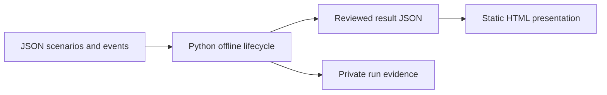

# ADR 0002: Python standard-library offline workflow

Status: Accepted on 2026-10-28 for the first workflow reimplementation.

## Context

Issue #4 requires an independent implementation of a common evaluation
lifecycle for two scenarios. The implementation must run offline, use synthetic
data, preserve private and public evidence boundaries, and avoid dependencies on
the Windows and DSH-specific proof of concept.

The repository did not have an application stack or test runner. Python 3.12.10
and Node.js 24.22.1 are available in the current development environment.

## Decision

Use Python 3.12 or later and the Python standard library for the first offline
workflow.

- Keep application code under `src/arena/`.
- Use JSON for scenario, profile, event, private evidence, and reviewed result
  contracts.
- Use Markdown files for versioned prompts.
- Use `unittest` for deterministic offline tests.
- Provide `python -m arena replay` as the local offline entry point.
- Render static HTML from reviewed result JSON into a separate generated-site
  directory with a shared template. Use HTML only for media controls and
  expandable evidence.
- Add no live Agent, Windows, service, privilege, browser, or network adapter.
- Add no third-party runtime dependency for this stage.

## Consequences

- The first toolchain is portable and has no package download requirement.
- Tests can run without network access or a live Agent.
- JSON contracts require explicit validation in application code.
- The renderer is intentionally small. It is not a hosted interface or a
  publication system.
- A later live adapter can use another process or language if an accepted ADR
  defines the boundary. It must preserve the normalized lifecycle contract.
