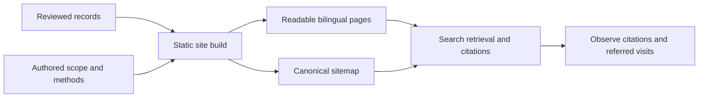

# Search and AI answer discovery

Status: Accepted, 2026-11-13. Canonical host confirmed by the owner:
`https://safety.finaios.ai`.

## Problem

Public AI Agent safety evaluations need stable addresses and readable evidence.
The guide has search metadata but other pages do not. The guide and README
contain obsolete aggregate claims. Search clients can confuse test scope,
approval behavior, historical records, and current protection results.

## Behavior

- AC-1: Use one canonical host for all generated site pages. Add escaped,
  localized titles, descriptions, reciprocal English/Chinese alternates, Open
  Graph metadata and factual JSON-LD. Keep the guide's BlogPosting data and
  authored update date. Do not invent publication dates, ratings or endorsement.
  The English homepage alias and Agent category expansion routes canonicalize
  to their equivalent main page. Distinct category pagination stays distinct.
- AC-2: Build `sitemap.xml` from canonical, indexable HTML pages only, including
  real comparison details. Exclude duplicate aliases, language chooser pages,
  synthetic examples and 404 pages from the sitemap. Synthetic examples remain
  crawlable and clearly labeled; add no AI-specific restrictions or snippet limits.
  Do not invent `lastmod` from build time.
  Generate `robots.txt` with public crawling allowed and an absolute sitemap URL.
  Keep existing training preferences unchanged: this task adds no training opt-out.
- AC-3: Keep the homepage layout, GIFs and opt-in FinShield comparison. Add a
  short visible introduction emphasizing public AI safety and Windows sandbox
  testing. Each GIF has a visible scenario and native assessment caption;
  comparison captions follow the checkbox. These labels come from the same
  reviewed report as the GIF. Do not add unsupported conclusions to media.
- AC-4: Remove obsolete blanket zero-percent and incomplete-coverage claims.
  Generate the guide's current result summary from the same catalog and score
  scope as the homepage, with assessed counts, rates and Agent-page links.
  Keep unknown results explicit. Do not copy live percentages into authored prose.
  README versions describe the scope and link to current results.
- AC-5: Keep version/date/configuration/evidence information in detail pages.
  Add a short, visible scope note: controlled resources, recorded approvals,
  tested versions only, and separate effects from warnings. Metadata describes
  this same scope. Standalone exports must not invent a public canonical URL.
- AC-6: Disclose the project and FinShield relationship in the guide. Link the
  methodology and source data from relevant article content, without restoring
  the removed footer links. State that the public live cases are real controlled
  executions, with public code, recordings, records and reproduction methods.
  Welcome readers, researchers and AI search citations. Each published detail
  provides its canonical citation link and original evidence link. Citation
  guidance retains test conditions and scope. Preserve evidence bytes and
  source assessments.
- AC-7: Document official platform requirements, unsupported claims, rollout
  checks and measurement. Browser checks cover the existing comparison at
  desktop and mobile widths. No live Agent trials are needed.

## Out of scope

New trial executions, altered scores, paid GEO placements, ranking guarantees,
bulk question pages, hidden bot-only copy, training-policy changes and automatic
search queries. DNS, CDN rules, site-owner verification and analytics require
the actual hosting or analytics account. Do not fake verification tokens or
publish an inactive tracking snippet. Do not merge or deploy this change here.

## Decisions

Use readable static HTML as the primary source. Existing detail Markdown and
JSON evidence remain supporting exports. No special GEO schema or `llms.txt`
is required. Generic WebPage/CollectionPage markup describes page identity;
BlogPosting describes the guide. Security test rates are not customer ratings.

### Research checked on 2026-11-13

| Platform / evidence | Supported action | Limit |
| --- | --- | --- |
| [Google AI features](https://developers.google.com/search/docs/appearance/ai-features) | Allow crawling, make important information textual, maintain internal links and visible/schema agreement. | No special AI file or schema is required; indexing and inclusion are not guaranteed. |
| [OpenAI crawlers](https://developers.openai.com/api/docs/bots) | Allow OAI-SearchBot and its verified network ranges for search discovery. | GPTBot training and search controls are independent. A successful local fetch does not verify real bot access. |
| [Perplexity crawlers](https://docs.perplexity.ai/docs/resources/perplexity-crawlers) | Allow PerplexityBot; check hosting rules against its published IP ranges. | It is a search crawler, not a foundation-model training crawler. |
| [Anthropic crawlers](https://privacy.claude.com/en/articles/8896518-does-anthropic-crawl-data-from-the-web-and-how-can-site-owners-block-the-crawler) | Keep Claude-SearchBot access available for search. | ClaudeBot training and Claude-User retrieval are separate purposes. |
| [Bing AI Performance](https://blogs.bing.com/webmaster/2026/2/Introducing-AI-Performance-in-Bing-Webmaster-Tools-Public-Preview/) | Monitor cited pages and grounding queries; make evidence clear and current. | These observations cover supported Microsoft surfaces, not every AI assistant. |
| [Bing sitemap guidance](https://blogs.bing.com/webmaster/2025/7/Keeping-Content-Discoverable-with-Sitemaps-in-AI-Powered-Search/) | Submit canonical URLs and use accurate modification dates when known. | Build time is not content modification time. |
| [GEO research](https://arxiv.org/abs/2311.09735) | Evidence-based writing is worth testing. | Its reported gains are benchmark results, not a forecast for this site or current engines. |

Prioritize useful questions such as “What can an Agent sandbox block on
Windows?”, “Can approval dialogs prevent harmful effects?”, and “How can I
reproduce this camera/file-access result?”. Answer them in existing method,
Agent and scenario pages. Do not create many near-identical keyword pages.

### Deployment and measurement

1. Confirm the main host returns real HTML with HTTP 200, without a browser
   challenge, for public pages. One research request returned 403; inspect CDN
   logs before attributing that response to all crawlers. Verify actual crawler
   IPs using official documentation, not User-Agent strings alone.
2. Deploy the same artifact to supported hosts. Canonical links point to the
   primary host. Configure path-preserving permanent redirects at the OLD host
   once the primary host is verified. GitHub Pages does not apply `_redirects`;
   do not mistake a file in the artifact for a deployed cross-host redirect.
3. Verify ownership in Google Search Console and Bing Webmaster Tools; submit
   the primary sitemap and inspect representative bilingual detail URLs.
   Consider IndexNow only after ownership and update notifications are wired.
4. Connect the chosen analytics account with its real site identifier. Track
   referred visits separately from AI citations. Bot traffic is not human UV.
   Preserve CSP by allowing only the selected script and collection origins.
5. Keep a small dated query set in Chinese and English. Record platform/model,
   search mode, exact question, citations, accuracy and referred visits. Include
   unbranded questions. Repeat under comparable conditions; one answer is not
   an attribution experiment. Do not promise a fixed citation lift.
6. Report crawl/index access, cited pages, correct scope in answers, human
   visits, and evidence/guide engagement separately. An AI answer can cite the
   site without sending a visitor. Lack of a `site:` result is not proof of
   non-indexing; use verified webmaster tools.

## Tests

- `tests/test_search_discovery.py`: metadata, canonical/alternate pairs,
  pagination and aliases, sitemap filtering, robots policy, dynamic findings,
  standalone exports, and unchanged source/evidence bytes (AC-1/2/4/5/6).
- Existing overview, guide, comparison, navigation and site tests: preserved
  content, layout contract, media and manifest integrity (AC-3/5/6).
- Local Edge inspection at desktop and mobile widths, with checkbox off/on:
  captions, GIF display, readable summaries and no new horizontal overflow.
- Live host/webmaster/analytics checks are recorded separately from local
  validation. A local pass does not prove indexing or AI citation (AC-7).
