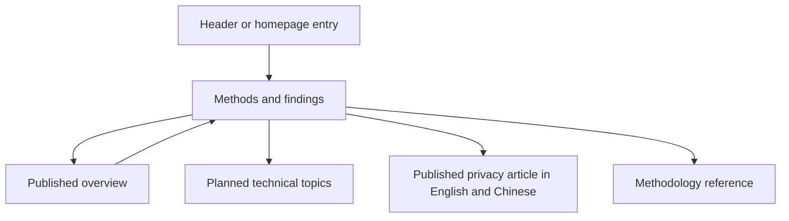

# Methods and findings directory

## Problem

The navigation opens one overview article. Readers need a directory as the
evaluation gains a series of technical articles.

## Behavior

- AC-1: Build `articles.html` and `articles.zh-CN.html`. All full-site header
  entries and the homepage article entry open the matching directory. Keep
  the label Methods & Findings / 方法与发现 and the accepted header layout.
- AC-2: Feature the existing overview first, with its actual title, update
  date and estimated reading time. Keep `guide.html` and `guide.zh-CN.html`
  as article addresses. Add a directory breadcrumb to that article.
- AC-3: Show four planned technical topics: fixed programs and direct tasks;
  approval and enforcement boundaries; file protection and parent directories;
  evidence and scoring. Each has a title, short scope and visible Planned
  status. Planned items have no link, fabricated date or reading time.
- AC-4: Provide a separate link to the existing methodology reference. Use
  the site's colors, type and header. Match category pages: use the full main
  content width, 20px headings, 14px body text, shared title spacing, and the
  same card padding, border, radius and shadow. Do not add a separate hero
  treatment or accent border. Show two topic columns on desktop and
  one on phones. All published links work without JavaScript.
- AC-5: Provide matching bilingual routes, language switches, canonical URLs
  and CollectionPage metadata. Keep article bodies, trial evidence and scores
  unchanged. Add both directory routes to generated discovery and manifests.
- AC-6: Publish the approved privacy article at `agent-privacy.html` and
  `agent-privacy.zh-CN.html`. Keep one Markdown source per language under
  `articles/`. Render the same title, paragraphs, prompts, links and original
  media for the website and external publications. Export each unchanged
  Markdown file beside its HTML page for reuse and content verification.
- AC-7: List published articles before planned topics, with dates and links.
  Use the existing article layout, responsive images, language navigation,
  directory breadcrumb and BlogPosting metadata. Never replace reviewed media.

## Out of scope

Revising the overview, changing evaluation results, and search/filter controls.
External publication uses the same approved language source but is an operator
workflow, not a website build action.

## Decisions

Keep the overview URL to preserve shared links. Store topic titles and scopes
in `templates/article-library.json`. Published article metadata remains owned
by its content file. The directory is a static page; the short initial list
does not need filters. Follow [evaluation-guide.md](evaluation-guide.md) for
the overview and [evaluation-overview.md](evaluation-overview.md) for site navigation.

Published entries in `templates/article-library.json` own the slug, date and
directory summary. The Markdown file owns the title and body. Support the
article's authored Markdown subset: headings, paragraphs, quotations, emphasis,
inline code, HTTPS links, images and horizontal rules. Escape raw HTML and
reject unsafe URL schemes. Article images retain their original public Safety
URLs on every platform. Allow that origin in the image content policy, so a
partial site export can display evidence that was not included in its inputs.
These article media require access to the public site; report assets stay local.
No model calls or trial executions occur during publication.

## Tests

- `test_article_directory_routes_and_publication_states`: AC-1 through AC-5,
  including existing article content and working local links.
- Existing homepage and article tests: preserve comparison controls and guide
  metadata while routing navigation through the directory.
- Published article tests: bilingual routes, exact Markdown exports, discovery,
  preserved content and media, and escaped HTML/unsafe links: AC-6 and AC-7.
- Browser checks at desktop and phone widths: visible navigation, two/one
  column topic layout, no horizontal overflow and working language links.
