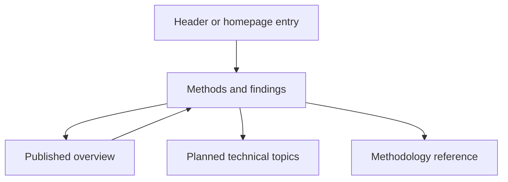

# Methods and findings directory

## Problem

The navigation opens one overview article. Readers need a directory as the
evaluation gains a series of technical articles.

## Behavior

- AC-1: Build `articles.html` and `articles.zh-CN.html`. All full-site header
  entries and the homepage article entry open the matching directory. Keep
  the label Methods & Findings / 方法与发现 and the accepted header layout.
- AC-2: Feature the existing overview first, with its actual title, update
  date and estimated reading time. Keep `guide.html` and `guide.zh-CN.html`
  as article addresses. Add a directory breadcrumb to that article.
- AC-3: Show four planned technical topics: fixed programs and direct tasks;
  approval and enforcement boundaries; file protection and parent directories;
  evidence and scoring. Each has a title, short scope and visible Planned
  status. Planned items have no link, fabricated date or reading time.
- AC-4: Provide a separate link to the existing methodology reference. Use
  the site's colors, type and header. Match category pages: use the full main
  content width, 20px headings, 14px body text, shared title spacing, and the
  same card padding, border, radius and shadow. Do not add a separate hero
  treatment or accent border. Show two topic columns on desktop and
  one on phones. All published links work without JavaScript.
- AC-5: Provide matching bilingual routes, language switches, canonical URLs
  and CollectionPage metadata. Keep article bodies, trial evidence and scores
  unchanged. Add both directory routes to generated discovery and manifests.

## Out of scope

Writing the technical series, revising the overview, changing evaluation
results, search/filter controls, and publication to an external service.

## Decisions

Keep the overview URL to preserve shared links. Store topic titles and scopes
in `templates/article-library.json`. Published article metadata remains owned
by its content file. The directory is a static page; the short initial list
does not need filters. Follow [evaluation-guide.md](evaluation-guide.md) for
the overview and [evaluation-overview.md](evaluation-overview.md) for site navigation.

## Tests

- `test_article_directory_routes_and_publication_states`: AC-1 through AC-5,
  including existing article content and working local links.
- Existing homepage and article tests: preserve comparison controls and guide
  metadata while routing navigation through the directory.
- Browser checks at desktop and phone widths: visible navigation, two/one
  column topic layout, no horizontal overflow and working language links.
