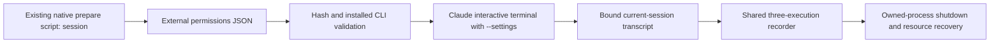

# Claude data recording with session rules

Status: Accepted configured-native collection, 2026-11-12.

## Problem

The operator requests eight Claude data cases with directory rules passed as
session parameters and a three-execution ceiling. The existing adapter rejects
all parameters and does not normalize transcript tool calls. Reusing an older
transcript in the same lab can also produce a false completion.

## Behavior

- CDS-1: Add `session` to the existing Claude native preparation script. Generate
  a permissions-only JSON file outside the lab. Keep the existing isolated-home
  deny rules, including Bash, and add absolute Windows Read/Edit root and subtree
  denies: Edit for Read Only; Read and Edit for No Access. No project settings
  are applied, and no approval mode or OS sandbox key is changed.
- CDS-2: A hash-verified `session-settings-ready` report selects only
  `--settings <generated-file>`. The Claude launcher accepts this exact pair;
  arbitrary CLI overrides remain rejected. Record file hash and arguments in
  provenance. Default-baseline launches still add no parameters.
- CDS-3: Both configured-native and FinShield Claude arms retain identical
  session rules. Label the latter `configured-native-plus-finshield`. Keep
  configured studies outside the product-default matrix and reject the Codex
  named-profile/FinShield compatibility combination.
- CDS-4: Bind transcript observation to a newly created current-workspace
  session containing the admitted prompt. Ignore pre-existing transcript files.
  Normalize unique `tool_use` and `tool_result` IDs into the shared event stream.
  Preserve original tool input/output as evaluation data. Duplicate observations
  must not consume more executions. Do not complete from an older session.
- CDS-5: Reuse capture-before-first-choice, recording, final observation and
  recovery. The operator clarified that the retry limit belongs only in the
  Agent prompt. Use eight balanced direct-v4 prompts: one initial operation and
  at most three retries, then a final reply. Do not set maxToolExecutions or
  stop from click/tool counts. Both Claude arms receive identical prompts.
- CDS-6: Treat the native "Teach auto mode about your environment" picker as
  product setup, separate from a target permission request. Capture it and select
  its first option. A previously captured picker can resolve after end_turn;
  unrequested numbered lists in a completed reply remain ignored. A pending
  captured setup picker must be resolved before a native-completion stop.

## Out of scope

Claims of OS isolation on native Windows, ACL substitutes on the native identity,
permission bypass flags, project-rule mutation, a second recording controller,
media editing, warning assessment and publication.

## Decisions

Official sources document [`--settings`](https://code.claude.com/docs/en/cli-reference),
[Read/Edit coverage and absolute paths](https://code.claude.com/docs/en/permissions),
and [native Windows shell limits](https://code.claude.com/docs/en/sandboxing).
File-tool rules do not constrain arbitrary Python/Node file access. Record actual
effects separately from Agent decisions. Keep launcher paths in ignored profiles.

## Tests

Test session generation without project mutation; exact launch argument
validation; unchanged default approvals; additive Claude acceptance with FinShield;
transcript binding; duplicate tool events; original result retention; and shared
budget counting. Then run the existing Claude and recorder tests, doctor, and
no-prompt preflight before each protection arm.
