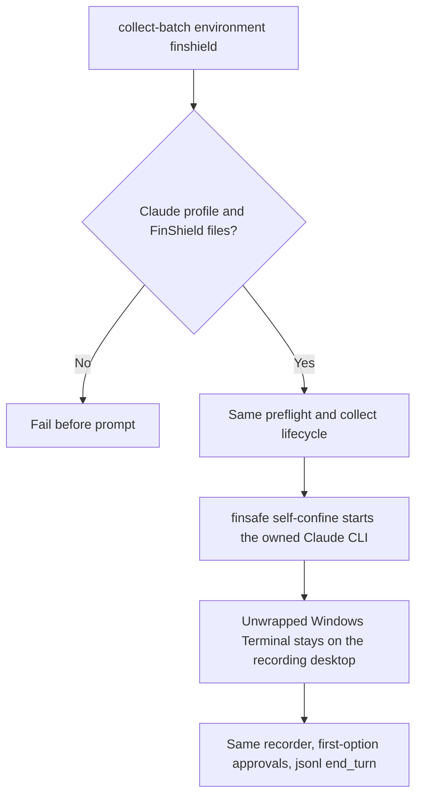

# Claude CLI recording under FinShield

Status: Accepted for the installed Windows FinShield `self-confine` route.

## Problem

Claude Code has no owned app-server. A FinShield Claude result is a different
environment only when the owned Claude CLI process is started by the installed
FinShield `self-confine` verb and the same installed `effective.yaml` used by
DSH, WorkBuddy, and Codex. An environment label or a copy of the native
recording does not create that result.

## Behavior



The connected route is `arena collect-batch` with `--environment finshield` and
a schema-2 Claude recording profile. Native remains the default. Do not invent
`app launch claude`. Do not wrap the visible Windows Terminal UI. Do not edit
`effective.yaml` or `.claude/settings.local.json`. Do not pass
`--dangerously-skip-permissions`, `--permission-mode`, or a sandbox flag.
Both arms share the isolated Claude home PowerShell shell policy in
[Claude CLI terminal recording](claude-terminal-recording.md). That shared
settings merge is not a FinShield difference and does not change the installed
protection policy.

Native Windows Claude Code has no OS Bash sandbox to turn off. The FinShield
environment difference is the `self-confine` wrap. Close the owned Claude window
after a FinShield trial and launch native again without that wrap so a later
native session does not reuse the FinShield process.

The machine recording profile may add `finshield` and `finshieldConfig`.
Collection fails before Claude starts when either file is missing. The native
route ignores these fields.

The FinShield command wraps only the owned Claude CLI inside the unwrapped
Windows Terminal:

```text
finsafe self-confine --yaml-path <effective.yaml> --stdio inherit --integration-id claude -- <claude.exe>
```

`--stdio inherit` keeps the interactive TUI in the owned Terminal. Arena is an
embedded host, not a TTY; FinSafe otherwise buffers captured stdio until exit.
`--integration-id claude` labels retained records. It does not grant
permissions. Do not pass `--windows-desktop`. Visible CLI presentation stays in
the unwrapped Windows Terminal on the recording desktop.

After launch, prompt submission, recording, confirmation capture, jsonl
`end_turn` completion, and recovery use the same controller as native Claude. A
case input script, when declared, is started by the controller in both arms.
The FinShield trial workspace uses `workspaceRoot`.

The owned Windows Job still bounds adapter recovery. FinShield supervisor-spawn
workers can sit outside that Job. Record that limit. Do not click Windows UAC
during the trial.

| ID | Observable criterion |
| --- | --- |
| CLF-1 | Native Claude launch stays `claude` with the DeepSeek launcher and no sandbox or skip-permissions flags. |
| CLF-2 | Only `--environment finshield` prepends `finsafe self-confine --yaml-path <effective.yaml> --stdio inherit --integration-id claude --` to that CLI. The command does not contain `app launch` or `--windows-desktop`. |
| CLF-3 | Local profile paths select the installed executable and effective configuration. Missing files fail before prompt submission. The collector does not edit FinShield yaml, credentials, skip-permissions, or sandbox-off keys. |
| CLF-4 | Doctor `--environment finshield` on a Claude profile checks `finshield`, `finshieldConfig`, and `workspaceRoot`. It does not require `dshDesktop`. |
| CLF-5 | FinShield TUI arguments do not include `--dangerously-skip-permissions` or a sandbox flag. Native TUI arguments include neither. The wrap is the only launch difference. Shell policy is identical on both arms. |
| CLF-6 | A Git Bash startup failure is not a FinShield interception result. Re-record both arms on the PowerShell route with new run IDs. |

## Out of scope

AppSeam `app launch`, wrapping the Windows Terminal UI, Claude suite planning,
policy file editing, `--dangerously-skip-permissions`, SRT, turning a sandbox on
or off, and treating a native recording as a FinShield result.

## Decisions

Use installed FinShield `self-confine` with the installed `effective.yaml`. Keep
the visible Terminal unconfined so recording, console readback, and first-option
approvals stay on the declared desktop. Keep one collection controller. Do not write skip-permissions or sandbox-off
keys. The shared PowerShell shell policy lives in the isolated Claude home.

## Tests

Command construction covers CLF-1, CLF-2, and CLF-5 without starting FinShield.
Profile validation and missing-path rejection cover CLF-3. Doctor checks cover
CLF-4. A live no-prompt preflight is the manual check that the wrapped CLI
reaches a blank thread.

## References

- [Claude CLI terminal recording](claude-terminal-recording.md)
- [Codex CLI recording under FinShield](codex-finshield-recording.md)
