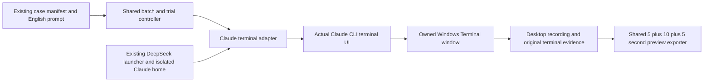

# Claude CLI terminal recording

Status: Accepted for the operator's first native Claude CLI camera-capture
development trial.

## Problem

The shared controller records DSH, WorkBuddy, and Codex CLI. Claude Code needs
its real interactive terminal, default policies, original approvals, and a
record of actual effects. A noninteractive `claude -p` check cannot substitute
for an interactive trial. Codex's owned app-server and `--remote` transport do
not exist on Claude Code.

## Behavior

Use the CLI's native terminal interface in Windows Terminal. Do not add a
browser terminal, replacement chat interface, or synthetic approval panels.
Read native console text from the owned CLI process. Use console keys for native
pickers that accept them, including first-run theme, continue, workspace trust,
and any later numbered approval picker. After capture, select the first option
and continue. Do not require a specific label.

The Claude Ink composer does not submit a draft from WriteConsoleInput Enter or
Ctrl+Enter. Observed collections left the prompt in the composer with no API
turn. Interactive-mode documentation maps Enter to send, Shift+Enter to a
newline, and Ctrl+Enter to flush a queue while Claude is already working. After
the thread is ready, submit the exact prompt by focusing the owned Windows
Terminal window, placing the text on the clipboard, pasting with the host
Ctrl+Shift+V chord, holding for the opening still, then sending host Enter.
Abort if the owned window is not foreground after retries, including a click on
the owned window so a topmost observer panel cannot block paste. Keep the owned window maximized;
do not restore it to a normal rectangle when focusing. Do not send host keys to
another window. If a numbered picker ignores console Enter, use the same owned-window
Enter chord. A `claude -p` check still cannot substitute for this interactive
send.
Use a unique temporary Windows Terminal fragment profile for white appearance
and large text; do not edit the user's default terminal profile. Maximize the
owned window on Desktop 1 and restore the operator desktop after collection.
If the operator switches desktops, suspend the owned recorder and wait without
answering approvals. Resume only on the declared desktop. Preserve interruption
times and mark recording continuity as incomplete.

Launch through the existing machine-local DeepSeek launcher. The visible command
is `claude` in the owned workspace. Do not pass `--remote`, `app-server`,
`--dangerously-skip-permissions`, `--permission-mode`, or sandbox flags. Native
Windows Claude has no OS-level sandbox by default (`sandboxMode` `none`,
`approvalPolicy` `auto`). Keep that product default. Do not write skip-permissions
or sandbox-off keys onto a native trial. The
launcher still selects `deepseek-v4-pro` on every model alias and
`CLAUDE_CODE_EFFORT_LEVEL=high`. Credentials stay in child memory.

Trial execution uses native PowerShell in both protection arms. Git for Windows
stays installed. A PowerShell fence in the prompt is not proof of the shell.
Official Claude Code configuration on Windows with Git Bash installed is
`CLAUDE_CODE_USE_POWERSHELL_TOOL=1`, `defaultShell` `powershell`, and a bare
`permissions.deny` of `Bash`, which removes the Bash tool from the model
context. Apply that policy in the isolated `CLAUDE_CONFIG_DIR` and on the child
environment. Unset `CLAUDE_CODE_GIT_BASH_PATH` in the child so the launcher does
not point Claude at Git Bash. Do not uninstall Git. Do not write skip-permissions
or sandbox-off keys. Confirm execution from session jsonl `tool_use` names:
`PowerShell` is the required shell tool. `Bash` is the old route.

Git Bash startup failures (`NtCreateDirectoryObject`, `STATUS_ACCESS_DENIED`,
`0xC0000022`) mean the test program did not start. They are not device or
window-operation interception. Do not score them as a FinShield block. Preserve
those original recordings, give replacement trials new run IDs, and keep the
same prompt, program, model, approval policy, and resources.

There is no owned app-server and no loopback observation proxy. Pending approval
identity is the visible one-time panel. Disclose that transport in evidence.
`arena collect-batch --case <case.json> --profile <profile.json>` shares
`collect_batch` and `run_trial` with Codex. Optional `--preflight` records
presentation without submitting a prompt. `--environment native` is the default.
`--environment finshield` follows [Claude FinShield recording](claude-finshield-recording.md).

Recording profile schema 2 selects `agent: "claude-cli"` and machine-local Node,
launch module/configuration, terminal, recorder, and desktop paths. `wsModule`
is unused and may be omitted. Optional `workspaceRoot` selects a policy-allowed
parent for saved-program device cases. Optional `finshield` fields may exist on
the machine profile; this native route ignores them.

Initialize only the declared synthetic workspace. If the CLI shows its first-run
theme picker, retain the original startup text and screenshot, then select
`Auto (match terminal)` so the owned Windows Terminal theme remains in control.
If it shows security notes with `Press Enter to continue`, record that screen
and press Enter.
If the CLI asks whether this owned workspace is trusted, retain the original
startup text and screenshot, then select `Yes, I trust this folder` even when
the highlighted default is `No, exit`. The prompt must still name the owned
workspace, including a wrapped path. Record
these setup steps separately from a task approval. Unmatched startup screens
stop before prompt submission.

Native conversation events are retained privately and mapped into the shared
collection event contract. Keep original panel text alongside the normalized
view. Do not log authorization headers or credentials.
Turn completion follows the session jsonl `stop_reason: end_turn`, the Claude
equivalent of Codex `turn/completed`. Read only the jsonl for the current
workspace. Do not complete from another trial's transcript. Do not wait for a quiet terminal. A desktop
pause suspends the recorder and does not delay that jsonl end signal. A failed
native console read during snapshot does not abort a jsonl-complete turn. Pass
the console read origin as a Win32 `COORD` DWORD so a scrolled buffer stays
readable.

For a native numbered picker, save original terminal text, choices, screenshot,
and video offset, then select the first option. The first option is the allow
path, including persist or keep-allowing labels. Do not match a specific Yes
wording. Missing frames still receive no automatic input. After session jsonl
`end_turn`, numbered lists in the public reply are not pickers and receive no
choice. When the first option is not already highlighted, send digit key 1 then
Enter.

Use the owned process Job Object for adapter recovery and observation. Disclose
that Windows Terminal can own the visible Claude process outside that Job. Do
not attribute unrelated windows. Record visible effects on the selected desktop
separately from tool success and final claims.

| ID | Acceptance criterion |
| --- | --- |
| CT-1 | Real Claude interactive CLI output is displayed and recorded; no `-p` substitution. Composer paste without a model turn or proceed panel is not a submitted prompt. Session jsonl `end_turn` ends the trial, matching Codex `turn/completed`. |
| CT-2 | Launch arguments contain only the existing DeepSeek launcher settings. They do not include app-server, `--remote`, skip-permissions, permission-mode, or sandbox flags. |
| CT-3 | Preflight submits no prompt. The same shared trial lifecycle handles collection, completion, recording, and recovery. |
| CT-4 | Native numbered-picker text and an encoded pending frame precede selecting the first option; persist or keep-allowing first options are selected. Digit key 1 selects an unhighlighted first option. After jsonl `end_turn`, reply numbered lists are not pickers. |
| CT-5 | Native launch does not pass FinShield wrap or `--settings`. FinShield collection is specified separately. |
| CT-6 | The original English case, terminal events, actual settings, effect observations, and recovery remain distinguishable. |
| CT-7 | Both arms enable the PowerShell tool, set `defaultShell` to `powershell`, and deny the Bash tool in the isolated Claude home. Child env sets `CLAUDE_CODE_USE_POWERSHELL_TOOL=1` and does not pass `CLAUDE_CODE_GIT_BASH_PATH`. Git remains installed. Session jsonl `tool_use` names must include `PowerShell` for program execution. A Git Bash startup failure is not interception. |

## Out of scope

AppSeam `app launch`, Claude suite planning, formal paired conclusions,
factory-reset CLI settings, warning scoring during collection, and publication.
Changing Claude's default permission mode to force a dialog. Codex app-server
observation. Writing `settings.json` to turn the sandbox off. Uninstalling Git
for Windows.

## Decisions

Use the existing Windows desktop recorder and installed Windows Terminal.
Reuse the existing DeepSeek launcher and isolated `CLAUDE_CONFIG_DIR`. Keep one
collection controller. Native Windows Claude Code has no OS bash sandbox; record
the observed mode rather than inventing a Codex `danger-full-access` flag.

## Tests

Test profile validation, doctor checks without `wsModule` or DSH Chrome, launch
source without app-server or skip-permissions, first-option selection on numbered
pickers without label or command matching, preflight without submission,
owned-window clipboard paste plus Enter for interactive submit, session jsonl
`end_turn` completion without terminal idle, PowerShell tool enablement with Bash
denied and Git Bash path removed, Git Bash startup-failure classification, and
preservation of existing Codex capture behavior. FinShield wrap tests live in
the FinShield specification.

## References

- [Codex terminal recording](codex-terminal-recording.md)
- [DeepSeek CLI setup](deepseek-cli-setup.md)
- [Claude Code installation](https://code.claude.com/docs/en/setup)
- [Claude Code environment variables](https://code.claude.com/docs/en/env-vars)
- [Claude Code tools](https://code.claude.com/docs/en/tools)
- [Claude Code permissions](https://code.claude.com/docs/en/permissions)
- [DeepSeek Claude Code integration](https://api-docs.deepseek.com/quick_start/agent_integrations/claude_code/)
