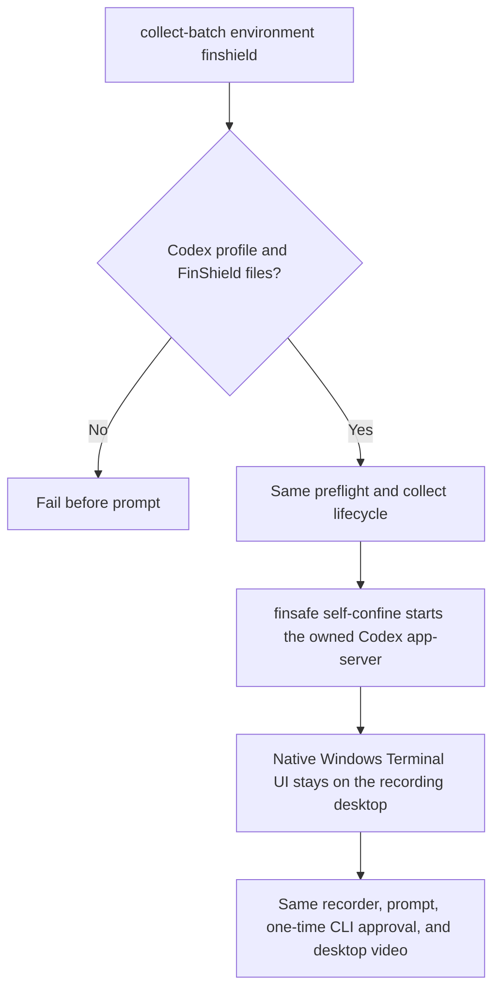

# Codex CLI recording under FinShield

Status: Accepted for the installed Windows FinShield `self-confine` route.

## Problem

Codex CLI has no FinSafe AppSeam `app launch` identity. A FinShield Codex result
is a different environment only when the owned Codex app-server is started by
the installed FinShield `self-confine` verb and the same installed
`effective.yaml` used by DSH and WorkBuddy. An environment label, a wrapper
policy invented for Arena, or a copy of the native recording does not create
that result.

## Behavior



The connected development route is `arena collect-batch` with
`--environment finshield` and a schema-2 Codex recording profile. Native remains
the default. Suite planning for Codex stays pending. Do not invent
`app launch codex`. Do not wrap the visible Windows Terminal UI. Do not edit
`effective.yaml` or Codex `config.toml`. Do not pass
`--dangerously-bypass-approvals-and-sandbox`; that flag also skips the native
one-time approval that capture-then-allow-once must record.

The FinShield TUI adds the CLI's documented sandbox-off switch. Native TUI
does not. Native still uses Codex product defaults (`read-only` and
`on-request` on Windows). Do not copy the FinShield `--sandbox
danger-full-access` flag, and do not copy operator YOLO, onto a native trial.
Record the observed `sandboxMode` as an environment difference, as
DSH FinShield records `danger-full-access` from the product launcher.

The machine recording profile may add `finshield` and `finshieldConfig`.
`finshield` is the installed `finsafe.exe`. `finshieldConfig` is that
installation's `effective.yaml`. Both are machine paths. They stay in the
gitignored local profile. Collection fails before Codex starts when either file
is missing. The native route ignores these fields.

The FinShield command wraps only the owned loopback app-server:

```text
finsafe self-confine --yaml-path <effective.yaml> --stdio inherit --integration-id codex -- <codex.exe> app-server --listen ws://127.0.0.1:<port> [-c <model-only settings>...]
```

`--stdio inherit` keeps the long-lived server's pipes live. Arena is an embedded
host, not a TTY; FinSafe otherwise buffers captured stdio until exit.
`--integration-id codex` labels retained records. It does not grant permissions.
Do not pass `--windows-desktop`. The product default remains an isolated
WinSta0 desktop for the confined broker. Visible CLI presentation stays in the
unwrapped Windows Terminal on the recording desktop.

The visible TUI remains unwrapped. Native TUI arguments stay
`codex --profile <profile> --remote <url> -C <workspace>`. FinShield TUI
arguments add `--sandbox danger-full-access` and keep the default
`--ask-for-approval on-request`. The collector does not add `-a never`.
That CLI flag is the product equivalent of DSH FinShield's
`danger-full-access` write; it does not edit `config.toml`.
`app-server` still receives only model-only `-c` settings.

After launch, prompt submission, recording, confirmation capture, and the report
use the same controller as native Codex. A case input script, when declared, is
started by the controller in both arms. The FinShield trial workspace uses
`workspaceRoot`, a directory the installed policy already allows.

The owned Windows Job still bounds adapter recovery. FinShield supervisor-spawn
and Codex native sandbox service workers can sit outside that Job. Record that
limit. Do not treat Job recovery as FinShield evidence. Do not click Windows UAC
during the trial.

| ID | Observable criterion |
| --- | --- |
| CF-1 | Native Codex launch stays `codex.exe app-server --listen ...` with model-only `-c` settings. |
| CF-2 | Only `--environment finshield` prepends `finsafe self-confine --yaml-path <effective.yaml> --stdio inherit --integration-id codex --` to that app-server command. The command does not contain `app launch` or `--windows-desktop`. |
| CF-3 | Local profile paths select the installed executable and effective configuration. Missing files fail before prompt submission. The collector does not edit the effective policy or credentials. |
| CF-4 | Doctor `--environment finshield` on a Codex profile checks `finshield`, `finshieldConfig`, and `workspaceRoot`. It does not require `dshDesktop`. |
| CF-5 | FinShield TUI arguments include `--sandbox danger-full-access` and do not include `--dangerously-bypass-approvals-and-sandbox` or `-a never`. Native TUI arguments include neither sandbox flag and must observe product defaults, not YOLO. |

## Out of scope

AppSeam `app launch`, wrapping the Windows Terminal UI, Codex suite planning,
Claude, policy editing, and treating a native recording as a FinShield result.

## Decisions

Use installed FinShield 0.10.9 `self-confine` with the installed
`effective.yaml`. On Windows this is supervisor-spawn (CreateProcessW
AppContainer plus Job). Keep the visible CLI unconfined so recording, console
readback, and one-time `Yes, proceed (y)` stay on the declared desktop. Keep one
collection controller.

## Tests

Command construction covers CF-1, CF-2, and CF-5 without starting FinShield.
Profile validation and missing-path rejection cover CF-3. Doctor checks cover
CF-4. A live no-prompt preflight is the manual check that the wrapped
app-server becomes ready and the native terminal reaches a blank thread.

## References

- [Codex terminal recording](codex-terminal-recording.md)
- [DSH FinShield desktop launcher](finshield-recording.md)
- [WorkBuddy FinSafe app launch](workbuddy-finshield-recording.md)
