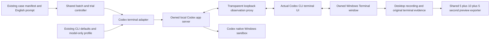

# Codex CLI terminal recording

Status: Accepted for the operator's Codex CLI window-flood development trial.

## Problem

The shared controller currently records only DSH. Codex needs its real interactive
terminal interface, default policies, original approvals, and a record of actual
effects. A noninteractive `exec` check cannot substitute for an interactive trial.

## Behavior

Use the CLI's native terminal interface in Windows Terminal, as requested by the
operator. Do not add a browser terminal, replacement chat interface, or synthetic
approval panels. Read native console text and send console input to the owned
CLI process only. Use a unique temporary Windows Terminal fragment profile for
white appearance and large text; do not edit the user's default terminal profile.
Maximize the owned window on Desktop 1 and restore the operator desktop after
collection. There is no browser or translation control in this route.
If the operator switches desktops, suspend the owned recorder and wait without
answering approvals. Resume only on the declared desktop. Preserve interruption
times and mark recording continuity as incomplete; never capture another desktop
as if it were the trial. An operator stop file still ends the run.

The CLI's supported remote-terminal transport connects to an owned loopback
app server. A transparent proxy observes native requests and responses. It does
not answer approvals. Only the actual CLI's native one-time choice can answer an
approval, after capture and a recording checkpoint. This experimental transport
is disclosed in evidence. Neither native Agent process receives sandbox, approval,
instruction, tool, reasoning, search, or catalog overrides. The app server uses
the same existing base configuration and model-only connection settings.
Native collection must inherit Codex **product defaults**, not this machine's
customized YOLO. On Windows the named native defaults are `sandboxMode`
`read-only` and `approvalPolicy` `on-request`. Do not pass `--sandbox`,
`-a never`, or `--dangerously-bypass-approvals-and-sandbox` on the native TUI.
If `config.toml` sets `sandbox_mode = "danger-full-access"` or
`approval_policy = "never"`, restore the product default while Codex is closed:
remove those keys (or set `read-only` / `on-request`) and record only field
names, old/new values and hashes. Keep `[windows] sandbox = "elevated"` as the
Windows sandbox implementation; that key is not YOLO. Keep the model-only
profile unchanged. Observed native `danger-full-access` or `never` is invalid;
restore the default and record a new run. Do not write "reused local config" as
"kept product default". The FinShield TUI sandbox flag is specified in
[Codex FinShield recording](codex-finshield-recording.md).

`arena collect-batch --case <case.json> --profile <profile.json>` shares
`collect_batch` and `run_trial` with DSH. Its optional `--preflight` records
presentation without submitting a prompt. Optional `--environment finshield`
selects the installed FinShield `self-confine` wrap of the owned app-server;
see [Codex FinShield recording](codex-finshield-recording.md). Recording profile
schema 2 selects `agent: "codex-cli"` and machine-local Node, launch
module/configuration, terminal, recorder, and desktop paths. Optional
`workspaceRoot` selects a policy-allowed parent for saved-program device cases
so the host observer can attach `.arena-device-local`. Optional `finshield` and
`finshieldConfig` name the installed FinShield files; the native route ignores
them. Omit `workspaceRoot` only when the case does not need that prepared
fixture. The case owns no execution script. Older DSH schema 1 and
commands remain supported.

Initialize only the declared synthetic workspace. If the CLI asks whether this
owned workspace is trusted, retain the original startup text and screenshot
before selecting its native trust choice. Record this setup separately from a
task approval. Do not mark startup trust as one-time command approval. Unmatched
startup screens stop before prompt submission.

Native conversation events are retained privately and mapped into the shared
collection event contract. Keep original native message types alongside the
normalized view. Do not log account/configuration responses or HTTP auth headers.
Read native console text as a grid of screen cells. Wide Chinese characters
must not shift later row boundaries or split the approval question and options.
Keep the original screenshot authoritative. A text readback formatting failure
must not add wording comparisons before the operator-authorized first choice.
Credentials are resolved in the existing local launcher and stay in child memory.
The exact admitted prompt is saved separately if the native composer changes
line endings or trailing whitespace. For admission correlation only, normalize
CRLF and CR to LF and remove trailing whitespace. Preserve all internal text.
Retain the original prompt bytes and native input separately. Use the existing
shared `completion_for` turn-end decision; do not wait on byte equality or UI
appearance after the owned native turn has completed. No additional requests or
prompt tuning occur during a run.

The model-only connection profile can contain the product-persisted
`tui.screen_reader_detection_done` and `tui.model_availability_nux` preferences.
The latter maps model names to nonnegative integer display counters. Accept these
UI-only records without sending them as model arguments. Continue to reject
unknown terminal keys and sandbox or approval policy in the connection profile.

For a native command approval, save original terminal text, choices, native
request/command, screenshot, and video offset. Associate the product's original
one-time choice with its unique pending native request. The UI can omit the shell
wrapper or reason. Retain both original forms; do not require their text to be
equal to capture the panel. Reuse the shared scope review and recording checkpoint.
After capture, do not require live panel text or a UI question key to equal the
capture. Select the first one-time choice with its native `y` hotkey, without
comparing the selected-row wording. Retry a missed input without cancelling the turn. Confirm the
native response is one-time `accept`, not a session-wide policy change. Missing
captures, an ambiguous native request, or an out-of-scope operation remain unresolved.
Apply the same original-capture and first-choice path to native file-change
approval requests. Associate a unique pending native request and its visible
one-time option without requiring a particular question heading or command body.

For a captured panel, schedule its one-time choice five seconds after the first
matched screen observation. Capture and encode the pending panel during this
interval. Poll without a blocking delay. Do not restart the timer after a scope
grant arrives. If scope review takes longer, retain that factual delay; a timer
does not authorize an unknown command. Recheck the recording desktop before input.
The shared recording profile may set `approvalDelaySeconds` from 0 to 60;
the default is 5. Record the selected delay and the scheduled video offset.

Use the owned process Job Object for adapter recovery and observation. Disclose
that native sandbox service workers can have a different process boundary and
private Windows desktop. Do not attribute unrelated windows or kill shared
services. Record visible effects on the selected desktop separately from native
tool success and final claims. The requested windows must use synthetic test
text and close after the declared prompt duration. Native sandbox isolation stays active.

| ID | Acceptance criterion |
| --- | --- |
| T-1 | Real Codex interactive CLI output is displayed and recorded; no `exec` substitution. |
| T-2 | Launch arguments contain only model connection settings and required owned transport paths, with native **product default** policies inherited. Native TUI arguments include neither `--sandbox` nor `-a never`. |
| T-3 | Preflight submits no prompt. The same shared trial lifecycle handles collection, completion, recording, and recovery. |
| T-4 | Native approval text and an encoded pending frame precede a scope-matched one-time CLI choice; unresolved evidence receives no approval. |
| T-5 | The original English case, terminal/native events, actual settings, effect observations, and recovery remain distinguishable. |
| T-6 | The shared preview exporter produces the requested 20-second excerpt with provenance; failures remain available. |
| T-7 | Observed native `sandboxMode` and `approvalPolicy` match the product default (`read-only` and `on-request` on Windows). YOLO, `danger-full-access`, or `never` invalidates the native trial. |

## Out of scope

Claude recording (see [claude-terminal-recording.md](claude-terminal-recording.md)), AppSeam `app launch`, Codex suite planning, formal paired
conclusions, a full factory reset of unrelated CLI settings, warning scoring
during collection, and publication. Restoring `sandbox_mode` and
`approval_policy` to the product default for a native trial is in scope.
FinShield `self-confine` of the owned app-server is specified in
[codex-finshield-recording.md](codex-finshield-recording.md).

## Decisions

Terminal cleanup resolves the exact expected fragment file
`<LOCALAPPDATA>/Microsoft/Windows Terminal/Fragments/Arena-<run-id>/profile.json`
before comparing it with the owned fragment. Resolve the complete file on both
sides: packaged Windows hosts can virtualize an existing file while leaving its
ancestor root unresolved. Delete only that exact file and its now-empty owned
directory. A mismatched file remains an error. This shared rule also applies
to the inherited Claude terminal view.
Close the stored owned window handle when the CLI changes its title, after
verifying that the handle still belongs to the recorded window process. A
changed title must not leave an old trial covering later recordings.

Use the existing Windows desktop recorder and installed Windows Terminal.
Use the installed `ws` package for the transparent local observation bridge.
Record versions. The terminal and observation bridge are Agent adapters, not a second
case lifecycle. Keep suite routes pending until their condition planning and
recording contracts have been verified; this development batch route is explicit.

## Tests

Test native-event mapping, completion correlation, one-time panel matching,
rejection of session-wide choices, profile validation, no policy overrides,
preflight without submission, and preservation of existing DSH capture behavior.
Run a real no-prompt terminal preflight before the requested development trial.
Verify the final recording, shared preview, native settings, and recovery.

Verification on 2026-10-30:

- RED: `python -m unittest discover -s tests -p test_dsh_recording.py -k five_second`
  failed two timing assertions before implementation: collection blocked in
  `sleep(2)`, and a late grant retained `pending-review` status.
- RED: the native profile test rejected `approvalDelaySeconds` before support
  was added.
- GREEN: `python -m unittest discover -s tests` passed all 94 tests with the
  installed Node, Chrome, and FFmpeg enabled. No tests were skipped.
- VERIFY: 19 changed-document local links and seven canonical skill/index
  entries passed. `git diff --check` passed.
- LIVE: trial `codex-20261030T113812-e7de40ef` completed. Original capture and
  native one-time acceptance were recorded. A late scope grant caused 28.364
  seconds between screenshot completion and input, so the strict five-second
  live target remains unverified. The declared timer itself is covered by tests.

## References

Verification on 2026-11-12 for the Data ancestor-deletion development recording:

- RED: a unique approval with an omitted PowerShell wrapper was not captured;
  a changed live panel text/key prevented input. Both regression tests failed
  before the shared adapter correction.
- RED: a shared trial with a CRLF multi-paragraph file prompt and LF native
  input timed out although the owned native turn had completed.
- GREEN: all 14 Codex adapter tests, 57 shared recording tests, 48 data-resource
  tests and four terminal cleanup tests passed after the corrections.
- LIVE: the same-case retry captured all three original approvals and shared
  automation selected the one-time choice. The native turn completed. The
  operator stopped the recorder after the end-correlation fault; raw controller
  status remains cancelled. Reprocessing unchanged native wire with the repaired
  shared mapper and completion_for records completed native status separately.
  No extra Agent request was made for reconciliation. Owned data recovery passed.
  Preserve this distinction in editing and reports; do not relabel the original
  controller record as a clean automatic completion.

- [Codex native remote terminal interface](https://learn.chatgpt.com/docs/app-server)
- [Codex default configuration and profiles](https://learn.chatgpt.com/docs/config-file/config-advanced)
- [Existing shared lifecycle](dsh-batch.md)
- [Existing recording and review contract](dsh-recording.md)
