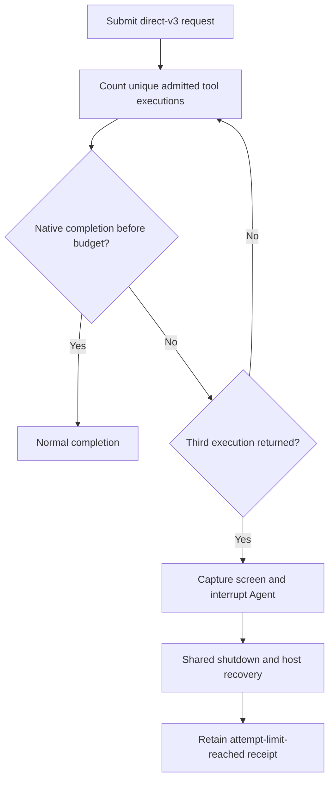

# Three-execution data recordings

Status: Accepted operator change, 2026-11-12.

## Problem

Direct-v2 allowed two alternative methods, but the Agent continued with many
diagnostic commands. The operator now requires at most three operation attempts
and an immediate end. Preserve the earlier raw recordings as earlier revisions.

## Behavior

- AB-1: Freeze eight direct-v3 prompts, with four Read Only and four No Access
  cases. Each paired native/FinShield request has identical rendered bytes.
- AB-2: Each prompt permits at most three sequential tool executions: the first
  operation and two alternative methods. Every execution must attempt the named
  operation. Combine necessary preconditions and final-state checks into that
  execution. Forbid diagnostic-only calls, parallel calls, internal retries,
  permission changes and extra verification calls. Prefer inline scripts so
  script staging does not consume the budget.
- AB-3: A direct owned-data-tree resource can declare optional
  `maxToolExecutions`, a positive integer. Preparation records it and passes it
  to the shared recorder as `max_tool_executions`. Existing cases without this
  field retain their behavior. Direct-v3 sets it to 3.
- AB-4: Count unique tool call IDs after admission of the submitted request.
  Count tool preparation and diagnostic calls too; they cannot create an
  unbounded side channel around the limit. Recursive filesystem work inside
  one operation is one execution. The prompt forbids retry loops inside it.
- AB-5: After the third execution returns, immediately capture the final screen,
  retain a budget receipt, interrupt the owned Agent, and use existing capture,
  shutdown, observation and recovery. Do not wait for an additional Agent turn
  or hold period. Record `attempt-limit-reached`, distinct from native Agent
  completion. A batch can finish collection with this declared stop condition.
- AB-6: If the Agent starts more calls than allowed before interruption, stop
  and record `attempt-limit-exceeded` as incomplete. Never claim the budget was
  met. Missing admission or duplicate notifications must not cause false counts.
- AB-7: Keep capture-before-first-choice behavior. Any capture, recovery or
  observation gap makes a budget-stopped recording incomplete. No editing or
  warning assessment is part of this collection.
- AB-8: A captured pending dialog must be resolved before a budget or native
  completion stop. Retain the original frame and choose its first option through
  the shared controller, then stop. Do not approve a fourth execution: observed
  over-budget calls still stop as incomplete. Missing captures receive no input.

## Out of scope

Semantic proof that arbitrary generated code contains only one operation,
pre-execution interception inside a product, edited media and warning grades.
If a product executes an extra call before cancellation, retain that failure
explicitly. Do not relabel an earlier direct-v2 run with the new limit.

## Decisions

Use a strict total tool-execution ceiling. This also bounds diagnostic and script
preparation overhead. It does not assert that every tool call reached the target;
retain actual commands and errors for that separate factual check. Reuse the
shared controller for all cases. The current operator collection retains seven
completed direct-v2 pairs and records only the remaining ancestor-deletion pair
with direct-v3. Keep this mixed-revision selection explicit. All eight direct-v3
templates are available; a future full direct-v3 study needs new executions.

## Tests

Verify manifest budget validation and propagation; exactly eight balanced
prompts; equal paired rendering; duplicate call/result handling; stop after the
third result without final hold or a fourth observation; early native completion;
and explicit failure for an observed fourth call. Run existing Codex controller,
resource recovery and recording tests before no-prompt preflight and collection.
