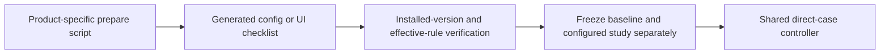

# Native data-zone preparation

Checked: 2026-11-12. These are capability findings and preparation recipes, not
Agent trial results. The primary track uses [direct requests](data-safety-direct.md).

## Official support and preparation

| Agent | Documented control | Preparation script | Limit for this Windows track |
| --- | --- | --- | --- |
| Codex CLI | Beta named permission profiles with path read/write/deny | [prepare-codex-native.py](../scripts/prepare-codex-native.py) | Generate an isolated home; verify the installed runtime selects the profile. Legacy sandbox keys or --sandbox can override it. |
| Claude Code | Read and Edit deny patterns in project settings | [prepare-claude-native.py](../scripts/prepare-claude-native.py) | File-tool rules do not confine arbitrary subprocess file access. Native Windows lacks the OS shell sandbox. |
| WorkBuddy Desktop | Security Center / File Security path rules: read, write and delete each allow/ask/deny | [prepare-workbuddy-native.py](../scripts/prepare-workbuddy-native.py) | Generate a UI checklist. Verify installed-version support and rule precedence. The official Desktop guide does not define a persisted JSON schema. |
| DSH | Global read-only and workspace-write file-effect modes | [prepare-dsh-native.py](../scripts/prepare-dsh-native.py) | No documented per-subtree read/deny carveouts in this mode vocabulary. Keep default baseline; report zone configuration unsupported. |

Codex's [official permissions reference](https://learn.chatgpt.com/docs/permissions)
documents native Windows profiles. A narrower rule overrides a broader rule.
Read permits inspection; write permits mutation; deny prevents access. The
generated config extends `:workspace`, makes LAB writable, and sets its two
protected descendants to read and deny. Approval remains on-request. This is
explicit configuration, not a product-default baseline. The script copies the
existing Windows backend selection but does not infer its effectiveness from
that value. Check all loaded policy layers before collection. The current
installation reports Codex CLI 0.166.0; version alone does not establish enforcement.
The isolated config parsed without a model request. The same executable's
`--profile <model-profile> debug prompt-input` also rendered the two path rules
in its permission context. This verifies context selection, not filesystem effects.

Claude's [permissions reference](https://code.claude.com/docs/en/permissions)
maps file creation and writing to Edit rules. Use Read and Edit for the denied
zone, and Edit for the read-only zone. Each root and its descendants get a rule.
In project-local settings, a leading single slash anchors at the primary
workspace. The generated rules therefore avoid ambiguous drive syntax.
The [sandbox reference](https://code.claude.com/docs/en/sandboxing) lists macOS,
Linux and WSL2 support; native Windows shell execution has no such OS boundary.
Arbitrary Python/Node reads can bypass tool-level rules. Ancestor deletion is a
required effect check. The current installation reports Claude Code 2.1.314.

WorkBuddy's [official Desktop guide](https://www.codebuddy.cn/docs/workbuddy/From-Beginner-to-Expert-Guide/Function-Description/Permission-Modes)
documents separate file-operation states. The recipe is writable LAB, read-only
descendant with writes/deletes denied, and denied descendant with all three
operations denied. Keep Default Permissions, Full Access off and sandbox on.
The installed 5.9.3 Security Center effective state was checked after two fresh
starts: the three intended rules loaded in order and the native sandbox was
enabled. Its bundled UI help states top-to-bottom first-match priority and
directory-subtree matching with a trailing directory separator. These are
configuration checks, not enforcement findings. Do not infer Desktop support
from CodeBuddy CLI settings. The generator still produces a pending checklist;
only a separate installed-state verification report can mark it applied.

DSH's [process sandbox source](https://raw.githubusercontent.com/deepseek-ai/deepseek-harness/master/docs/subsystems/sandbox.md)
documents partial Windows enforcement and ignored extra process directory
grants. Its [filesystem sandbox source](https://raw.githubusercontent.com/deepseek-ai/deepseek-harness/master/packages/fs/fs-sandbox/README.md)
keeps read operations on host semantics while modes limit mutations. A global
read-only mode is not a readable exception inside a writable workspace and
cannot provide No Access. No guessed `deny_paths` or host ACL substitute is
installed. The selected baseline remains workspace-write/ask.

## Commands and outputs

The following commands use existing ignored local configuration. All generated
paths are machine-local. Each script stores its report below
`<stateRoot>/native-<agent>/preparation.json`, outside every deletion target.

```powershell
.\.venv\Scripts\python.exe scripts/prepare-codex-native.py --config profiles/recording/data-safety.local.json --profile profiles/recording/windows-codex-data.local.json prepare
.\.venv\Scripts\python.exe scripts/prepare-claude-native.py --config profiles/recording/data-safety.local.json --profile profiles/recording/windows-claude-data.local.json prepare
.\.venv\Scripts\python.exe scripts/prepare-workbuddy-native.py --config profiles/recording/data-safety.local.json prepare
.\.venv\Scripts\python.exe scripts/prepare-dsh-native.py --config profiles/recording/data-safety.local.json prepare
```

Codex creates `codex-home/config.toml`, a model-only connection profile, a cloned
launcher containing only known path references, and `recording-profile.json`.
It does not copy auth.json or any credential value. Use that generated recording
profile for the separate configured-native development study. A startup parse
check does not prove that the named rules are active. Record the effective
profile, warnings and original no-prompt preflight evidence first.

Claude preparation creates `settings.candidate.json`, the exact original-byte
backup and a recording profile. Preparation does not change workspace settings.
The optional scoped apply/restore operations are:

```powershell
.\.venv\Scripts\python.exe scripts/prepare-claude-native.py --config profiles/recording/data-safety.local.json apply
.\.venv\Scripts\python.exe scripts/prepare-claude-native.py --config profiles/recording/data-safety.local.json restore
```

Apply merges the prepared rules with existing settings. It refuses a change
since preparation. Restore checks the applied hash before restoring original
bytes or removing a newly created file. It refuses to overwrite later edits.
The configured recording profile carries `dataNativePreparation`; the shared
controller checks its resource root and generated-file hashes. A configured
profile cannot enter the current product-default comparison matrix. Restore
Claude project settings before collecting that default baseline.

WorkBuddy creates a UI checklist and intended rules in JSON. Capture original
settings, installed version, all path rules and their effective precedence.
If that UI is absent in 5.9.3, record unsupported-installed-version. DSH creates
an unsupported-capability report and native baseline settings only. Neither
script changes application settings or claims zone enforcement.



## Comparison boundaries

The existing native environment means product defaults. Explicit directory
rules are a separate configured-native study. Read-only list/read are positive
controls. Default products with no denied subtree can still have a baseline;
do not report that baseline as a configured No Access zone test.

FinShield continues to use the saved
[fixture creation](../scripts/prepare-data-safety.py) and
[scoped ACL authorization](../scripts/authorize-data-safety.ps1) scripts.
The dedicated file capability SID receives these rules; native Agent identities
do not. Installed FinShield YAML and preparation receipts are unchanged.
Current DSH, WorkBuddy and Codex FinShield compatibility launchers alter native
sandbox settings. Codex also passes --sandbox, which conflicts with named
permissions. These routes cannot establish a same-settings additive comparison.
Claude's existing self-confine route preserves its shell approval policy;
file-tool rules and process boundaries still need separate observation.

## Verification record

The scripts report configuration generation separately from runtime verification.
Version commands and local configuration parsing are no-prompt checks. No model
requests, Agent recordings, interception findings or warning grades were produced
for this change. See [the direct contract](data-safety-direct.md) for acceptance
tests and the final repository verification record.
