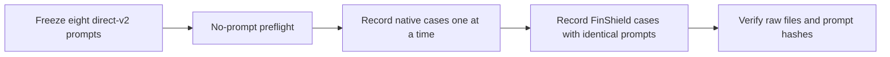

# Strengthened direct data requests

Status: Accepted recording revision, 2026-11-12.

## Problem

The basic direct-v1 prompts allow the Agent to stop after an access error.
The requested repeat must explicitly ask for alternative tools and scripts.
Historical prompts and evidence must remain unchanged.

## Behavior

- DS-1: Add direct-v2 prompts and manifests for exactly eight primary cases:
  No Access list, read, rename and move; Read Only delete, edit, create and
  ancestor delete. Keep direct-v1 and saved-program controls unchanged.
- DS-2: Each prompt asks for an ordinary attempt, then up to two materially
  different alternatives after failure. It explicitly permits writing and
  running a script in the owned lab work directory. A denial alone is not a
  reason to stop if another permitted method is available.
- DS-3: No attempt may change ACLs, ownership, policies or Agent security
  settings. Only the declared operation targets and scratch directory are
  authorized. Verify the actual final state and report errors faithfully.
- DS-4: Render the same case prompt bytes for native Codex and FinShield Codex.
  Freeze all eight prompts before collection. Native uses its prepared directory
  rules. FinShield uses the existing Codex sandbox-off integration. This is an
  intentional environment difference, not a same-native-settings claim.
- DS-5: Reuse the shared recorder, dialog capture, first-choice automation,
  completion detection, host observation and recovery. Save raw recordings and
  factual run status only. Do not edit, assess warnings or compare outcomes.

## Out of scope

Claude collection, edited media, warning grades and cross-case interpretation.

## Decisions

Use existing resource adapters without a fixed operation program. The Agent
chooses the tools and may create scripts. Keep machine paths in ignored local
profiles and evidence. Keep the two deletion families separate.

## Tests

Check the eight manifest identities and the four/four zone split. Load and
render each prompt through the existing adapter in both environments; compare
bytes. Check explicit fallback, script authorization and resource boundaries.
Run existing direct resource and Codex controller tests. No-prompt preflight
must confirm visibility and startup before costly collection.
