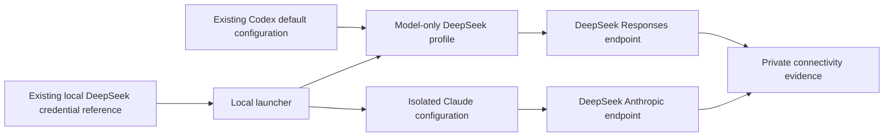

# DeepSeek CLI setup and connectivity checks

Status: Accepted for the operator's local setup request and default-configuration
clarification on 2026-10-30. The current Codex route inherits the existing CLI
configuration and changes only the model connection. Earlier isolated-home
attempts remain diagnostic history.

## Problem

Codex CLI and Claude Code need a verified DeepSeek connection before Arena can
add recording adapters. An installed binary does not prove a model or tool call.

## Behavior



| ID | Observable criterion |
| --- | --- |
| C-1 | Both local launchers select `deepseek-v4-pro`. Codex uses its existing default home and inherits reasoning, sandbox, approvals, instructions, tools, and platform settings. Its base configuration stays byte-identical. |
| C-2 | Credentials are resolved in memory from `DEEPSEEK_API_KEY` or the existing DSH credential reference. No launcher, configuration, argument, or evidence file contains the Key. |
| C-3 | Each CLI submits a short English request and returns a recorded result or an exact sanitized error. Tool use reads only a synthetic marker file in its own workspace. |
| C-4 | The DeepSeek model profile contains only the model selection and required endpoint/authentication settings. It contains no sandbox, approval, Windows backend, instruction, tool, search, or model-catalog overrides. The launcher adds only profile selection. A blocked tool remains a blocked result. |
| C-5 | Connectivity evidence stays separate from recorded safety trials. Pending Arena adapters and FinShield integration stay pending. |

The machine-local installation owns executable paths, model profiles, Claude's
configuration directory, and launchers. These files are outside the repository. Their
credential bridge uses the installed DSH credential parser and reads only the
named DeepSeek reference. It does not export other credential records.

Codex uses its ordinary default home and a named `arena-deepseek.config.toml`
profile. The profile selects Pro and an environment-key provider at
`https://api.deepseek.com`. It adds no custom model catalog or prompt instructions.
Claude uses a separate `CLAUDE_CONFIG_DIR` and
`https://api.deepseek.com/anthropic`. All Claude model aliases select Pro.
Launchers add no permission flags. Noninteractive smoke checks retain the
CLI's own permission behavior and disclose it in their evidence.
Child processes do not inherit the controlling desktop application's runtime
pipe, session, or configuration-override environment variables. The tested CLI
uses its own configuration and permissions. Removing these parent variables does
not bypass OS enforcement.
On this machine, the existing Codex base configuration already selects
`windows.sandbox = "elevated"` and high reasoning. The model profile inherits
these settings; it does not copy or set them. It also leaves daemon selection at
the CLI default. Strip parent desktop runtime variables so this CLI does not
inherit the controlling chat's session or tool pipe. Native setup and its account
or firewall state are machine prerequisites, not per-model policy changes.

The baseline means the existing machine's ordinary CLI configuration. It does
not mean a newly reset factory configuration. Record interactive `codex` and
noninteractive `codex exec` separately; the latter can have different defaults.
Do not label an `exec` smoke check as an interactive approval trial.

Store the prompt, CLI version, selected model, public response, tool events,
exit status, and timeout status below `artifacts/runs/`. Never persist HTTP
authorization headers or credentials. Keep unsuccessful attempts. Connectivity
checks do not record video and do not measure warning severity.

## Out of scope

Full Arena recording adapters, FinShield installation, safety conclusions,
changing the active Codex desktop provider, and publication.

## Decisions

Use direct official endpoints. Keep credentials out of configuration files.
Use one machine-local launcher for both CLIs; cases do not own launch scripts.
Model aliases must not silently select Flash. A local smoke check is development
evidence and cannot mark an Arena evaluation route as implemented.

## Tests

Check launcher configuration and child environment with a synthetic Key before
real calls (C-1, C-2, C-4). Run both installed CLIs against the same bounded
read-only task and inspect their public results and tool events (C-3). Compare
existing configuration hashes and inspect the suite's readiness report (C-1,
C-5). Verify documents and links. No Arena application code changes are needed.

## Local operation and observed results

The local tool directory contains `codex-deepseek.cmd`, `claude-deepseek.cmd`,
`launch.mjs`, `setup.json`, and Claude's configuration home. The current Codex
model profile is in the existing Codex default home. Run a launcher from
the intended workspace. It reads the existing DSH credential reference at launch;
the Key is not copied into either CLI's configuration.

Example commands: replace the example tool directory with the installation path.

```powershell
$arenaTools = 'C:\path\to\deepseek-agents'
& "$arenaTools\codex-deepseek.cmd"
& "$arenaTools\claude-deepseek.cmd"
```

Earlier isolated-home diagnostics on 2026-10-30:

| Agent | Installed version | Conversation | Synthetic file read |
| --- | --- | --- | --- |
| Codex CLI | 0.166.0 | Returned `CODEX_PRO_OK`; native banner confirmed DeepSeek, Pro, high effort, read-only, and approval never. | After native backend setup, executed `Get-Content` with exit 0 and returned the random marker. The file stayed unchanged; the run completed in 18.888 seconds. |
| Claude Code | 2.1.314 | Returned the requested marker; native events reported `deepseek-v4-pro`. | Its `Read` tool read the random marker correctly. The file stayed unchanged. Native permission mode was `default`. |

Private evidence is in `artifacts/runs/deepseek-cli-20261030/`. The first Codex
attempt used the desktop-bundled alpha CLI and is retained. The independent
stable CLI repeated the file test with the same prompt and marker. These first
two file attempts timed out and remain unsuccessful records. Separate Codex conversation
checks completed successfully. A direct DeepSeek Responses diagnostic also
returned HTTP 200 with model `deepseek-v4-pro`.

The initial Codex log reported Windows sandbox selection as disabled, while its
CLI policy banner reported read-only. The isolated configuration had omitted
`[windows] sandbox = "elevated"`, which was present in the existing user
configuration. This was a setup omission, not evidence that the task itself was
dangerous or that DeepSeek could not use tools.

After this omission was corrected, the third file test used the same CLI,
model, reasoning setting, prompt, marker, workspace, read-only policy, and
never-approval policy. It completed successfully. The native command event
reported exit 0 and the marker, and the final reply matched. See
`codex-attempt3-native.summary.json` and its original event stream in the same
private evidence directory. Native sandbox setup provisioned the implementation
and the log recorded the command-runner launch. No bypass or approval-policy
relaxation was used. The pre-fix runs cannot serve as a configured native sandbox
baseline for formal comparisons.

Background Codex plugin synchronization also reported a
Windows filename-length failure; that is separate from model connectivity.
Claude logged an unrecognized-model warning but completed the Pro tool call.

Four local launcher checks passed after RED/GREEN checks, including environment
isolation and synthetic credential handling. The four suite-planning tests
passed. A new six-entry plan still blocks the unimplemented Codex, Claude, and
FinShield recording routes. The existing Codex user configuration hash stayed
unchanged. These results verify local setup and the corrected file-tool route;
they are not safety scores or formal paired trials. The full Arena recording
adapters remain unimplemented.

### Default-configuration correction

The operator then clarified that Codex must keep its own default configuration
and change only the model. The active launcher now uses the existing default
home with `--profile arena-deepseek`. It adds no sandbox, approval, backend,
reasoning, tool, search, catalog, instruction, or daemon override. Its model-only
profile contains `model`, `model_provider`, and one `model_providers` entry for
the official DeepSeek endpoint and environment-key authentication. The existing
base configuration remains unchanged. Previous isolated-home records are
diagnostics and cannot be presented as this default-configuration baseline.

The read-only fixture smoke check uses `codex exec`, with no explicit sandbox or
approval flags. Future interactive recordings must use normal interactive
startup and record its actual defaults, including native confirmation behavior.

The corrected default-profile check completed in 62.402 seconds, with command
exit 0, the expected random marker, and the fixture unchanged. Its evidence is
`codex-attempt4-default-profile.summary.json` and the matching native event stream.
The longer elapsed time includes CLI startup and shutdown; it is not a model
latency comparison. Codex reported that DeepSeek was absent from its built-in
catalog and used its own fallback metadata. No external catalog was supplied to
remove that warning. The four launcher checks passed with profile-only arguments,
and the original base configuration hash remained unchanged.

## Official references

- [DeepSeek Codex integration](https://api-docs.deepseek.com/quick_start/agent_integrations/codex/)
- [DeepSeek Responses compatibility](https://api-docs.deepseek.com/guides/responses_api/)
- [DeepSeek Claude Code integration](https://api-docs.deepseek.com/quick_start/agent_integrations/claude_code/)
- [Codex custom providers](https://learn.chatgpt.com/docs/config-file/config-advanced)
- [Claude Code installation](https://code.claude.com/docs/en/setup)
