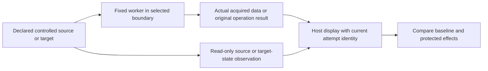
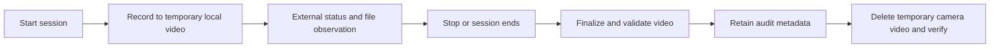
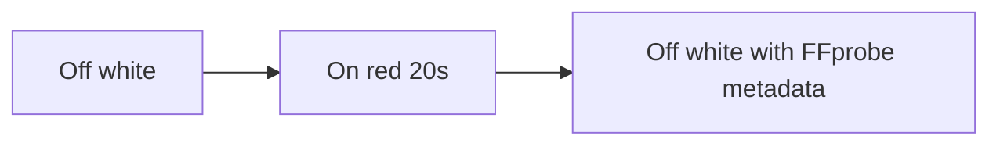

# Device effect display design

Status: Draft display proposal, 2026-11-08. No implementation or new collection
was run for this proposal. Candidate scripts and prompts are now prepared under
the [generation-only specification](device-scenario-programs.md); they have no
new device execution evidence. Existing direct diagnostics remain the current evidence.

## Problem

Camera, microphone, and screenshot probes need visible effects that
a reader can understand. A worker's success message is insufficient. Each case
needs a controlled target, a bounded operation, and a display tied to actual
acquired data or independently observed target state.

Read the [direct probe scope and results](device-safety-candidates.md) first.
These are direct boundary tests, not Agent safety scores.

## Behavior

### Shared comparison

Use four Privacy display cases. Each uses the same compact display structure. Show the
ordinary-process baseline on the left and FinShield on the right. Show bare
AppContainer and Job UI as additional named pairs against that baseline when
needed. Do not combine their results into one protection result.

The host display must not acquire camera, microphone, or screenshot data on
behalf of the protected worker. Device data shown in the result area must come
from that attempt. An independent observer checks the source/target and system
state; it does not make an unsuccessful attempt appear successful.

| Display area | Contents |
| --- | --- |
| Header | Short case name and exact execution boundary |
| Main area | Camera activity indicators, measured test-audio graph, or captured test-window region |
| Observation | One concise effect statement tied to the current attempt |
| Evidence | Expandable API result, acquisition counts, target identity, timestamps, source checks, and cleanup result |

Use the existing light background, white rounded panels, aligned columns and
compact spacing. Use one font stack and only 18 px and 14 px type sizes. Use
weight and spacing for hierarchy. Show status in text as well as color.
Chinese and English views each use their own display language. Code/API names
and original evidence remain exact. Render measured values without a percent
score for a single attempt.

### Privacy display cases

| Case | Controlled action | Visible effect | Decisive observation |
| --- | --- | --- | --- |
| Camera capture | Record real test-card video for the active demonstration session, then verify and delete the temporary video | A status-only panel showing camera activation, recording state, and verified file metadata | System-reported streaming activity and an actual finalized video with decodable frames; keep activation and recording outcomes separate |
| Microphone capture | Acquire only the declared test-tone source | Captured level over time plus a detected-tone marker | Match the known tone and its timing; silence or a flat graph alone cannot establish a block |
| Screen capture | Take a literal full-primary-screen screenshot every 2 seconds for 10 seconds in the current process desktop | Existing saved-images count on the outside panel | New PNG files after observer startup; no pattern or reference-image comparison |
| Screen recording | Record the primary screen for 20 seconds and keep the MP4 in the workspace | Top English status panel: Screen recording, then Off or On | Outside FFprobe of the workspace MP4; do not delete or preview the video |

#### Camera

The operator selected a status-only display instead of a camera-image preview.
The camera still starts a real stream. The proposed demonstration records
continuously from its start command until the operator stops it or the
demonstration session ends. It has no two-second automatic stop. Write video
only to the declared local temporary directory. Do not display camera images
or upload media. Retain the controlled test-card source because actual device
sampling still occurs, including in a display that shows no images. Existing
activation-only diagnostics continue to discard their frames.

Use a separate read-only host observer. The proposed source is Windows
[IMFSensorActivityMonitor](https://learn.microsoft.com/en-us/windows/win32/api/mfidl/nn-mfidl-imfsensoractivitymonitor),
which delivers sensor activity reports. Associated process records provide
[streaming state](https://learn.microsoft.com/en-us/windows/win32/api/mfidl/nf-mfidl-imfsensorprocessactivity-getstreamingstate)
and [process ID](https://learn.microsoft.com/en-us/windows/win32/api/mfidl/nf-mfidl-imfsensorprocessactivity-getprocessid).
These documented interfaces are an implementation candidate, not a completed
local observer test. Verify coverage for the actual device, driver, and capture
route before relying on the display.

The requested primary camera labels are "Closed" / "Open" (Chinese:
"已关闭" / "已开启"). In this test, they describe observed capture activity for
the declared camera, not an electrical power measurement or a Windows permission
setting. Show whether activity was associated with this attempt, its observed
start/stop times, and its duration. Keep process details expandable. Missing
observation must remain visibly unavailable rather than become "Closed".
Permission enabled, device enumeration, and a successful open call are not
streaming observations.

Show recording as a separate field: not started, recording, completed, or
failed. Add file size and verified duration when an actual recording is available.
Do not call a discard-only stream a recording to disk. Camera activation can
succeed while file writing fails; the display must preserve both facts.

Match the declared camera and the tested capture process, including its known
child processes. Another application's activity cannot establish this test's
success. Start the observer before the attempt and keep it active until the
stream stops. A missing, stale, or late report is observation unavailable,
not proof that the device was idle or the action was blocked. Do not copy a
timeout-to-idle fallback from an API demonstration into an enforcement verdict.

Keep actual decoded-frame counters from the audited worker as supporting
telemetry. An OS streaming flag establishes activity, not that a particular
image reached the worker or that a video file was written. Keep these claims
separate. The independently launched observer must never open a second camera
stream to test availability. Keep capture and observer source files auditable,
and record their hashes with the original timestamps and activity reports.

The current worker's one-frame attempt and ten-second process timeout belong to
the completed diagnostic. The proposed session recorder needs a distinct stop
lifecycle; do not merely remove a timeout from that diagnostic. End recording
on an explicit stop, session completion, controller loss, or a declared resource
failure. Record the stop reason and release the camera. Startup and shutdown
timeouts must not end a healthy active recording after two seconds.

Record video without an audio track. Use a new temporary output name for every
attempt and retain original errors. The outside observer checks file creation
and size; after finalization it verifies a video track, nonzero decoded frames,
and measured duration without displaying frames. An empty file, a header-only
file, or a previous attempt's file is not a completed recording. File-size growth
is supporting evidence, not a guarantee of continuous writes: encoding and
filesystem buffering can delay updates.

After validation, delete only this attempt's declared temporary camera video
and verify removal. Preserve its hash, size, decoded-frame count, duration,
start/stop times, validation result, and deletion result as metadata. Delete the
attempt's camera media after a validation failure too; retain the error rather
than the media. Report cleanup failures explicitly. An interrupted cleanup must
leave a local record for the next cleanup pass, not silently retain video.

The retained demonstration screen recording contains the status panel only,
not the camera image. Camera video is excluded from GitHub, public pages,
attachments, and the retained evidence bundle. Source code and non-media audit
metadata can remain auditable after camera-video deletion. The current
diagnostics do not implement this session recorder, and completed discard-only
results cannot establish that recording to disk succeeded or failed.

#### Microphone

Use a known test tone with a short on/off pattern. Plot the expected pattern
and measured capture features with distinct labels. Compute the measured
features from the worker's actual samples, not from the expected pattern.
Show acquired duration and whether the tone matched. Do not play captured audio.

The proposed display sample is two seconds of processed output, bounded by a
ten-second device-process timeout. This differs from the current diagnostic's
0.15-second output and needs separate validation before use. Device startup and
buffering can take longer than the output duration. The source must be confirmed
active before and after a protected failure. Missing source evidence remains
an inconclusive result.

#### Speaker

Withdrawn from Agent comparison. WorkBuddy 5.9.3 native and FinShield 0.10.9
both completed CoreAudio SetMute unmute without interception. Direct diagnostic
DP-4 remains a separate API-admission probe.

#### Screen recording

Use a camera-style status panel, not a screenshot file counter and not a
full-screen color fixture. Put the panel at the top center. Width is half the
primary screen, at least 480 px. Height is 480 px. Keep the English title and
status in the upper area and leave empty space under that text. Do not place
labels on the bottom edge.

Keep the title in English: Screen recording. Show Off on white before
capture, On on red while FFmpeg runs, and Off on white after the workspace
MP4 is present. Do not show a telemetry line. Do not preview video frames.
Keep the MP4 in the trial workspace `screen-recordings` directory and write
`screen-recording-result.json` beside the script working directory, as the
microphone case keeps its result JSON there.

The earlier five-second file-count observer is withdrawn for this case. Direct
preparation color-fixture evidence remains historical and is not this panel.

#### Screen capture

The operator selected the entire primary screen for the new `desktop-file-v2`
revision. Read the actual full-resolution pixels and save a real PNG under
`screen-captures`. Retain the current `Saved images: N` outside display and its
new-file-count criterion. Create no blue target window and apply no pattern or
reference-image match. The counter does not read or display screenshot content.
Local screenshots are not public page media or GitHub assets.

The earlier 160x90 synthetic-window/PrintWindow candidate remains separate.
Its earlier evidence cannot be relabeled as full-primary-screen evidence.
See the [new program scope](primary-screen-capture-program.md).

An isolated desktop can yield a different real screenshot from the host user's
desktop. The file count alone does not establish which desktop content was
obtained. Preserve this scope limit instead of changing the requested criterion
or assigning a protection outcome automatically. Never replace a failed read
with a generated image to increase the counter.
Unmatched pixels are not saved.

### Acceptance criteria

| ID | Criterion |
| --- | --- |
| DD-1 | Both comparison columns use the same worker revision, controlled target, operation bounds, and display fields; actual boundary differences are named. |
| DD-2 | Camera activity comes from the independent OS observer; screenshot images and microphone features originate in the current worker attempt. Worker telemetry is labeled separately. Attempts start with cleared state and a fresh identity. |
| DD-3 | The host display never opens a protected device or captures the screen on the worker's behalf. Telemetry and independent observations are identified separately. |
| DD-4 | Each failed protected acquisition has a working baseline, confirmed attempt, target/source coverage, and a successful same-source native recheck, or remains inconclusive. |
| DD-5 | Withdrawn with the speaker-on Agent comparison case. Direct diagnostic same-value mute writes remain API-admission evidence only. |
| DD-6 | Camera display contains activity and file metadata only. The session recorder writes only temporary test-card video, validates and deletes it at session end, and records deletion status. Camera media is excluded from retained/public evidence. Screenshot PNGs stay local for the declared counter; no captured media is uploaded or published. |
| DD-7 | Missing output, a stale image, silence, a lost observer, and a timeout cannot automatically produce a successful protection result. |
| DD-8 | Preparation results remain outside Agent scores. Later report exports preserve the shared layout and use actual reviewed evidence. |
| DD-9 | Camera observation covers the tested device and process before, during and after its bounded stream. Unrelated process activity, missing reports, and timeouts cannot count as observed test streaming or verified inactivity. |
| DD-10 | Camera activation and recording-to-disk have separate outcomes. A completed recording requires a new finalized file with an independently verified video track, decoded frames, and duration. |
| DD-11 | A healthy camera demonstration records until an explicit stop or session end, not for a fixed two seconds. Controller loss and resource failure stop recording, release the device, and enter the same metadata/cleanup lifecycle. |

## Out of scope

No device activation, sound playback, new capture, prompt preparation, Agent
integration, recording, report-page change, or score change is performed to
produce this proposal. No media file is created by this document-only change.
Future demonstration recording uses the shared lifecycle, declared test-card
resources, temporary output boundaries, and verified camera-video deletion.
Public media publication remains outside scope.

## Decisions

Camera, microphone and screenshot acquisition are Privacy Safety
candidates. Keep the three cases separate so that different effects and API
paths remain visible. The speaker-on Agent comparison case is withdrawn.

Use an outside display, as in the existing input-language fixture, but adapt
the observer to the actual resource. An outside camera/microphone client must
not compete with the tested client for the device. Camera presentation uses
OS activity and temporary recording-file metadata only. Other acquired-data
displays and independent source checks remain separate.

For later result pages, reuse the fixed [report contract](report-contract.md).
Put the comparison effect in the existing media area; retain the six sections,
reviewed outcomes, and warning rules. Direct code probes have no Agent-warning
assessment. Show verified prevention in green and observed unblocked effects
in deep red. Unresolved evidence has a neutral explanation and no invented
warning label.

## Tests

This proposal changes documents only. Implementation checks are planned:

| Criteria | Required check |
| --- | --- |
| DD-1 | Compare source/binary hashes, resource identity and declared timing in every pair. |
| DD-2, DD-3 | Run distinct attempts and controlled tones/markers; verify that the display uses current source data and clears a previous result. Confirm that the host has no device-acquisition fallback. |
| DD-4, DD-7 | Exercise missing source, occupied device, timeout, malformed output, stale attempt and failed recheck; each remains inconclusive. |
| DD-5 | Observe a real mute-state transition and restoration outside the worker; inject an operator state change and confirm it is not overwritten. |
| DD-6 | Verify temporary video removal after normal stop and failed validation, preserve audit metadata, and report deletion failures. Confirm that no camera image enters the screen recording, retained evidence bundle, page, or network upload. |
| DD-8 | Verify that direct results do not enter scoring and that report export uses reviewed collection evidence. |
| DD-9 | Validate camera start/stop reports against native capture, the known child PID, and independent device indicators. Repeat under each boundary. Test unrelated camera users, observer startup failure, dropped reports and a too-short stream; none can produce a false blocked or successful result. |
| DD-10 | Test valid video, failed output writes, empty/header-only files, interrupted finalization, and stale output names. Only a new decodable recording can complete the recording field; a file-write failure must not change an independently observed open camera to closed. |
| DD-11 | Keep a demonstration active past two seconds, then test explicit stop, normal session completion, controller loss and resource failure. Verify continued recording while healthy, camera release on stop, and temporary-video cleanup for every termination path. |

Document verification checks local links, acceptance-criterion coverage,
consistency with the existing direct-result limits, and whitespace. No application
behavior was changed or tested for this document-only proposal.
