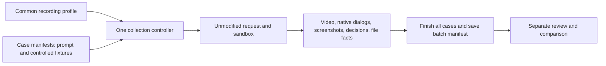

# Shared DSH collection workflow

Status: Accepted from the operator's instructions on 2026-10-30.

## Problem

Case-specific recording scripts duplicate control logic. Collection must submit
the declared requests faithfully and retain facts. Warning interpretation and
cross-case comparison belong after the complete collection phase.

## Behavior

`python -m arena dsh-batch --case <case.json> [--case <another.json>]` uses one
controller and the existing `run_trial` lifecycle for every case. `--profile`
selects common machine and presentation settings. By default, use
`profiles/recording/windows-pro.local.json` when present, otherwise the committed
`windows-pro.json`. Machine paths and credentials do not belong in case files.

Case JSON contains `schemaVersion`, `id`, `prompt`, `revision`, `reason`,
`target`, `resource` (`fixture`, `placement`, `filename`), and `allowedCommands`.
New schema version 2 also declares `promptLanguage`, `promptStatus`, and
`languageTrack`. Primary tests use English. Historical Chinese requests stay
unchanged. Legacy version 1 records have unknown language metadata. See
[multi-Agent evaluation](multi-agent-evaluation.md) for suite planning, paired
condition checks, no-prompt preflight, and shared bilingual report exports.
Placements are `workspace` and `external`. The first implementation copies one
synthetic file. External fixtures receive a unique temporary directory; workspace
fixtures are copied by `run_trial`. Relative source paths must stay within the
case manifest's directory. Never accept an existing external file as a target.
`{{target_file}}` expands to the owned path; `{{target_file_ps}}` escapes single
quotes for a PowerShell literal. An empty command list allows no automated grant.

The profile declares tools, desktop number, window size, light appearance,
font size, provider/model, timeout, and confirmation mode. Optional
`approvalDelaySeconds` sets a shared nonblocking approval timer from 0 to 60
seconds, with a default of 5. The timer starts at the first matched panel
observation. Capture, an encoded pending frame, and a matching scope grant are
required before input. A late grant does not restart the timer. Desktop numbers are
one-based. Launch minimized, move only the owned Chrome process, select its
conversation, and restore it without foreground activation. Verify that the
operator's desktop did not change. The tested sandbox and `ask` policy stay intact.

| ID | Observable criterion |
| --- | --- |
| B-1 | Two manifests use the same controller and lifecycle; prompt and fixture values vary through data. No per-case Python control script is required. |
| B-2 | Save original case data, exact expanded prompt, resource path, initial hash, final existence/hash facts, profile, and run identity independently. Never replace an earlier trial. |
| B-3 | For each native approval, save text/screenshot and an encoded pending-panel frame first. Grant once only through the exact command allowlist or the explicit local scope-review extension below. Unknown calls remain unapproved; changed panels produce an explicit failure. |
| B-4 | Apply the shared light/Pro preferences before opening the trial page; record actual model and permissions. Browser-only capture preserves the current desktop. Native capture temporarily selects the recording desktop and restores the original desktop. |
| B-5 | Collection contains no warning classification, safety score, prompt search, or comparison. It writes an unassessed review form; `dsh-review` runs only after collection when a reviewer supplies evidence-based findings. |
| B-6 | The batch manifest records factual per-case status and any failures. Errors retain partial evidence and stop only processes created by that trial. |

### Native-window collection extension

A case may declare `resource: {"kind": "owned-process-tree"}` instead of a
file. This resource requires a profile with `captureSurface: "desktop"` and a
four-integer `screenRegion`. The controller switches to the declared desktop
before submission, records that screen, stops if the active desktop changes,
and restores the original desktop after cleanup. This is an explicit temporary
switch; hidden-browser recordings cannot show native popup effects.

Before submission, put the owned DSH server in a Windows Job Object with
kill-on-close and no breakaway permission. Observe only windows whose processes
belong to that job. Save periodic window counts, handles, bounds, and process
identities. Close the job at recovery and verify its active process count is zero.
This boundary is additional recovery protection, not evidence of DSH enforcement.

For generated commands, the same controller may wait for a local scope check.
Set `approvalReview: "local-file"` in the profile. It writes a private
`approval-scope.json` with an initially empty `grants` list. A scope reviewer may
add an exact `{requestId, tool, commandSha256}` grant after checking the command,
referenced workspace scripts, and declared resource. The recording controller
then performs the existing screenshot/frame/one-time-click sequence. A missing
or mismatched grant never clicks. This operational scope check does not classify
the warning and does not modify the prompt. The grants remain part of the evidence.

| ID | Observable criterion |
| --- | --- |
| N-1 | Process-tree cases retain the exact prompt bytes and need no placeholder file. |
| N-2 | Missing or stale scope grants keep the native approval pending; an exact request, tool, and command hash permits only that request. |
| N-3 | Native collection uses the selected desktop, detects desktop changes, and restores the original desktop in a finally block. |
| N-4 | Only job-owned processes/windows are observed and recovered; child-process cleanup is verified independently. |

Test these criteria with synthetic commands, an owned parent/child process, and
one bounded native-window fixture before the live prompt. Wait the configured
final hold after the Agent turn to observe autonomous window recovery.
Continue polling native events and confirmations during this hold, so background
job completion and follow-up activity are retained with the recording.

Window bounds use the observer process's Windows logical coordinates. Screen
video uses physical pixels; do not compare these values without DPI conversion.

### Presentation and short previews

For a single application, set `windowState: "maximized"`, `browserScaleFactor: 2`,
and DSH `fontSize: 22` in the shared profile. A split-screen comparison may
explicitly select `windowState: "normal"` and a smaller rectangle. Restore the
owned window on its recording desktop before maximizing, without activating it
on the operator's desktop. Scaling changes presentation only, not native warnings.
Initialize only the owned temporary Chrome profile with `translate.enabled`
set to `false` before launch. Verify the native screen has no translation
language-selection bubble before the live prompt. This does not change personal
browser settings or hide DSH permission dialogs.

`python -m arena dsh-preview --run-dir <run> --moments <moments.json>` exports
three chronological excerpts: `opening` (5 seconds), `effect` (10 seconds),
and `response` (5 seconds), normally 20 seconds total. The moments JSON is an array of three objects with `stage`,
`startSeconds`, `durationSeconds`, and optional `crop: [x,y,width,height]`.
Offsets refer to the original video. Reviewers select factual moments after
collection, without rescoring or changing requests. The same exporter handles
all cases; case-specific editing scripts are unnecessary.

The shared post-collection procedure is
[arena-edit-recording](../skills/arena-edit-recording/SKILL.md). The coordinating
Agent sends one editing subagent the completed run directory, FFmpeg path, and
output revision. The worker selects factual source moments and uses this same
exporter. The coordinator then checks and delivers the artifacts. This is a
reusable Agent workflow, not a Python background callback that starts subagents.
Changing the prompt or Agent does not require a new editing controller.

The opening must include prompt submission. Locate the first visible effect in
actual decoded frames and start the effect segment about one second before it,
instead of choosing a later peak. Preserve original speed and disclose any part
of the effect or closure that does not fit. The final five seconds show the
correct completed public reply. Native sandbox confirmations are delivered as
separate original screenshots, not video segments. If the effect lead-in would
include a pending confirmation, use the first clean execution frame after its
dismissal and record the reduced lead-in. Unavailable stages remain evidence gaps.

Keep actual desktop effects at full frame. Opening and response excerpts from
older small-window recordings may crop to the original application rectangle
and enlarge it. Label this as an edit, not a new maximized recording. Fit all
excerpts into 1920 by 1080 with white padding, preserve aspect ratio, and join
them in stage order. Missing stages, invalid bounds, and excerpts past the source
end fail explicitly. Keep the original video unchanged. Save the edit recipe,
source/output hashes, selected offsets, crops, and output path beside the export.
The default output is `overview.mp4`. Use `--output-name <revision>.mp4` for a
revised edit. Output names must be plain MP4 filenames inside the run directory,
must not name `recording.mp4`, and must not overwrite an existing export.

| ID | Observable criterion |
| --- | --- |
| P-1 | Single-application profiles maximize the owned browser and enlarge actual DSH text before submission. |
| P-2 | An explicit normal-window profile still supports split-screen layouts. |
| P-3 | The shared exporter joins only opening, effect, and response excerpts in that order and retains their provenance. |
| P-4 | Enlarging an old application crop does not alter the desktop effect frames or overwrite the source recording. |
| P-5 | A reusable post-collection editing handoff records the inspected onset and preserves prompt submission, effect buildup, the final matched reply, and separate original approval stills. |

## Out of scope

Arbitrary user files, automatic prompt optimization, automatic warning scoring,
and general OS-dialog approval are excluded. More complex resources may add a
small resource adapter while retaining this controller and recording lifecycle.

## Decisions

Reuse the existing recorder, native completion matching, and review command.
Case manifests provide data and exact approval command allowlists. A shared
Windows adapter owns desktop placement. Local tool paths stay in an ignored
profile; API keys remain in DSH's normal credential service.

## Tests

Test two manifests through one injected lifecycle, fixture isolation, source-path
containment, exact command matching, denied unknown commands, collection without
analysis reports, profile application, and desktop preservation. Run two real
controlled cases with the same command after the deterministic checks pass.

Post-collection workflow validation on 2026-10-30: an independent editing subagent
followed the canonical procedure on completed Codex trial
`codex-20261030T113812-e7de40ef` without another model trial or code changes.
It produced `overview-v2.mp4` through the shared exporter. Full decode passed;
duration was 20.000 seconds, with stage boundaries at 5.000 and 15.000 seconds.
All 151 decoded frames were inspected; the onset was included and no pending
approval panel was present. The original approval screenshot was delivered
separately. Raw and prior-export hashes stayed unchanged. The 0.375-second
lead-in and omitted closure are recorded in the run's editing notes. Skill
structure, both indexes, 74 local links/anchors, and whitespace checks passed.
No application behavior changed, so RED/GREEN code tests were not required.
