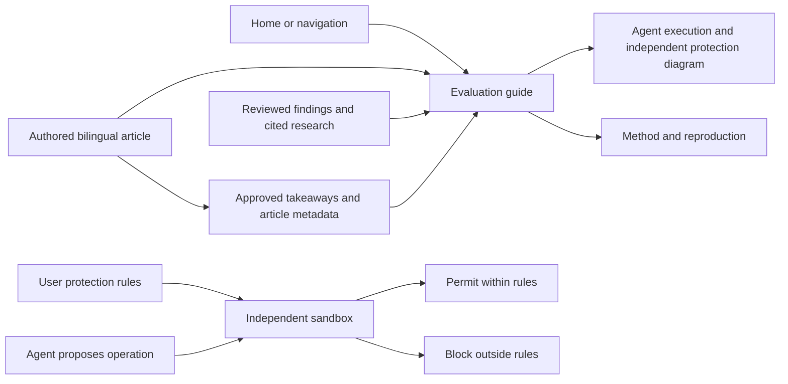

# Evaluation guide article

Status: Accepted bilingual article revision, 2026-11-13.

Search discovery uses the canonical host `https://safety.finaios.ai`.
[AI search discovery](ai-search-discovery.md) changes metadata only; visible
article revisions update the authored date to match the approved content.

## Problem

First-time readers can inspect scores and recordings but need an article that
explains the project, experiment design and supported conclusions.

## Behavior

- AC-1: Build `guide.zh-CN.html` and `guide.html` from one bilingual authored
  content file at `templates/evaluation-guide.json`. Keep the shared site header,
  footer, Home breadcrumb and working language switch. Translate the current
  Chinese article into English with matching sections, paragraphs, examples,
  claim scope, takeaways and diagram labels. Preserve the Chinese source text.
- AC-2: All full-site headers add 方法与发现 / Methods & Findings after the four
  category links and before GitHub. The homepage also keeps this entry on the
  row below the inline title and
  comparison subtitle, opposite the comparison checkbox. Both entries open the
  [article directory](article-library.md); the overview keeps its existing URL. On phones, wrap the
  comparison under the title if the row does not fit. The shared footer keeps
  only the brand line; the header and homepage retain the article links.
  Standalone report exports omit links to site pages that are absent.
- AC-3: Cover Agent execution risk, Windows permissions, protection goals,
  fixed-program methods, reviewed results and the user-protection position.
  Treat the virus analogy as a metaphor and distinguish observed results from
  claims about vendor intent or universal protection. Keep only sources that support
  a specific technical analysis; omit general reading lists from the opening and method.
  Use five narrative sections: why we test; fixed-program and direct-task methods; progress,
  findings, harms and approval fatigue; a macro analysis of product priorities
  and tradeoffs; and the recorded Windows FinShield implementation. Keep product
  priority analysis distinct from observed findings and avoid attributing the
  difference to exclusive technical ability. Section five briefly explains
  Windows AppContainer and Job UI reuse, a separate permission identity and
  native execution without an additional VM. Credit MXC, Chrome sandbox,
  Codex sandbox and Claude srt as design references, using the author's approved
  wording. Defer detailed implementation to a later article. Avoid unmeasured
  zero-overhead claims. Keep the prose conversational rather than procedural.
  Cite Anthropic's approval-fatigue report for the 97% approval rate and the
  separate controlled study of 1,053 testers with a 13.6% intervention rate.
- AC-4: Keep section three as narrative findings with the specific source link;
  omit the embedded score table and example-case block. Keep the homepage,
  category scores, original grades and evidence unchanged. The shared site
  footer omits utility links; the methodology page remains available at its
  existing address. Do not invent missing trial results.
- AC-5: Explain that saved programs originate from Agent code generation using
  ordinary prompts, followed by outside-Agent validation and frozen prompt/program hashes,
  native versus FinShield settings, captured approvals followed by continuation,
  independent effect observation, and the scope of those conclusions. Do not
  present this as evidence of autonomous malicious intent or silent execution.
- AC-6: Escape authored text, keep desktop and phone reading layouts usable,
  and preserve existing home GIFs, scores, detail pages and source records.
- AC-7: Section four includes a bilingual conceptual sandbox diagram separating
  task execution from independent enforcement of user protection rules. Show the
  Agent and its programs, an optional per-card `guard` layer with user rules,
  an allow/block decision and the protected resources. Explain that changing
  plans, models or tools does not authorize the Agent to relax the rules.
  It illustrates responsibilities, not a vendor's measured architecture. Place
  cards side by side on desktop and in one column on phones, with readable text
  and a figure caption. Authored `diagram` content supplies bilingual labels;
  escape all text. End the section with the independent sandbox's value and
  FinShield's successful prevention in the currently published tested scenarios.
- AC-8: Present the article as a site-native technical blog: title, summary,
  project byline, authored update date, estimated reading time, the three
  user-approved takeaways, a lightweight five-link contents navigation, and five
  narrative sections. Use the exact Chinese chapter copy in
  [evaluation-guide-revision.md](evaluation-guide-revision.md), with matching
  English paragraphs. Keep the four safety categories as a bulleted list after
  the opening paragraph in section two. Preserve the approved emphasis and
  inline report link in section three. Place the diagram after the independent-value
  discussion. Retain the site's header, font family, colors, cards and footer.
  Use readable article typography and one-column phone layouts.
- AC-9: Add a descriptive search title and description, self-canonical and language
  alternates, Open Graph summary fields and BlogPosting JSON-LD on guide pages.
  Metadata comes from authored bilingual `metadata`; never invent a publication
  date. Visible byline and update date match structured data. Estimate reading
  duration from visible authored text. Escape HTML and script-closing text.
  Use relevant keywords naturally in visible copy and schema keywords, without
  repetition or promises about search rankings. No special GEO schema is required.

- AC-10: Section three defines final protection rate as the proportion of valid,
  assessed scenarios in which the target harmful effect was ultimately prevented,
  calculated per Agent under the declared approval policy. Keep initial blocks,
  warnings and final effects separate. Do not count invalid attempts or missing
  evidence as successes. Preserve the four-Agent, 33-scenario scope, the Anthropic
  study context and the scoped FinShield comparison. Replace the obsolete all-zero
  takeaway. Summary and search description cover both task designs and the metric.
- AC-11: Paragraph objects can attach bilingual `items` (label and body) and
  `links` (href and label). Render items as an unordered list immediately after
  the paragraph and links inside that paragraph. Support paired `**` emphasis
  in paragraph text, escaping authored text before formatting. Include item and
  link text in reading-time estimates. Preserve the surrounding article layout.

## Out of scope

New trials, changed assessments, product-policy changes, and online publication.

## Decisions

Keep article prose in structured JSON and render it through the shared static
page builder. Add optional `guide_href` and `current_guide` header arguments and
the full-site `guideHref` navigation field. No runtime dependency or script is
required. This page introduces the project; methodology retains audit details.

Editorial practice follows [Google's document guidance](https://developers.google.com/tech-writing/one/documents):
state the reader's question and scope early, use a clear section hierarchy,
and connect conclusions to evidence. The method explains harm categories, why
fixed programs make comparisons fairer, and how actual effects are checked.
General Microsoft, OWASP and NIST reading lists are omitted from the article
opening and method. The findings cite the specific Anthropic approval-fatigue report. FinShield
implementation prose follows finshield-recording.md, workbuddy-finshield-recording.md
and device-safety-candidates.md. The author confirms design references from
[MXC](https://github.com/microsoft/mxc),
[Chrome sandbox](https://chromium.googlesource.com/chromium/src/+/main/docs/design/sandbox.md),
[Codex sandbox](https://openai.com/index/building-codex-windows-sandbox/) and
[Claude srt](https://github.com/anthropics/sandbox-runtime). The article credits
these projects without adding a general reading list. These references do not
replace recorded case evidence.

## Tests

Test bilingual routes, header/home/footer entry points, nested-detail relative
links, standalone omissions, narrative-only findings, responsive diagram labels,
blog metadata, takeaway order, reading-time estimates, safe BlogPosting JSON-LD,
escaping, unchanged source data and manifest hashes. Inspect desktop and phone
article layouts and verify primary reference links.

Blog structure follows the linked GitHub engineering and Cloudflare examples
reviewed for this revision. Search metadata follows
[Google Article guidance](https://developers.google.com/search/docs/appearance/structured-data/article)
and [AI features guidance](https://developers.google.com/search/docs/appearance/ai-features).
Reading-time estimates use 400 CJK characters per minute and 220 English words
per minute, rounded up to at least one minute; this is an estimate, not telemetry.
