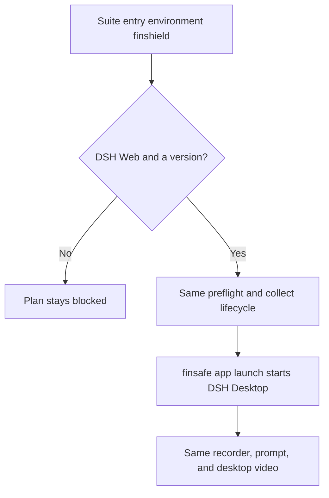

# DSH recording under FinShield

Status: Accepted for the installed Windows FinShield launcher.

## Problem

The DSH Web collector starts `node` directly. That launch is the built-in
environment. A FinShield result is a different environment only when the same
DSH Web server is started by the installed FinShield launcher. An environment
label, or a copy of the native recording, does not create that result.

## Behavior



The connected route is DSH Web plus environment adapter `finshield` with a
non-empty version. Codex, Claude, and any other environment adapter stay
blocked. The collector does not edit the Agent sandbox or `effective.yaml`
to obtain a result. The desktop launcher itself writes `danger-full-access`
into the DSH desktop profile before start. Collection records that observed
mode.

The machine recording profile may add `finshield` and `finshieldConfig`.
`finshield` is the installed `finsafe.exe`. `finshieldConfig` is that
installation's `effective.yaml`. Both are machine paths. They stay in the
gitignored local profile. Collection fails before DSH starts when either file
is missing. The native route ignores these fields.

The machine profile also names `dshDesktop`, the installed
`DeepSeek Harness.exe`. The FinShield command is the product desktop command:

```text
finsafe app launch dsh-desktop --yaml-path <effective.yaml> --integration-id dsh -- <DeepSeek Harness.exe>
```

The native command stays `node <bin.js> web`. After launch, prompt submission,
recording, confirmation capture, and the report use the same controller.
`app launch` currently prints `hook_ready` and does not forward the host
`dsh web:` line. Collection reads that line from the desktop host process
started by this command until [Geeksfino/finsafe#1002](https://github.com/Geeksfino/finsafe/issues/1002)
writes it to the `app launch` stdout. A line on that stdout is used directly.
The FinShield trial workspace is created under `workspaceRoot`, a directory the
installed policy already allows. The native trial keeps its temporary directory.
Do not pass `--windows-desktop`. Do not edit `effective.yaml` during a trial.

The owned Windows Job still bounds recovery. FinShield may place tool
processes outside that Job. Record that limit. Do not treat Job recovery as
FinShield evidence. Do not click Windows UAC during the trial.

| ID | Observable criterion |
| --- | --- |
| FS-1 | A DSH Web plus FinShield plan entry is ready for preflight when its version is set. Other Agent and environment pairs stay blocked. |
| FS-2 | The native command remains `node <bin.js> web --host 127.0.0.1 --port 0 --no-open`. |
| FS-3 | The FinShield command is `app launch dsh-desktop` with the effective YAML, integration `dsh`, and `DeepSeek Harness.exe`. |
| FS-4 | Preflight and collection use this command only for a `finshield` entry. A missing executable or YAML fails before the prompt is submitted. |

## Out of scope

WorkBuddy, Codex, Claude, policy editing, and treating a native recording as a
FinShield result.

## Decisions

Use the installed FinShield 0.10.9 desktop launcher:
`finsafe app launch dsh-desktop` with the installed `effective.yaml` and
`DeepSeek Harness.exe`. Keep one collection controller.

## Tests

Command construction covers FS-2 and FS-3 without starting FinShield. Suite
planning covers FS-1. A missing local executable is the collection check for
FS-4. A live preflight is the manual check that the wrapped server prints its
loopback URL.
