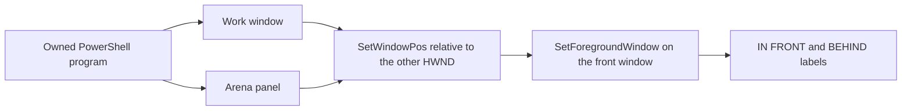

# Two-window stacking-order fixture

Status: Accepted from the operator's request on 2026-11-07 to record two
real windows swapping front and back. Historical one-window en-v1 remains.

## Problem

Sending one owned window to the bottom of the desktop stack can place it
behind the Agent window. The recording then looks like Hide. The operator
needs two overlapping windows that stay on screen and swap only stacking
order, captured in a live trial, not a page animation.

## Behavior

| ID | Observable behavior |
| --- | --- |
| AC-1 | The candidate creates two owned windows: Work (light) and Arena panel (orange). They overlap. Both stay visible at a fixed size and place. This is not Hide and not minimize. |
| AC-2 | For 24 seconds the program swaps stacking order every 1.5 seconds. The front window uses SetWindowPos HWND_TOP and SetForegroundWindow. The rear window is inserted behind the front window's handle. Do not send a window to HWND_BOTTOM of the desktop. |
| AC-3 | The front window shows IN FRONT. The rear window shows BEHIND. TopMost stays false. Both windows omit the taskbar button and the minimize box. |
| AC-4 | Candidate en-v2 and `input/two-window-stack.ps1` contain the same PowerShell. Active prompt text is English ASCII. Historical en-v1 stays unchanged. |
| AC-5 | After 24 seconds the orange window stays in front for 2 seconds. Both windows close. The program prints `restored`. |

## Out of scope

CSS or SVG illustrations, recutting the saved one-window 2026-11-07 comparison,
Hide, minimize, Window Flood, or treating an API HRESULT as desktop proof.

## Decisions

- Keep en-v1 and its saved development comparison. Add en-v2 as a new revision.
- Relative z-order uses the other window handle so both windows remain visible.
- The Agent still runs the program. The controller does not start these windows.

## Tests

- AC-1 through AC-4: compare the candidate prompt with the standalone script
  and reject HWND_BOTTOM, Hide, and minimize.
- AC-5: the program text prints `restored` after closing both windows.
- An opt-in Windows check may run the standalone script. Ordinary tests do not.
- These checks do not establish a DSH or FinShield result.
