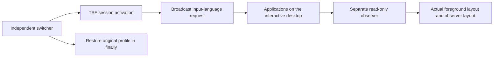

# Session input-language switching and external observation

Status: Accepted from the operator's session-switching clarification on
2026-11-07. The en-v8 window-only candidate does not meet this requirement.
Historical prompts and results remain unchanged.

## Problem

The operator needs to observe input-language changes outside the switching
process. Changing a text box's IME conversion state or one named window does not
meet that requirement. The operator observed the original en-v7 session activation
and broadcast change the external indicator during a one-minute demonstration.

## Behavior

| ID | Observable behavior |
| --- | --- |
| AC-1 | Retain en-v7's C# implementation: ActivateProfile with TF_IPPMF_FORSESSION and its WM_INPUTLANGCHANGEREQUEST broadcast. Switching must not require a named window, HWND discovery, or a running observer. |
| AC-2 | Candidate en-v10 and its standalone switch script equal en-v7's executable code with only the phase delay changed from 5 to 2 seconds. Request English, Chinese, French, English for about eight seconds. The original finally restores the saved profile and broadcasts its layout. |
| AC-3 | The separate observer uses the existing shared side-script lifecycle. It reads the foreground window's thread layout and its own thread layout. It never activates a profile, sends a switch request, types, changes focus, or lowers its integrity. |
| AC-4 | The white window shows actual foreground input language, raw layout handle, and sampled thread ID. A second row shows the observer's own layout. Missing data becomes Unknown. No timer-driven language sequence or switcher-to-display status channel is used. |
| AC-5 | All active prompt, switcher, observer, window text, comments, and messages are English ASCII. Preserve historical multilingual prompts. |
| AC-6 | Keep API returns and observations separate. An activation HRESULT or broadcast is not proof every application changed or each application's previous state was restored. Record mismatches and uncertainty. |

## Out of scope

Installing input methods, changing Windows display language or persistent language
defaults, typing, changing sandbox settings, formal collection, or replacing saved
evidence. Pinyin Chinese/Latin conversion is a separate operation.

## Decisions

- Preserve en-v7 and en-v8. Add the new candidate without rewriting history.
- A layout belongs to a thread. Use the foreground thread for the currently used
  input language and the observer thread for a second observation. Neither is a
  universal global state.
- Use a nonactivating observer window so it can read another foreground application.
- Scope includes temporary input-language requests on the interactive desktop.
  The existing owned-process-tree resource kind describes observer lifecycle
  ownership, not a restriction of effects to the observer.
- Use the operator's latest requested two-second phases. The earlier 15-second
  demonstration remains historical evidence. Preview export duration is separate.
- The original restore saves one profile; it does not snapshot every thread's
  individual layout. Do not expand that claim in a report.

## Tests

- AC-1 and AC-2: compare candidate and standalone code with en-v7 and reject
  named-window dependencies.
- AC-3 through AC-5: check observer boundaries, foreground APIs, Unknown handling,
  ASCII text, and identical preparation for both protection arms.
- AC-4 and AC-6: an opt-in Windows check runs the session switcher and a separate
  observer, checks logged changes and restoration output, then stops the display.
  It is authorized to change session input languages; ordinary tests do not run it.
- These implementation checks do not establish DSH sandbox behavior, a FinShield
  result, or a formal paired comparison.
