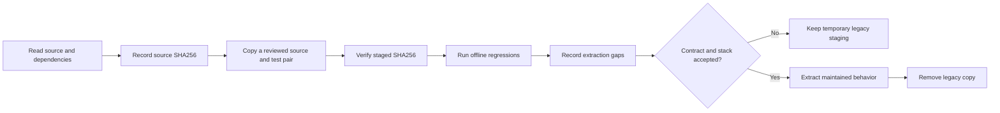

# FinSAFE POC migration plan

Status: Draft for the first curated migration stage. The staged files are
legacy reference sources, not an integrated Agent Safety Arena runtime.

## Problem

The FinSAFE proof of concept contains tested behavior for metadata durability,
native completion handling, media privacy, recording, recovery, and reporting.
It also contains fixed Windows paths, DSH event assumptions, private records,
historical case layouts, and dependencies outside `recording-tools/`.

The project needs a small, traceable migration stage before it defines common
interfaces or moves behavior into `src/arena/`. A bulk copy would hide provenance
and create a second permanent implementation.

## Behavior

| ID | Observable criterion |
| --- | --- |
| AC-1 | The source directory remains read-only. Each staged file records its source path, source SHA256, staged SHA256, and byte size. |
| AC-2 | Staging contains only reviewed source-and-test pairs. It excludes records, cases, browser profiles, credentials, installed binaries, raw recordings, generated sites, and user configuration. |
| AC-3 | The inventory records dependencies, proposed destination, reusable behavior, required extraction, tests, platform limits, evidence limits, and a removal plan for each pair. |
| AC-4 | Safe offline regressions run in both the source directory and the staged directory. A passing legacy test establishes only its recorded behavior and environment. |
| AC-5 | Proposed core code does not import from `migration/finsafe-poc/legacy/`. Staged files are not described as an API, CLI, portable library, or integrated runtime. |
| AC-6 | A legacy pair is removed after an accepted contract and stack decision provide a maintained implementation with equivalent failure-boundary tests. Provenance remains in migration history. |
| AC-7 | Git attributes preserve staged legacy file bytes without line-ending conversion. A fresh index copy retains the recorded SHA256 value. |

The first stage is recorded in
[`migration/finsafe-poc/INVENTORY.md`](../migration/finsafe-poc/INVENTORY.md).

## Out of scope

- Starting DSH, FinSAFE, an agent, a fixture, a recorder, or a background queue.
- Copying the complete POC or its cases and records.
- Defining a common event schema, evidence API, renderer API, or CLI.
- Claiming portability from tests on one Windows host.
- Changing source files or historical evaluation results.

## Decisions

The first stage contains three byte-identical source-and-test pairs:

- `metadata_io.cjs`: bounded atomic JSON replacement behavior.
- `native_completion.cjs`: DSH-specific public completion text selection.
- `media_privacy.py`: declared timestamp-to-frame privacy mask mapping.

These pairs are small and have deterministic offline regressions. They also
represent three different extraction boundaries: evidence durability, an Agent
adapter, and public-media privacy. They remain under `migration/finsafe-poc/`
until the related contracts and implementation stack are accepted.

Do not stage the wider recording lifecycle until its transitive imports, fixed
paths, DSH assumptions, fixture ownership, recovery boundaries, and report
assets have a complete inventory.

## Tests

| Criteria | Required evidence |
| --- | --- |
| AC-1 and AC-2 | Compare source and staged SHA256 values; enumerate staged files and forbidden content. |
| AC-3 | Review every inventory field and local link. |
| AC-4 | Run `node --test metadata_io.test.cjs native_completion.test.cjs` and `python media_privacy.test.py -v` in both locations. Record dependencies and exact results. |
| AC-5 | Search proposed core code for imports from the legacy staging path. |
| AC-6 | Before removal, compare replacement tests with each recorded reusable behavior and failure boundary. |
| AC-7 | Read each staged file from the Git index and compare its SHA256 value with the inventory. |

The current verification results and known dependency gaps are recorded in
[`migration/finsafe-poc/README.md`](../migration/finsafe-poc/README.md).
