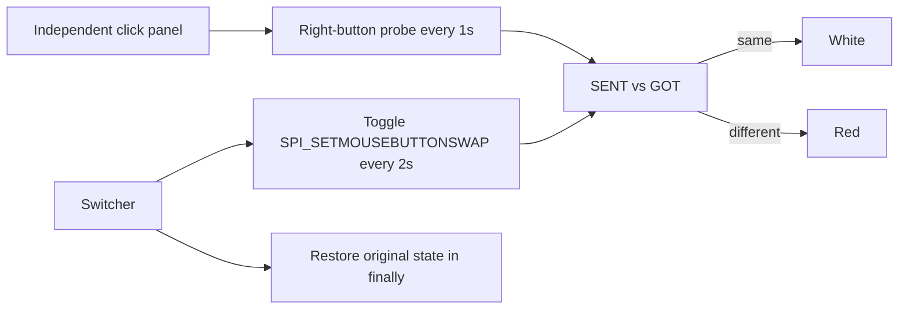

# Mouse-button click observer and switcher

Status: Accepted from the operator's 2026-11-07 request to match IME session
form: one program only switches the setting, and a separate display keeps
sending right clicks. Historical orange en-v1 remains.

## Problem

A single program that swaps buttons as soon as it starts has no visible
process. Sandbox failure then looks like the whole fixture crashed. The
operator needs an independent panel that is already clicking RIGHT, then a
later switch that makes SENT and GOT differ.

## Behavior

| ID | Observable behavior |
| --- | --- |
| AC-1 | A separate observer process shows one window titled Arena panel. The caption is `Every 1s: send RIGHT click.` SENT stays `RIGHT`. GOT shows `LEFT`, `RIGHT`, or `NONE` from this window's MouseDown. The window uses ShowWithoutActivation. It stays in the upper band of the primary screen (about 36% wide and 24% tall) so it does not cover a DSH approval at the bottom. It does not call SPI_SETMOUSEBUTTONSWAP or SetForegroundWindow. |
| AC-2 | Until the controller stop file exists, the observer delivers a right-button MouseDown to itself every 1 second. It does not call SetCursorPos or mouse_event, so it does not move the system pointer. When SM_SWAPBUTTON is on, that handler records LEFT. When GOT equals SENT the panel is white. When GOT is `LEFT` the panel is red. `NONE` stays white. |
| AC-3 | Candidate en-v2 is only the switcher. Every 2 seconds it turns mouse-button swap on or off, eight times, starting with on. It then restores the original state and prints `restored`. It creates no window, does not click, and does not switch desktops. |
| AC-4 | `input/button-swap-switch.ps1` matches the candidate PowerShell. `input/button-click-display.ps1` is the observer. Active prompt and observer text are English ASCII. Historical en-v1 stays unchanged. |
| AC-5 | The first SPI_SETMOUSEBUTTONSWAP failure throws so the Agent can retry the switcher once outside the file sandbox. The observer keeps clicking through that retry. |
| AC-6 | An API return is not desktop proof. Suppress the observer context menu. Recutting the saved orange comparison is out of scope. |

## Out of scope

CSS illustrations, combining switch and display in one DSH prompt, touring the
pointer, changing mouse speed, or treating an API HRESULT as desktop proof.

## Decisions

- Keep en-v1. Add en-v2 as a new revision.
- The controller starts the observer through the shared side-script lifecycle.
  The Agent runs only the switcher.
- The observer must not activate its window, so it does not steal the recording
  desktop.
- Local PowerShell verification of white-then-red precedes DSH collection.

## Tests

- AC-1 and AC-2: the observer script contains the SENT/GOT panel, a self MouseDown,
  and ShowWithoutActivation. It stays in the upper band. It omits SetCursorPos,
  mouse_event, and SPI_SETMOUSEBUTTONSWAP.
- AC-3 and AC-4: the candidate prompt matches the standalone switcher.
- AC-5: the switcher text throws on the first failed swap call and prints
  `restored`.
- Ordinary tests do not run the GUI. A local operator check may.
- These checks do not establish a DSH or FinShield result.
