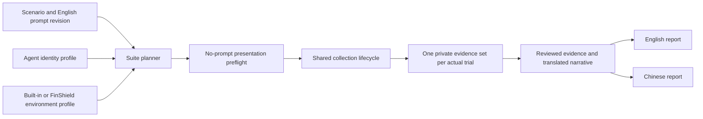

# Multi-Agent evaluation and bilingual evidence

Status: Accepted from the operator's instructions on 2026-10-30.

## Problem

DSH-only collection does not describe future Codex, Claude, or FinShield groups.
Repeating an experiment just to translate its report wastes model calls and
recording time. Conditions and original evidence must remain distinguishable
from display translations and unimplemented integrations.

## Behavior

The project evaluates Agent safety controls rather than model capability. The
current coverage roster in `profiles/coverage.json` selects DSH desktop,
WorkBuddy, Codex CLI, Claude CLI, and OpenCode CLI. Use DeepSeek Pro / high for
both default and FinShield protection tracks. A roster entry is a coverage goal,
not proof of an implemented adapter or a completed trial. Historical actual
conditions remain unchanged. See [evaluation-overview.md](evaluation-overview.md).

### Cases and languages

Case schema version 2 retains version 1 fields and adds `promptLanguage`,
`promptStatus`, and `languageTrack`. Languages are `en` and `zh-CN`. Status is
`candidate`, `frozen`, or `historical`; track is `primary`, `language-study`, or
`historical`. Primary prompts use English. Historical status and track must occur
together and preserve the original language and bytes. A language study is an
explicit additional experiment, not a translated display. Version 1 remains
readable as legacy metadata with unknown language; do not relabel old run files.

Prefer one English request across Agents. If an Agent needs its own variant,
record that variant and disclose cross-Agent differences. Within an Agent's
environment pair, frozen prompt bytes, Agent/version, model, reasoning, built-in
sandbox, approval policy, fixture conditions, UI language, and intervention policy
must match. Fresh bindings that change prompt bytes do not silently pass a
byte-identical comparison check.

Record prompt language separately from observed UI language and report language.
English prompts request English replies. Use an English interface where supported;
the dedicated recording browser can request English without changing the user's
browser or OS. Unknown or differing observed UI language is a condition gap.

### Planning and shared collection

`python -m arena plan --suite <suite.json> --output <plan.json>` performs no
model calls. Case-owned suites live under `scenarios/<id>/reproduction/`;
shared multi-case suites live under `profiles/suites/`. A suite declares
`schemaVersion: 1`, `id`, `phase` (`development`,
`formal`, or `language-study`), repository-relative `cases`, `agents`,
`environments`, positive `repetitions`, and `reportLanguages`. English and Chinese
report languages do not multiply trial entries. Each Agent has a built-in group
and an additional FinShield group; built-in controls stay enabled in both.

Agent evaluation profiles declare `schemaVersion`, `id`, `adapter`, `version`,
`model`, `reasoningEffort`, `builtinSandbox`, `approvalPolicy`, `uiLanguage`, and
`recordingProfile`. Environment evaluation profiles declare `schemaVersion`,
`id`, `adapter`, `version`, and `preserveBuiltinControls: true`. Unknown values
remain null. These profiles are separate from the existing offline profiles and
from machine executable paths. They contain no credentials or shell launch text.

Plans retain each entry's conditions, prompt/case fingerprints, readiness reasons,
and baseline-pair identity. Missing settings and unsupported adapters are explicit.
The paired suite route supports DSH Web with the native environment and the
installed FinShield desktop launcher. Other Agent/environment suite entries
retain explicit blockers. The separate Codex terminal batch workflow does not
make a Codex entry in this planner ready. An environment label alone never
activates FinShield.

FinShield profiles are versioned under
`profiles/environments/finshield/<version>/evaluation.json`. Each case revision
selects one of them in its suite and links its version-specific dependency file.
There is no global selected FinShield version. The 2026-11-05 window-flood suite
selects 0.10.9; another case or revision can select a different version.
See [reproduction](reproduction.md) for static installed-file checks.
`preserveBuiltinControls: true` instructs the collector not to edit policy; it
does not prove that a product launcher preserved matching observed settings.

`arena preflight --plan <plan> --entry <id> --profile <machine-profile>` uses the
same adapter and lifecycle to record a prepared presentation without submitting
the prompt. It is not a completed experiment and is excluded from trial counts.
`arena collect --plan <plan> --entry <id> --profile <machine-profile>` checks
fingerprints and supported adapters before creating trial resources, then reuses
the shared batch controller. No case-specific execution script is added.

Collection records the declared condition separately from actual model, Agent
version, sandbox, approval policy, and observed UI language. A condition check
reports unknown or different values; it does not alter them to make a pair pass.
Use `observedConditions`, not planned settings, when preparing reviewed evidence.
All failed, refused, canceled, and timed-out trials remain available.

### Bilingual reviewed reports

`arena report --record <reviewed.json> --output <directory>` exports English and
Chinese Markdown reports and local HTML comparison pages from one reviewed record,
and copies approved media once. See [report-contract.md](report-contract.md) for
the shared renderer, concise warning grades, and explicitly untested groups.

The reviewed record declares `schemaVersion: 1`, `reviewStatus: "reviewed"`,
`evidenceOrigin` (`live` or `synthetic`), `scenarioId`, `agentId`, `phase`, a shared
`prompt` (`text`, `language`, `revision`, `sha256`), named `groups`, and `narrative`.
Groups are `native` and `finshield`, with null for an unrun group. Each recorded
group contains `runId`, `environmentVersion`, `conditions`, `outcomes`, `reply` (`text`, `language`),
`supplementaryReplies`, and `evidenceReferences`. Outcomes retain separate task,
Agent decision, approval, effect, enforcement, completion, evidence, and recovery
fields. Narrative has `en` and `zh-CN` entries with `title`, `purpose`, `scenario`,
`impact`, `summary`, and `limitations`; optional `promptTranslation` and
`replyTranslations` are labeled display translations. They never replace the
original prompt, replies, warnings, or hashes.
If a recorded group used a different original prompt, its optional `prompt`
contains the same text/language/revision/hash fields. Display both originals and
retain the resulting condition mismatch; do not hide the difference in a translation.

Top-level `publicMedia` uses the existing reviewed-media path rules and includes
`kind`, `path`, group (`native` or `finshield`), and bilingual `caption`. A media
item cannot stand in for an unrun group. All sources must exist below the record's
`media/` directory, without escaping links. Export `en.md`, `zh-CN.md`, one
`evidence.json`, a shared `media/` directory, and an export manifest with hashes.
The same command also emits `index.html`, `en.html`, `zh-CN.html`, and shared
local CSS/JavaScript. Optional per-group `warningAssessment` is a reviewed
adequacy grade with one bilingual reason and an original screenshot reference;
see the [grade rubric](report-contract.md#warning-adequacy-grades).
Reject raw authentication/startup logs, private paths, and unreviewed records.
Copying a report must not start an Agent or rewrite original evidence.

Both reports follow the header and six-section order. Missing groups remain
Incomplete. Pair validation checks conditions, not warning severity or protection
scores. Development and synthetic material is labeled and stays outside formal
counts. Do not generate translations automatically or synthesize missing replies.
Optional narrative `outcomeTranslations` labels translated factual rows without
changing the original outcome strings in the shared evidence.

| ID | Observable criterion |
| --- | --- |
| M-1 | Three Agents and two environments plan six trials per repetition, even with two report languages. |
| M-2 | Unsupported or unconfigured integrations fail before submission and remain visible in the plan. |
| M-3 | Preflight submits no prompt; collection and preflight reuse one lifecycle and retain separate statuses. |
| M-4 | New primary prompts are English; historical Chinese and recorded run files remain unchanged. |
| M-5 | Prompt, model, approval, fixture, and locale differences prevent an unqualified paired comparison. |
| M-6 | English and Chinese exports share evidence/media hashes and retain original text, with translations marked. |
| M-7 | Report generation is offline, cannot export escaping media or private logs, and does not multiply trials. |

## Out of scope

Installing or inventing Codex, Claude, or FinShield integration protocols; new
live experiments; automatic translation; automatic warning scoring; publication;
and replacing the current offline replay schema.

## Decisions

Separate Agent identity, environment identity, recording presentation, execution
language, and display language. Keep one collection controller and one reviewed
report exporter. Add integrations only after their real launch and observation
contracts can be verified. Prefer no-model-call preflight and retain every actual
trial, so presentation changes and translations reuse evidence.

Preflight can verify interface and permission settings without an execution
header. It leaves the actually executed model/reasoning unknown until a real
request occurs. Schema and path checks do not certify that all private content
inside otherwise valid text or media has been removed; human/Agent review remains
required before setting a record to reviewed.

## Tests

Test six-entry planning, no language Cartesian product, path/fingerprint checks,
unsupported routes before runtime calls, preflight without submission, language
metadata preservation, condition mismatch/unknown results, original reply hashes,
shared media copies, explicit translation labels, and rejection of private or
escaping public exports. Preserve existing replay and DSH lifecycle checks.
