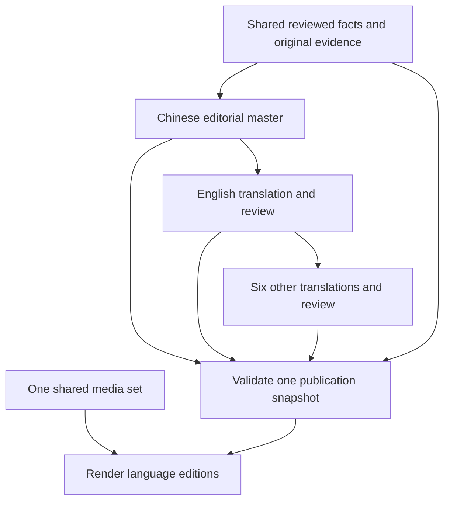
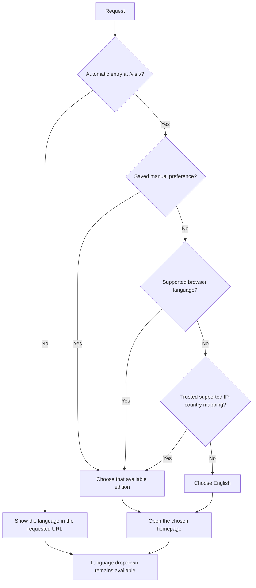
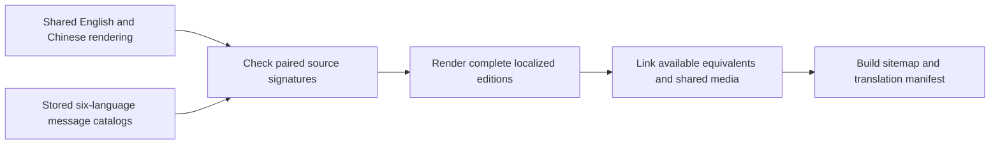

# Eight-language website

Status: Design accepted, 2026-11-25. The owner approved the design and the
interactive language-dropdown preview, then requested implementation.
The owner requested the six additional translations on 2026-11-26 and a pull
request containing the changes. This extends the dropdown stage to static
Spanish, Arabic, French, Brazilian Portuguese, Japanese, and Korean editions.
IP-based hosting integration remains outside the current implementation.
The owner specified LLM translation on 2026-11-26 and explicitly requested one
subagent per target language. Earlier machine-translation drafts are excluded
from the committed publication catalogs. The existing approved Chinese/English
editions remain the source snapshot; this change does not rewrite their claims.

Implementation and local eight-language validation are complete as of 2026-11-26.
Live publication has a capacity gate for the configured GitHub Pages mirror;
see the final verification and deployment-capacity sections below.

## Problem

The current static website renders English and Simplified Chinese. Page text,
navigation, metadata, and report validation contain two-language assumptions.
Readers need eight language editions that retain the same evaluation facts and
original evidence. The publication process also needs a clear source of truth
and a way to prevent translations from becoming stale.

## Behavior

### Content and translation

- AC-1: Support the following language order throughout the site. Portuguese
  uses Brazilian Portuguese as a proposed initial editorial convention.

  | Language | Native label | Language tag | Home route | Direction |
  | --- | --- | --- | --- | --- |
  | English | English | `en` | `/` | LTR |
  | Simplified Chinese | 简体中文 | `zh-CN` | `/zh-cn/` | LTR |
  | Spanish | Español | `es` | `/es/` | LTR |
  | Arabic | العربية | `ar` | `/ar/` | RTL |
  | French | Français | `fr` | `/fr/` | LTR |
  | Portuguese | Português (Brasil) | `pt-BR` | `/pt-br/` | LTR |
  | Japanese | 日本語 | `ja` | `/ja/` | LTR |
  | Korean | 한국어 | `ko` | `/ko/` | LTR |

- AC-2: Treat Chinese as the editorial master for new or revised public copy.
  Review its English translation against Chinese before translating that English
  into Spanish, Arabic, French, Portuguese, Japanese, and Korean. Translate
  navigation, titles, descriptions, tables, captions, alternative text, and
  evidence explanations as well as article bodies. Do not translate only menus.
  Do not call a language reviewed merely because generation completed.
- AC-3: Keep recorded facts independent from editorial language. Scores,
  denominators, trial conditions, IDs, dates, hashes, warning grades, and evidence
  associations come from shared reviewed records. Chinese prose cannot override
  a record. Flag a discrepancy for correction of the source, not translation.
  Original prompts, replies, warnings, commands, and code retain their exact
  wording and language. Label display translations and keep the original
  accessible. Verify quoted translations against the original evidence, even
  when explanatory copy follows the Chinese-to-English translation chain.
- AC-4: Track each text unit by a stable identity and its source revision.
  English records the Chinese revision it translates. The other six translations
  record the reviewed English revision they translate. Track draft, reviewed,
  and stale states. An upstream change invalidates dependent review status.
  A Chinese change invalidates English and its descendants immediately; an
  English change invalidates the six descendants. Do not claim a translation
  has the source's update date unless it actually represents that revision.
- AC-5: Publish a consistent release snapshot. Existing pages may stay on the
  previous complete snapshot while a replacement is reviewed. Do not publish
  a new score beside an old translated conclusion. New incomplete translations
  remain unpublished. The dropdown and language alternates advertise only
  available editions of that exact page. The full eight-language rollout covers
  all public page families; a partial release must state its actual coverage.
  Historical bilingual copy is reconciled with evidence before entering the
  new workflow, not blindly regenerated or overwritten.



### Shared media

- AC-6: Store and publish one copy of each referenced GIF, video, screenshot,
  and poster asset at its existing public asset location. All language editions
  resolve to the same asset URL for the same evidence item. Do not copy assets
  into language directories or re-encode them for localization. Preserve hashes,
  original UI text, edit provenance, and reviewed durations. This means one set
  across languages, not one clip for different trials or protection tracks.
  Translate surrounding captions and explanations as text. Media bytes do not
  carry an authored translation update. Language-specific burned-in captions,
  dubbing, and localized GIFs are outside this design.

### Language dropdown

- AC-7: Replace the two-language link in the shared site header with a compact
  dropdown showing the current language, for example `简体中文` plus a caret.
  Use native labels in the fixed AC-1 order, show the current selection, and
  avoid country flags. Include a way to return the entry preference to automatic.
  A manual selection opens the same logical page in the chosen language and
  saves that preference for 180 days on this site. Preserve the current Agent,
  case, pagination, and comparable section where that destination exists.
  If an edition is absent, show it as unavailable; do not silently send the reader
  to a homepage or display English under another language's URL.
- AC-8: Make the dropdown usable by keyboard, touch, and screen readers. Keep
  language links available without JavaScript, for example with a native
  disclosure and real links enhanced by a small first-party script. Navigation
  still works if preference storage is unavailable. A failed preference write
  must not prevent opening the selected page. Match existing site styling and
  keep the control usable at a 360-pixel viewport and 200 percent zoom.

### Automatic selection and IP

- AC-9: Separate language recommendation from the language of an explicit page
  URL. Existing English URLs, including `/`, retain their current content
  identity; existing Chinese URLs retain theirs. A request for any language page
  returns that language regardless of IP, saved preference, or browser language.
  Internal links stay in the current edition. The dropdown is an explicit action
  that navigates to a different URL. Shareable links therefore stay predictable.
- AC-10: Propose a separate `/visit/` automatic entry for campaigns or links
  whose reader language is unknown. It chooses an available homepage in this
  order: saved manual preference, supported browser language, conservative
  IP-country mapping, then English. Match regional browser variants to supported
  editions; all Portuguese variants currently use the one Brazilian edition.
  Map Chinese preferences to Simplified Chinese without calling it Traditional
  Chinese. Missing or explicitly excluded browser languages do not force an
  unsupported match. Automatic detection never writes a manual preference.
- AC-11: Use IP country only when no supported browser preference is available.
  Initial conservative mappings are mainland China to Chinese, Japan to
  Japanese, South Korea to Korean, Brazil and Portugal to Portuguese, France
  to French, Spain and clearly Spanish-dominant countries to Spanish, and
  clearly Arabic-dominant countries to Arabic. Keep the exact country table
  reviewed with the implementation; leave multilingual or uncertain countries
  unmapped. Unknown, anonymized, failed, or unavailable country results fall
  back to English. Do not infer language from continent or timezone.
- AC-12: On a host with trusted country metadata, `/visit/` may issue a temporary
  redirect to the chosen homepage. Personalized entry responses use
  `Cache-Control: private, no-store`; language pages and media remain shared
  static assets cached by URL. Do not trust client-supplied country headers.
  Do not call an external IP service from every page or retain raw IP addresses
  for this feature. On a plain static host, `/visit/` renders real language links
  and can use a first-party browser-language enhancement; absence of IP support
  is an explicit capability limit, not a build failure or a claimed IP detection.
  With no scripts and no edge service, the reader can still choose a language.
- AC-13: On the existing `/` homepage, offer a dismissible language suggestion
  when saved preference or browser language points to an available different
  edition. Do not automatically leave `/`. Show it once per browser session
  unless the reader resets the preference. Recommendation failure must not
  delay or hide the page. No bot-specific page body or bot-only exception is
  required because all language pages are stable for every requester.



### Search and layout

- AC-14: Render complete static HTML for each available language page. Extend
  the existing route map instead of moving English to `/en/`. Other editions
  use the same content slug after their language prefix. Preserve the existing
  legacy redirects and evidence paths. Give each edition its own canonical URL
  and reciprocal `hreflang` links to available equivalents. Use the equivalent
  English page as the `x-default` fallback; do not send article fallback links
  to a homepage. Include only eligible canonical language pages in the sitemap.
  Keep current synthetic, untested, withheld, and alias exclusions. `/visit/`
  is not a sitemap content page; its rendered fallback is `noindex,follow`.
  Localized metadata, structured data, and visible content must agree.
- AC-15: Arabic pages use `lang="ar"` and `dir="rtl"`. Use logical spacing
  and alignment for text layout. Isolate Latin product names, URLs, code, and
  hashes with their appropriate direction. Keep media pixels, chronological
  plots, and the native/FinShield comparison track order unchanged. Make
  captions and navigation readable without mirroring recorded evidence.
  Use font fallbacks suitable for Arabic, Japanese, and Korean. Allow longer
  French, Spanish, and Portuguese text to wrap without clipping controls.
- AC-16: Generalize the shared language registry, translation lookup, route map,
  metadata, header, and renderers. Do not maintain eight separate templates.
  Keep translation text separate from immutable trial evidence and media.
  Store translation provenance in a publication sidecar rather than modifying
  historical evidence merely to add language metadata. Normal site builds use
  stored reviewed text and need no translation service or model credentials.
  Only the small first-party preference script needs new script access where
  the overview currently uses `script-src 'none'`; do not permit inline scripts,
  third-party scripts, or broad CSP bypasses for language selection.

### Six-language publication stage, 2026-11-26

- AC-17: Reuse the approved English edition as the translation pivot for the
  current Chinese/English publication snapshot. Keep a shared, stored message
  catalog for each of the six target languages under `templates/translations/`.
  Record the English and Chinese content signatures for every source page,
  source language, generation method, validation scope, and original update date.
  Normalize platform newline expansion for source signatures and message lookup;
  retain original evidence bytes in their shared files and literal display fields.
  Normal builds must read these files without a translation service or credentials.
  LLM-authored translation must not be described as native-speaker review.
- AC-18: Generate localized HTML in the shared site assembly stage from the
  same rendered structure and reviewed inputs. Translate visible prose, menus,
  captions, alternative text, accessible labels, search descriptions, and
  structured-data descriptions. Keep code, original prompts/replies/logs,
  hashes, identifiers, product names, numeric scores and evidence links unchanged.
  New editions display a translated notice linking to the Chinese and English
  equivalents and explaining which sources control an ambiguous translation.
- AC-19: Publish a target page only when the stored Chinese/English source
  signatures match and every required message has a validated translation or
  an explicit unchanged technical literal. A missing or stale page stays absent
  from language links and the sitemap. Report publication coverage and reasons
  in a generated translation manifest. A changed source invalidates its target
  editions without changing the original trial or silently reusing English.
- AC-20: Keep all editions linked to the same media files and original evidence.
  Rebase relative asset/navigation links for each language prefix. Set the
  correct HTML language, direction, self-canonical, Open Graph locale and
  reciprocal alternate links, including the equivalent English `x-default`.
  Preserve index exclusions and category-expansion canonical identities. Arabic
  text uses RTL layout, while comparison track order, tables of track results,
  code, media and recorded screenshots retain their original orientation.



## Out of scope

New trial executions, new warning assessments, changed scores, translated
recordings, an automatic translation API, new hosting accounts, live CDN changes,
and production deployment. The design does not claim increased rankings,
unique audience counts, or a fixed AI citation improvement.

## Decisions

The owner has accepted eight target languages, shared media, Chinese editorial
authority, the English translation pivot, and the dropdown design. Use Brazilian
Portuguese, browser language before IP, stable content URLs, a separate automatic
entry, and 180-day manual preferences. The current production host's trusted country metadata
and edge execution capabilities remain unverified. Choose an adapter only after
checking the actual host; Cloudflare is an example, not an assumed deployment.

This design extends [public URLs](public-urls.md),
[search discovery](ai-search-discovery.md), and
[report presentation](report-contract.md). Chinese editorial
authority does not require changing the existing English root URL.

[Google's multilingual guidance](https://developers.google.com/search/docs/specialty/international/managing-multi-regional-sites)
recommends separate language URLs and advises against inferred-language
redirects between content pages. The automatic-entry boundary is this proposal's
design choice, not a claim that Google requires `/visit/`.
[Google's language alternate guidance](https://developers.google.com/search/docs/specialty/international/localized-versions)
defines reciprocal alternates and the `x-default` fallback.
[Cloudflare's header reference](https://developers.cloudflare.com/fundamentals/reference/http-headers/)
documents country metadata and unknown/anonymized values for that provider.
[W3C's writing-direction guidance](https://www.w3.org/International/questions/qa-scripts)
explains script direction and its layout implications.

## Tests

The table covers the complete design. Record implemented checks and remaining
stages separately; a dropdown does not establish eight translated editions.

| Criteria | Required evidence |
| --- | --- |
| AC-1/2/4/5 | Source revision propagation, incomplete and stale translation rejection, historical reconciliation, and release snapshot consistency. |
| AC-3/6/16 | Identical fact values, original strings, media URLs, media hashes, trial counts, and evidence hashes across all editions; build without translation credentials. |
| AC-7/8 | Dropdown on all page families; matching destination and section; unavailable edition; storage failure; preference expiry/reset; keyboard, mobile, zoom, and no-script behavior. |
| AC-9/10/11/13 | Explicit URL beats saved/browser/IP hints; browser beats contradictory IP; missing/unsupported preferences; multilingual and unknown countries; suggestion dismissal; no redirect loops. |
| AC-12 | Host adapter capability, trusted metadata, no public caching of personalized redirects, static fallback, and absence of browser IP-service calls. |
| AC-14 | Eight route families, old redirects, reciprocal alternates, self-canonicals, equivalent English fallback, index exclusions, 404 behavior, and resolved local links. |
| AC-15/16 | Desktop/mobile screenshots in all languages, mixed Arabic/Latin content, fixed evidence/track order, font coverage, long labels, and narrow CSP. |

Implementation must use [arena-tdd](../skills/arena-tdd/SKILL.md). Language-picker
work requires application checks, but no new trial executions.

### Language-picker implementation evidence, 2026-11-25

RED: `.\.venv\Scripts\python.exe -m unittest discover -s tests -p test_language_picker.py`
ran four tests and reported 21 failing assertions: the dropdown, preference
assets, and automatic-entry page were absent. A later focused regression with
`-k first_party` confirmed that the legacy result chooser referenced a missing
local `language.css`. The chooser now receives the site's navigation context
and uses the root preference assets.

GREEN: The same four language-picker tests pass. The public URL suite also passes
all six tests after the chooser fix. Relevant regression suites passed:
`test_detail_navigation.py` (4), `test_case_navigation.py` (7),
`test_article_library.py` (1), `test_search_discovery.py` (13),
`test_bilingual_report.py` (8), and `test_evaluation_guide.py` (4). Each suite used
`.\.venv\Scripts\python.exe -m unittest discover -s tests -p <suite>`.
`node --check src/arena/reporting/language.js` passed.

VERIFY: A local Chrome run passed 25 behavior checks against the final complete
site artifact. Checks covered explicit URLs, homepage suggestions and dismissal,
same-article and same-section switching, keyboard navigation and Escape,
preference persistence/reset/expiry, malformed and disabled storage, supported
and unsupported browser languages, no-script navigation, and 320/360-pixel
layouts. A 680-CSS-pixel viewport at device scale 2 checked the layout equivalent
to 200 percent zoom on a 1360-pixel display. Desktop and mobile screenshots were
inspected. The local test server reported a canceled media transfer during
navigation; it did not cause a failed browser check or a page runtime error.

The final build command was
`.\.venv\Scripts\python.exe -m arena build-site --results results --output artifacts/site/language-picker-20261125-reviewed`.
It included 159 comparisons and zero trial executions. Independent artifact
checks covered 1,097 HTML files, 53,084 local references including declared legacy
redirects, 5,253 file hashes, and 159 source-record hashes without errors. Across
217 equivalent language-page pairs, GIF and video references resolve to the
same files; result-page original screenshots also match. Existing language-specific
editorial illustrations remain unchanged. The automatic entry stays outside the
sitemap. Seven changed documents had 126 valid local links/anchors, and the
12-skill instruction tree and new-file whitespace checks passed. `git diff --check`
passed; Git emitted only its existing LF-to-CRLF conversion notices.

NOT RUN: Production deployment, trusted IP-country integration, and translation
production/review for the other six languages. The translation revision workflow,
eight complete route families, Arabic full-page layout, and expanded search
alternates remain later stages. An unavailable menu option is not a translated
edition. Browser and artifact inspection helpers and screenshots are local-only
files under ignored `.tools/language-picker/`.

### Source and AI-readable export verification, 2026-11-26

GREEN: `test_localization.py` passes four tests. These cover six stored editions,
source-signature newline normalization, literal facts and original evidence,
stale Chinese source rejection, and incomplete-message rejection.
`test_machine_readable.py` passes three tests. They cover tables, original fenced
text, media, escaped HTML examples, index exclusions, and alias-relative links
with separate canonical citation metadata. The public URL suite passes six tests.

VERIFY: The current base build includes 159 comparisons and zero trial executions.
Its 245 Chinese/English page pairs match the approved translation snapshot after
excluding the new machine-readable discovery tags. All 4,388 required English
messages have source bindings. The artifact has 1,097 HTML pages, 490 new Markdown
page exports, 54,064 resolved local references, 5,745 checked file hashes, and
159 unchanged source-record hashes. All checks pass. Its 428 sitemap entries
are identical to the previous bilingual publication snapshot. These are base
build results, not evidence that the six target translations are complete.

Seven changed documents have 126 valid local file links. The 12-skill instruction
index, JavaScript syntax, and Git whitespace checks pass. Translation authoring
checkpoints and local QA scripts remain outside the publication catalogs.

### First language handoffs, 2026-11-26

Dedicated Arabic and Spanish LLM agents completed all 3,568 source patterns per
language. Their final checks cover exact placeholder multiplicities, complete
unit coverage, ordinary English residue, repeated phrases, and sentence joins.
Original UI labels, commands, fields, and evidence quotations remain identifiable.
The publication compiler expanded 4,388 messages per language, retained literal
paths, flags, URLs and hashes, and bound each catalog to 245 source-page pairs.
This is LLM authoring and review, not native-speaker human copyediting.

RED: Once the stored catalogs were present, the language-picker and public-URL
suites each reported four failures. Their older expectations treated every
non-English/Chinese edition as absent, including unchanged article pages that
now have valid translations. These assertions now check the exact published
editions, real equivalent destinations, and reciprocal alternate URLs.

GREEN: The updated language-picker suite passes four tests, the public-URL suite
passes six, and the localization suite passes four. The shared UI and translation
notices include wording recommendations from the language owners. The complete
eight-language artifact and browser checks remain pending until all six target
catalogs are ready.

VERIFY: The four-language preview publishes 245 Spanish and 245 Arabic pages
without unavailable or stale entries. It has 1,587 HTML pages, 980 Markdown
exports, 87,150 resolved local references, 7,215 checked file hashes and
159 unchanged source-record hashes. Its sitemap has 856 entries. Checks compare
490 target-language page pairs, preserve English/Chinese evidence-media identity,
and report zero trial executions and no errors. Local Chrome passed 96 checks
across the four published languages, including every page family, 320-pixel
dropdowns, browser-language entry and fixed Arabic evidence/track orientation.
Arabic and Spanish desktop/mobile screenshots were inspected. This preview
does not claim that its four unavailable languages are published.

The dedicated French owner subsequently completed and reviewed all 3,568 patterns.
Its 4,388 expanded messages and 245 paired source signatures pass the same
compiler checks. Literal checks also reject newly introduced Unicode replacement
characters and retain original Chinese input strings quoted in English evidence
descriptions. Portuguese, Japanese and Korean remain in progress at this stage.

### Complete eight-language verification, 2026-11-26

All six dedicated LLM owners completed 3,568 patterns each. The six publication
catalogs each contain 4,388 expanded messages and signatures for 245 approved
Chinese/English source pairs. Final language QA covers full sentence joins,
durations, negation, source quotations, exact placeholders, original technical
literals and repeated phrases. Native-speaker human copyediting was not performed.

RED/GREEN: Actual homepage export checks exposed joined score labels, table
captions without a boundary, block-card links rendered as invalid inline links,
unsafe fallback titles, disabled controls presented as content, and a cropped
preview description beside a full GIF. Added regressions reproduced these
failures. All six machine-readable tests pass after correction. The HTML page
content and original evidence remain the source of the export.

An Arabic browser regression also exposed reversed homepage GIF labels with the
comparison checkbox enabled. At a 1,360-pixel viewport, the built-in label was at
x=1,112 and FinShield at x=991. Shared RTL styling now fixes the evidence-label
grid to LTR while retaining RTL text. The same check reports x=991 and x=1,112.
The complete browser run also checks all four GIF label pairs at mobile width.

GREEN: The combined language-picker, localization, machine-readable and public
URL suites pass 20 tests. Search discovery passes 13 tests and the article library
passes one, for 34 relevant tests. Commands use the project Python environment:

```text
python -m unittest tests.test_language_picker tests.test_localization tests.test_machine_readable tests.test_public_urls
python -m unittest discover -s tests -p test_search_discovery.py
python -m unittest discover -s tests -p test_article_library.py
```

VERIFY: The complete build command was
`python -m arena build-site --results results --output artifacts/site/multilingual-final-20261126`.
It includes 159 comparisons and zero trial executions. Strict artifact checks
pass for 2,567 HTML pages, 1,960 Markdown exports, 164,102 local references,
1,470 foreign-language page comparisons, 10,155 file hashes and 159 source-record
hashes. Each of the six target languages publishes all 245 pages, with no stale,
missing or incomplete entries. The sitemap has 1,712 eligible URLs. Original
preformatted text, literal conditions, source records and shared evidence/media
references remain intact.

Local Chrome passed 211 checks across all eight languages. Checks cover every
page family, equivalent links and section anchors, regional browser-language
matching, explicit URL authority, stored preference expiry/reset, disabled
storage, no-script fallback, keyboard controls, 320/360-pixel layouts, zoom
reflow, full-page width, Arabic comparison order and JavaScript errors.
Desktop/mobile screenshots for all languages and the Arabic GIF comparison
were inspected. A derived Markdown refresh with the current exporter changed
zero files, confirming that the final artifact already matched the formatter.

### Deployment capacity

The final artifact is 1,149,746,250 bytes (1,096.5 MiB, about 1.15 GB).
Original screenshots, videos and GIFs dominate the footprint; all languages
share their existing asset files. No evidence is removed or re-encoded to fit
a hosting quota.

[GitHub Pages documents a 1 GB published-site limit](https://docs.github.com/en/pages/getting-started-with-github-pages/github-pages-limits).
The current repository workflow publishes the complete `build-site` output.
The GitHub Pages API reports the configured mirror domain as
`agent-safety-arena.finogeeks.club`; the canonical primary domain remains
`safety.finaios.ai`. Capacity for the primary host has not been verified.

The complete local feature checks pass, but publication through the configured
Pages path requires a capacity decision before merge/deployment. Select a
verified hosting path that accepts the complete artifact, or separately review
a storage/sharing change that preserves original evidence bytes and working
public asset URLs. Hosting migration and production publication are outside this
change. Local validation does not establish live hosting acceptance or indexing.
