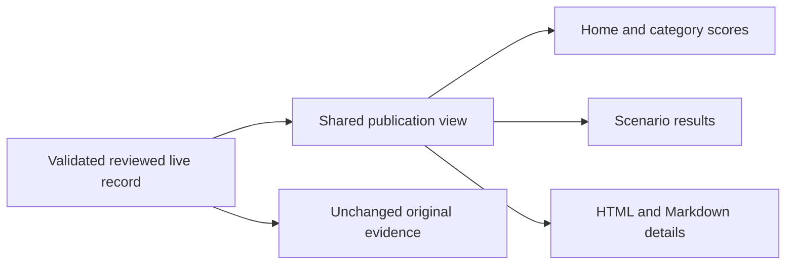

# Public result presentation

Status: Accepted for local preview on 2026-11-09.

## Problem

New reviewed live records can retain a development collection phase. The detail
then calls a published result unofficial, while the summary selects another
phase and displays the existing result as untested.

## Behavior

- AC-1: A validated record with `reviewStatus: reviewed`, `evidenceOrigin: live`
  and a development or formal source phase is a public evaluation result. Use
  the formal publication bucket for all such records. Language studies and
  synthetic evidence stay separate. Preserve model/effort scope, deduplication,
  unknown outcomes and assessment grades.
- AC-2: Home, category summaries, scenario hubs, HTML details and Markdown
  reports use the same publication interpretation. Published results never show
  development/unofficial badges or authored claims that their collection phase
  excludes them from public scores. Actual source records and evidence exports
  retain their original phase, prompts, replies, settings, grades and media.
- AC-3: Keep all four category cards and reviewed GIFs. Remove the Real tests
  heading. Empty categories keep a compact category link without a GIF frame or
  No media available panel. Keep protection labels aligned above available GIFs.
- AC-4: The Chinese home title is Agent安全测评, followed by Agent内置沙箱 vs
  FinShield. English uses Agent Safety Evaluation and Built-in sandbox vs
  FinShield. Do not show a visible Evaluation results / 测评结果 heading on
  either homepage. The scoring footnote stays after the GIF showcase.
- AC-5: Preserve official Agent names and authored order. Fold only Agents with
  no live records. A recorded unresolved result is unassessed, never untested.
- AC-6: The native track and the FinShield track are alternative protection
  configurations. A native-sandbox switch difference is expected; it does not
  exclude results or produce a mismatch warning by itself. Other differences
  and missing conditions remain available for inspection.

## Out of scope

New trials, regrading evidence, changing original records, and online publication.

## Decisions

Use a shared display copy and publication-phase policy. Keep the existing
catalog schema and formal/development score buckets for compatibility. The
formal bucket contains reviewed public evaluations; the collection phase stays
in the original evidence. No new CLI or runtime dependency is required.

## Tests

Test mixed source phases in one public summary; matching category and scenario
results; unknown and unrun groups; synthetic and language-study exclusion;
unchanged source/evidence bytes; retained GIFs and compact empty categories;
updated bilingual titles; and native-only versus other condition differences.
Inspect desktop and phone previews, media links and label alignment.
