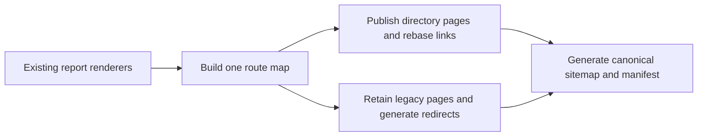

# Public website URLs

Status: Accepted, 2026-11-21. English uses the default path; Chinese uses `/zh-cn/`.

The [multilingual design](multilingual-website.md), accepted on 2026-11-25,
adds `/visit/` as a non-indexed automatic-language entry. It has real fallback
language links and no canonical identity. Existing content routes remain stable.
The six additional editions use `/es/`, `/ar/`, `/fr/`, `/pt-br/`, `/ja/`, and
`/ko/`. Each published edition retains the same content slug and shared evidence
paths. `index.md` beside a public directory page is an AI-readable export, not a
new trial or a replacement for its canonical HTML identity.

## Problem

Search Console identifies `/index.html` and `/guide.html` as redirected pages.
The host serves `/` and `/guide`, but generated canonical links and the sitemap
still name the HTML files. Language suffixes and report paths also differ by
page type. Readers need one predictable public URL scheme.

## Behavior

| Page | English | Chinese |
| --- | --- | --- |
| Home | `/` | `/zh-cn/` |
| Category | `/privacy/` | `/zh-cn/privacy/` |
| Category page 2 | `/privacy/page/2/` | `/zh-cn/privacy/page/2/` |
| Article list | `/articles/` | `/zh-cn/articles/` |
| Article | `/articles/agent-sandbox/` | `/zh-cn/articles/agent-sandbox/` |
| Evaluation overview | `/articles/guide/` | `/zh-cn/articles/guide/` |
| Methodology | `/methodology/` | `/zh-cn/methodology/` |
| Agent | `/agents/dsh/` | `/zh-cn/agents/dsh/` |
| Case | `/cases/camera-capture/` | `/zh-cn/cases/camera-capture/` |
| Result | `/results/<case>/<agent>/<comparison>/` | `/zh-cn/results/<case>/<agent>/<comparison>/` |

- AC-1: Build each public page as a directory with `index.html`. Use lowercase
  route segments and a trailing slash. Preserve case, Agent and comparison IDs.
  Agent category expansion pages use `/agents/<agent>/<category>/` and retain
  the main Agent page as their canonical URL.
- AC-2: Canonical, hreflang, Open Graph, JSON-LD and sitemap URLs agree. Exclude
  synthetic reports, their case pages, aliases, 404 and verification files from
  the sitemap. Do not invent modification dates.
- AC-3: New pages link directly to the new routes, including language switches,
  pagination, fragments and links authored with the site's absolute URL. Rebase
  local styles, scripts, media and evidence links without changing asset bytes.
  Relative navigation works when the artifact is hosted below a URL prefix.
- AC-4: Preserve old HTML URLs and their existing extensionless forms. Emit
  explicit permanent redirects in `_redirects` for hosts that support it, without
  loops or redirect chains. Retain HTML fallback pages with an immediate refresh
  and the new canonical for plain static hosts. Keep fallback body content for
  clients that do not follow refresh. Do not redirect assets or unknown paths.
- AC-5: Keep standalone report exports, source evidence, media, prompts and the
  Google verification file unchanged. Refresh generated export manifest hashes
  when the site's copy of report HTML changes. Record the route map in
  `site-routes.json` so the migration can be audited.
- AC-6: Fail the build on an ambiguous destination or a missing page target.
  Preserve existing atomic build behavior. Update both README versions.

## Out of scope

Trial executions, evidence changes, article rewrites, domain changes, deployment,
Search Console account changes and promises about rankings or indexing speed.

## Decisions

Apply routing at the site assembly boundary so standalone reports keep their
portable layout. Keep reviewed evidence at its existing storage path; public
page routes do not rename source records. The route map separates those roles.
Both language versions use the same content slug. English has no `/en/` prefix.

GitHub Pages does not apply `_redirects`; its fallback pages use HTML refresh.
The production bot must publish the complete artifact. After merge and release,
check real redirect responses and sitemap processing separately from local tests.
Keep old URL support for at least one year, and preferably indefinitely.

See [Google's URL migration guidance](https://developers.google.com/search/docs/crawling-indexing/site-move-with-url-changes)
and [Cloudflare redirect handling](https://developers.cloudflare.com/pages/configuration/redirects/).

## Tests

- `tests/test_public_urls.py`: route families, localized identity, redirects,
  synthetic exclusions, relative links under a prefix, assets, hashes and collisions.
- Search discovery and existing site/report tests: canonical metadata, page
  content, navigation, evidence bytes and standalone compatibility.
- Local static HTTP/browser checks: homepage, language switch, article and result.
- Deployment checks remain pending until this PR is merged and published.
