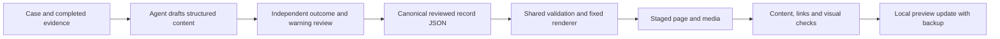

# Generate reports with a fixed layout

Status: Accepted on 2026-11-06 for reusable report preparation.

## Problem

All cases need the same page structure. Editing a generated page or putting a
case conclusion in Python makes later reports inconsistent.

## Behavior

| Fixed in shared code and procedure | Generated from each case's evidence |
| --- | --- |
| Six sections and their order | Case explanation and possible user impact |
| Agent built-in sandbox / FinShield protection columns | Actual versions, settings, dates, and one-line observations |
| One side-by-side overview GIF; two videos below | Reviewed media paths and timing provenance |
| Interception first, then timely warning if unblocked | Reviewed target-effect result and warning assessment |
| Short information icons and expandable evidence | Applicable default-setting and Full Access notes |
| Original-text and evidence controls | Original prompt, replies, tool records, reproduction steps, and the section 06 audit index |



Use [arena-write-report](../skills/arena-write-report/SKILL.md) and the
[English authoring prompt](../templates/report-authoring-prompt.md). Follow the
content and assessment rules in [report-contract.md](report-contract.md).
Define the target effect and observation boundary before new collection. If a
criterion changes after collection, identify the revision and retain the earlier
review. Use the maintainer-confirmed publication phase. This classification must
not change observations, original run snapshots, or assessment grades.

The Agent writes content into the reviewed `record.json`. It must preserve the
configured layout, column roles, section order, and shared CSS. It may not
redesign HTML, change a grade to satisfy a desired conclusion, or replace source
tool results. Case-specific statements belong in the record, not in shared code.
Changing reviewed content is a separate step from rendering a page.

The shared [evaluation overview](evaluation-overview.md) reads those reviewed
records and the public coverage roster. Its purpose is to evaluate Agent safety,
with DeepSeek Pro / high held fixed, across default and FinShield protection.
It does not rank model capability. Do not write separate overview conclusions
or count repeated exports as additional trials.
The homepage is a compact English-first four-category summary. Assign each
new case a short bilingual title and explicit safety category in
`scenarios/catalog.json`. Category pages paginate 20 scenarios, then link to
scenario hubs and the unchanged detail pages. The homepage starts with one
reviewed GIF slot per safety category (one large, two small), with direct links
to videos, evidence and reviewed reproduction instructions. Leave missing media
explicitly empty. Do not put full case lists on the homepage or label Agents by
region. Show total, category and
Agent protection scores from the shared scoring rules, with pass/fail counts.
List each Agent once as a homepage card: overall and four category
groups, each with Default/FinShield scores. Keep those results visible together.
Every total/category/scenario score belongs to one Agent. Never merge different
Agents into a shared score, average, or pass/fail denominator.
Unassessed items do not enter the denominator. Keep development and formal data
separate, and hide collection progress and planning targets.

The shared renderer keeps legacy-record compatibility. New comparison reports
use the fixed `comparison-v1` dense presentation and the overview slot described
in the contract. Missing media or evidence stays explicitly missing. Layout
changes require an operator request and shared template updates.

Run the reusable wrapper from a clone after bootstrap:

```powershell
.\scripts\export-report.ps1 -Record '<reviewed-record.json>' -Output 'artifacts/site/<report-id>'
.\scripts\export-report.ps1 -Record '<reviewed-record.json>' -Output 'artifacts/site/<report-id>' -Update
```

Replace the example placeholders. The first command creates a report. The second
regenerates an existing local report from reviewed inputs. The wrapper invokes
`arena report` in a fresh staging directory; it never edits the input record.
An update requires an existing comparison export with matching scenario and
Agent identities. It backs up the previous export under ignored `.tools/`, then
copies staged output. Existing unreferenced public media is retained. Invalid
input fails before the old page changes. Output must be below `artifacts/site/`.
No trial, product launch, or external publication occurs.

| ID | Acceptance criterion |
| --- | --- |
| AC-1 | A second synthetic case and Agent use the same layout with their own text, criterion, versions, and assessments. |
| AC-2 | Generated output retains original evidence and contains no wording copied from an unrelated case. |
| AC-3 | Export/update leaves the source record bytes unchanged, retains a backup, and rejects invalid or mismatched inputs before replacing files. |
| AC-4 | The authoring skill, prompt, indexes, and exporter identify one shared flow and do not require an ignored case-specific script. |
| AC-5 | With `presentation.audit`, section 06 shows identity, collapsed reproduction, and an audit index, and does not repeat section 02 findings, originals from sections 04 and 05, or a second shared-evidence link. Records without `audit` keep the previous summary block. |

## Out of scope

Live collection, automatic generation of evidence, automatic success judgments,
product installation, and production publication.

## Decisions

Keep layout in the shared renderer, generation instructions in the canonical
skill/prompt, and reviewed case content in result JSON. Use a parameterized
PowerShell wrapper for repeated local preview updates.

## Tests

Run offline regression coverage for another case/Agent, missing evidence,
assessment rules, original text, and media. Verify the wrapper on a current
reviewed record, compare input hashes, and check backup preservation. Check
documentation links, skill indexes, and whitespace. No live trial is required.
