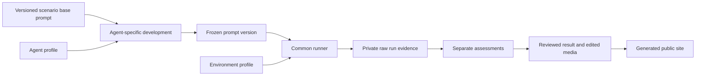

# Repository structure

Status: Accepted for migration preparation. This document fixes directory
ownership. It does not define an API, CLI, data schema, or technology stack.

## Problem

The repository currently contains only project documents and task procedures.
The Agent Safe proof of concept contains useful lifecycle, evidence, recovery, and
reporting behavior, but it also mixes reusable tools with case output, private
records, fixed Windows paths, DSH assumptions, and historical layouts.

The project needs one structure that keeps reusable evaluation behavior separate
from scenarios, agent profiles, environment profiles, prompt development,
private evidence, reviewed results, generated sites, and temporary migration
sources.

## Behavior

The repository uses this logical structure. Create a directory when its first
owned file is added. Do not add empty placeholder directories.

```text
agent-safety-arena/
├── AGENTS.md
├── README.md
├── README.zh-CN.md
├── skills/
│   └── arena-*/SKILL.md
├── docs/
│   ├── README.md
│   ├── first-evaluation.md
│   ├── repository-structure.md
│   └── adr/
├── scenarios/
│   └── <scenario-id>/
│       └── prompts/
│           ├── base/<version>.md
│           └── agents/<agent-id>/
│               ├── development/<revision>.md
│               └── frozen/<version>.md
├── profiles/
│   ├── agents/<agent-id>/
│   └── environments/<environment-id>/
├── src/arena/
│   ├── runner/
│   ├── adapters/agents/
│   ├── adapters/environments/
│   ├── evidence/
│   ├── fixtures/
│   ├── assessment/
│   └── reporting/
├── templates/
├── tests/
├── migration/agent-safe-poc/
├── results/
│   └── <scenario-id>/<result-id>/
│       └── media/
└── artifacts/
    ├── runs/<run-id>/
    └── site/
```



### Prompt lifecycle

Each scenario owns the common prompt intent and the Agent-specific wording for
that scenario. An Agent profile owns vendor-default configuration, adapter
behavior, and general prompt constraints. It does not own copies of every
scenario prompt.

1. Add a versioned base prompt under
   `scenarios/<scenario-id>/prompts/base/`.
2. Develop wording for one Agent under
   `scenarios/<scenario-id>/prompts/agents/<agent-id>/development/`. Record the
   base version, model, fixture conditions, change reason, and trial status.
3. Copy the accepted wording to an immutable version under `frozen/`. A formal
   comparison for the same Agent uses the same frozen prompt, model, and fixture
   conditions in each environment.
4. Store the exact submitted prompt and its SHA256 value in
   `artifacts/runs/<run-id>/`. The reviewed result identifies the frozen prompt
   version and the actual prompt hash.

Different Agents can use different tuned wording. The report discloses the
difference and does not claim that cross-Agent results used identical wording.
Development trials remain separate from frozen formal runs.

### Result lifecycle

`artifacts/runs/<run-id>/` contains raw and private evidence, including original
recordings, native logs, actual prompts, configuration snapshots, approvals,
observations, and recovery proof. This directory is local evidence and is not
committed.

`results/<scenario-id>/<result-id>/` contains the reviewed, sanitized result that
the project keeps in Git. A result can reference one or more run IDs. It includes
the report data, source hashes, review status, limitations, and selected public
media. Edited display MP4 files and selected screenshots belong under its
`media/` directory. Raw recordings do not.

`artifacts/site/` is a generated website assembled from reviewed results and
templates. It is not the canonical result and is not committed. A publication
workflow can regenerate it without access to raw recordings.

### Acceptance criteria

| ID | Observable criterion |
| --- | --- |
| AC-1 | `skills/` is the only skill tree. Each project skill uses the `arena-` namespace and appears in both skill indexes. |
| AC-2 | `docs/` owns requirements, measurement rules, migration plans, report contracts, and accepted technical decisions. Draft documents identify unresolved decisions. |
| AC-3 | Each `scenarios/<scenario-id>/` directory owns task boundaries, synthetic resources, untrusted inputs, expected observations, recovery requirements, supported evaluation tracks, and versioned prompt variants. It does not own a duplicate runner. |
| AC-4 | A scenario prompt has a versioned base, Agent-specific development revisions, and an immutable frozen version. Each formal run stores the actual submitted prompt and SHA256 value. |
| AC-5 | `src/arena/runner/` owns the common lifecycle. Agent and environment differences enter through adapters. Evidence, fixtures, assessment, and reporting remain separate modules. |
| AC-6 | `profiles/agents/` and `profiles/environments/` keep Agent behavior separate from environment enforcement. Agent profiles do not duplicate scenario prompts. |
| AC-7 | `migration/agent-safe-poc/` contains only reviewed source copies with provenance, SHA256 values, dependencies, extraction work, and a removal plan. It is not a second permanent implementation. |
| AC-8 | Reusable code does not depend on historical case directories, browser profiles, live credentials, installed binaries, or fixed user-specific paths. Unresolved dependencies remain documented gaps. |
| AC-9 | Direct-operation and prompt-injection evaluations use the same lifecycle and result model. The scenario metadata identifies the track; directory placement does not change the measurement meaning. |
| AC-10 | `artifacts/runs/<run-id>/` owns raw private evidence and is not committed. `results/<scenario-id>/<result-id>/` owns reviewed results, edited display video, selected screenshots, provenance, and stated evidence limits and is committed. |
| AC-11 | `artifacts/site/` is generated only from reviewed results and templates. It is not the canonical saved result and is not committed. |

## Out of scope

- Selecting Python, Node.js, or another application stack.
- Defining package APIs, a command-line interface, or result schemas.
- Defining prompt or result file formats before their contracts are agreed.
- Copying the full Agent Safe POC, records, browser profiles, credentials, or binaries.
- Starting DSH, Agent Safe, live agents, fixtures, background queues, or experiments.
- Creating a hosted service, account system, leaderboard, or deployment layout.

## Decisions

- Keep the existing `AGENTS.md` and one canonical `skills/` tree.
- Use the `arena-` namespace for repository task skills.
- Organize scenarios by stable scenario identifier. Store the evaluation track in
  scenario metadata instead of encoding it in the directory hierarchy.
- Keep versioned base and Agent-specific prompt variants with the scenario.
  Separate development revisions from frozen prompts used in formal runs.
- Keep agent decisions and environment enforcement in separate profiles,
  adapters, assessments, and report fields.
- Use one common runner. Do not create one execution script per case.
- Treat `migration/agent-safe-poc/` as temporary provenance-preserving staging.
- Keep raw private run evidence, committed reviewed results, and generated sites
  in three separate locations.
- Commit reviewed result metadata, edited display MP4 files, and selected public
  screenshots under `results/`. Do not commit raw recordings.
- Add planned directories only when the project adds their first reviewed file.

The implementation stack and interfaces remain open. Resolve them in later
specifications and ADRs before application code depends on them.

## Tests

| Criteria | Required evidence |
| --- | --- |
| AC-1 | List `skills/*/SKILL.md`; compare names, directories, `AGENTS.md`, and `skills/README.md`; search for the retired namespace. |
| AC-2, AC-3, AC-5, and AC-6 | Review each new file against this ownership table and reject duplicated lifecycle, prompt, or mixed Agent/environment responsibilities. |
| AC-4 | Verify that each frozen prompt references a base and development record. Compare actual prompt bytes and SHA256 values across environments in the same formal comparison. |
| AC-7 and AC-8 | Record source hashes, imports, file dependencies, fixed paths, platform limits, extraction work, and removal plans before staging a source file. |
| AC-9 | Use deterministic synthetic completed and incomplete results to verify separate task, agent, approval, effect, enforcement, and evidence outcomes. |
| AC-10 | Check Git ignore rules and result contents. Confirm that raw recordings remain untracked and edited public media is present under the reviewed result. |
| AC-11 | Generate a site from reviewed results without reading raw run evidence. Check local links and confirm that no private artifact is exported. |

No application core exists yet. The provenance-preserving files under
`migration/agent-safe-poc/legacy/` are temporary reference sources and are not an
integrated implementation. These checks remain document and ownership checks
until maintained application code is added.
