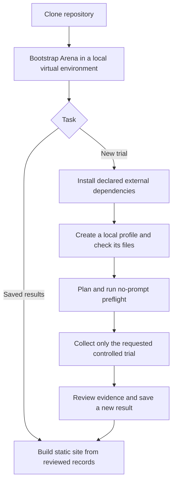

# Reproduction and static publishing

Status: Accepted on 2026-11-06 for repository organization. Result page design
will be reviewed separately with the first DSH desktop case.

## Problem

A new contributor must be able to clone this repository, ask an Agent to follow
the documented setup, build saved reports offline, and prepare a controlled
trial. Machine paths, installed products, and chat history must not be hidden
requirements. Rebuilding a report and repeating a live trial are separate tasks.

## Behavior

### Setup and dependency ownership

Arena uses Python 3.12 or later. `pyproject.toml` supports an editable installation
from a clone. `scripts/bootstrap.ps1` creates `.venv`, installs Arena, and copies
the DSH desktop profile template only when the local destination does not exist.
The script accepts an explicit Python executable. It never installs FinShield,
starts an Agent, changes product policies, or reads credentials.

`dependencies/runtime.json` records common tool capabilities and acquisition
instructions. It does not select a global FinShield version. Version-specific
files under `dependencies/finshield/<version>/` record installer provenance and
installed runtime hashes. Each case's reproduction suite selects its environment
profile version, and its reproduction notes identify the matching dependency
file. Different cases and different revisions of one case may select different
versions. Reuse dependency files by reference, without copying binary bundles
into each case. FinShield remains an external product. Its executable
is named `finsafe.exe`; its display name is FinShield. Downloaded installers may
be kept in ignored `.tools/`. Product source code is not copied into this repo.
Unknown installer URLs and checksums remain null and are identified as gaps;
tested versions alone do not establish a verified installation source.

`arena doctor [--profile <file>] [--environment native|finshield] [--lock <file>]` checks Python,
repository inputs, and, when requested, the DSH profile's declared file paths,
workspace directory, and capture rectangle. It does not execute product binaries,
switch desktops, query a model, or certify service health or product versions.
For a FinShield profile, `--lock` is required and names the dependency file
selected for that case revision. Compare all declared runtime file hashes with
the installed directory. Never fall back to the newest or a global version.
The 0.10.9 dependency file records this host's inspected baseline; it is not a
vendor-attested installer checksum. It returns JSON with individual checks and
`trialReady: false`. Exit 0 means the
requested static checks passed; exit 2 means a check failed. Live presentation,
authentication, actual settings, the running service image, and recovery still
require preflight and trial evidence. Installer checks are operator setup steps.

### Cases, Agents, and results

Use the directory ownership in [repository-structure.md](repository-structure.md).
Cases own prompts, resources, allowed actions, and observation requirements.
Agent adapters and environment adapters share one collection lifecycle.
Save reviewed comparisons as
`results/<scenario-id>/<agent-id>/<comparison-id>/record.json`.
Keep existing record schemas, run IDs, exact prompts, replies, and media bytes.
Historical synthetic replay `result.json` files use the same directory grouping
but remain a separate schema and do not become live comparisons.

Keep result JSON in Git: HTML alone cannot preserve structured conditions for
rebuilding or filtering. Attach only reviewed display media and provenance.
Full recordings, full tool-event streams, temporary workspaces, and extraction
materials stay outside Git under `artifacts/runs/` or their recorded workspace.
This organization does not delete existing evidence. A public result must state
when original evidence is no longer available; hashes do not replace evidence.

Reproduction means executing the same declared procedure and recording actual
conditions and outcomes. It does not promise identical model replies. A changed
built-in sandbox, approval policy, launcher, or unknown condition remains visible;
such a pair does not isolate FinShield's incremental effect.

### Static build and deployment

`arena build-site --results <results-root> --output <new-directory>` discovers
reviewed comparison `record.json` files in the case/Agent/comparison hierarchy.
It validates identities against directories and validates every record and media
source before creating output. It reuses the current six-section report renderer
without changing its layout, language rules, or private-value checks.
An invalid record fails the build; it is never silently omitted.

The builder writes a small linked catalog, per-comparison reports, and
`site-manifest.json` with source/output hashes and `trialExecutions: 0`.
Historical replay `result.json` files are listed as excluded in that manifest.
All site links are relative. No raw evidence or local profile is required.
An existing destination, or an output directory overlapping the results source,
is rejected. A failed export does not replace an earlier site.

Serve or deploy only the generated directory using a static HTTP host. This
change supplies a build artifact, not hosting credentials or a production deploy.
The [evaluation overview](evaluation-overview.md) defines the compact global home,
three safety categories, 20-scenario static pagination, scenario hubs, and evidence
navigation. English is the default; Chinese is available. The build reads
`profiles/coverage.json` (`--coverage`) and `scenarios/catalog.json` (`--catalog`).
The homepage shows protection scores and pass/fail counts, not collection
progress. Planning targets do not enter score denominators. Untested entries
say "Not tested"; unresolved observations stay unassessed.

| ID | Observable criterion |
| --- | --- |
| AC-1 | A clone installs into `.venv`; installation includes the Agent helper files. Bootstrap preserves an existing local profile. |
| AC-2 | Each case revision selects a FinShield version. A version-specific dependency file distinguishes installed runtime hashes from unknown installer provenance. Missing locks or mismatched installed files fail static checks without starting products or changing policies. |
| AC-3 | Saved results use case/Agent/comparison grouping without changing evidence bytes. Documentation links use the new layout. |
| AC-4 | A static build succeeds without raw runs or credentials and exposes every discovered valid comparison. Invalid inputs and existing outputs fail explicitly. |
| AC-5 | Site links resolve under a URL subdirectory. Source hashes, output hashes, excluded replay files, and zero trial executions are recorded. |
| AC-6 | English and Chinese setup instructions describe the same supported paths and remaining external setup requirements. |

## Out of scope

- New trials, prompt changes, product policy changes, or a changed launch command.
- Installing product services, automatic UAC actions, or distributing installers
  without an established source and redistribution arrangement.
- Redesigning result pages, changing reviewed evidence, or grading warnings.
- A backend, production publication, or a promise of deterministic model output.

## Decisions

- Keep `scenarios/`, `profiles/`, and `src/arena/` as the existing canonical trees.
- Add Agent grouping to saved results. Keep raw run paths stable.
- Use an editable Python package and a small PowerShell setup wrapper.
- Keep dependency downloads and machine settings out of Git.
- Build static reports from result JSON through the existing exporter.

## Tests

Use `unittest` for CLI file checks, offline builds, nested identities, invalid
records/media, output preservation, relative links, and hash manifests. Run the
existing recording, planning, and reporting tests before and after the change.
Verify bootstrap twice with a controlled profile to check preservation. Check
package installation and bundled helper files in `.venv`. Check documentation
links, skill indexes, and Git whitespace. Do not run live preflight or collection
for this repository organization task.
