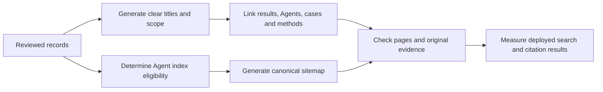

# Search result clarity

Status: Accepted, 2026-11-22. The owner requested implementation of the SEO and
AI search improvements discussed in this session.

## Problem

Different Agents' result pages can share the same search title. A result can be
quoted without its execution conditions. Pages for Agents without live evidence
are included in the sitemap. The website does not clearly explain the maintainer's
relationship to FinShield or provide short routes from results to methodology.

## Behavior

- AC-1: Full-site result titles identify the Agent, short case title and recorded
  test date when available. HTML titles, Open Graph and JSON-LD names agree.
  Do not change the short visible heading, reviewed titles, original evidence,
  scores, source hashes or standalone report identities. Never infer a test date
  from a build date or directory name.
- AC-2: Full-site results have one brief bilingual scope note. Link to the
  methodology, recorded execution settings and evidence. State that findings
  apply to recorded conditions and approval decisions, not every configuration.
  Link to the Agent's score page when the Agent is in the coverage roster. Keep
  all six report sections and the existing media layout.
- AC-3: Case search titles identify Windows Agent safety tests. Case and Agent
  pages link to methodology and state the scope of their displayed outcomes.
  Keep tested and untested entries distinct. Keep all existing result links.
- AC-4: All pages and category aliases for an Agent without published live
  records have `noindex,follow` and stay out of the sitemap. Keep these pages
  accessible and linked. A live record restores index eligibility, including
  unassessed or model-mismatched records. Synthetic evidence alone does not.
- AC-5: Methodology states that the FinAI OS team maintains this project and
  develops FinShield. Explain the available evidence and feedback route without
  claiming external institutional independence or an external review that has
  not occurred. Link the shared page footer to methodology. State that scores
  describe assessed scenarios, not a guarantee for every configuration.
- AC-6: Document account checks, a fixed bilingual query set and separate crawl,
  search, citation, accuracy and human-visit metrics. Mark account data as unknown
  until observed. Do not add inactive analytics, verification tokens, training
  policy changes, automated query runs or ranking guarantees.
- AC-7: At 360, 390 and 430 CSS pixels, case and Agent scenario rows show two
  clearly labeled protection columns with each outcome and warning kept together.
  Category totals align with their protection headers. Long content wraps without
  clipping or document-wide horizontal scrolling. Detail sections stack, section
  navigation wraps, and controls remain reachable. Wide score tables may scroll
  inside their own region. Preserve the desktop layout and original media.

## Out of scope

New trials, edited assessments, new articles, media replacement, a new framework,
account configuration, changes to deployment configuration and paid promotion.
Production deployment and webmaster measurements require the actual account and
published artifact. Local validation does not establish production indexing.

## Decisions

This follow-up supersedes the earlier deferral of visible changes in
[ai-search-discovery.md](ai-search-discovery.md) for the additions listed above.
The six-section layout in [report-contract.md](report-contract.md) remains in use.
Keep the [public URL contract](public-urls.md). No URL migration is needed.
Use the shared renderer and existing live-record eligibility; add no case-specific
findings to renderer code. Do not use score denominators as a proxy for evidence.

## Tests

- `tests/test_search_discovery.py`: Agent-specific and escaped result identities,
  optional recorded date, unchanged standalone output/evidence, scope links,
  relationship disclosure, noindex on empty Agent aliases and restored index
  eligibility after live evidence, including unknown/out-of-scope assessments.
- Existing overview, report and URL tests: sections, comparison controls, scores,
  localization, navigation, original evidence, media and manifests stay valid.
- Build the complete saved-results site; check local links, canonical identities,
  sitemap membership and input hashes. No trial executions are required.
- Inspect English and Chinese result, case, Agent and methodology pages at
  desktop and mobile widths. Record account-dependent checks separately in
  [seo-geo-operations.md](seo-geo-operations.md).
- Use a real browser to verify AC-7 at 360, 390, 430, 768 and 1366 pixels,
  including expanded evidence and Agent categories. Record viewport width,
  document width, content clipping, comparison labels and screenshots.

## Verification on 2026-11-22

- RED: The Agent-title and untested-page tests failed before implementation:
  the title omitted the Agent, and the robots value was absent.
- GREEN: 26 targeted tests passed with `PYTHONPATH=tests`: search discovery,
  detail navigation, case navigation, and the two canonical-URL product-gate
  regressions. An earlier broader run passed 66 tests; its two stale URL
  assertions also failed against unchanged renderer code. Those assertions now
  check the accepted canonical routes in both languages. The corrected runner
  also resolves the earlier module-import errors.
- Browser RED: At 390 pixels, baseline pages split statuses and warnings,
  omitted scenario protection labels, misaligned category totals, and required
  horizontal scrolling for section navigation.
- Browser GREEN: Headless Edge passed 90 combinations: nine page types, two
  languages and widths of 360, 390, 430, 768 and 1366 pixels. Checked full-page
  width, content clipping, labels, totals, expanded evidence and the homepage
  comparison toggle. Reviewed mobile and desktop screenshots. The final build
  includes updated CSS revision URLs to refresh cached mobile styles.
- Complete saved-results build: 159 comparisons, zero trial executions, 1,092
  HTML files, 426 sitemap URLs and 38,565 resolved local links. All 5,231 manifest
  entries matched their files; all 162 source record hashes stayed unchanged;
  1,251 copied media files matched their source hashes.
- Documentation: 112 local targets, heading anchors, the 12-skill instruction
  tree and `git diff --check` passed. Official source links were checked during
  the research for this change.
- Local checks do not establish production deployment, indexing, citations or
  human-visit performance. Account-dependent observations belong in the
  [operations guide](seo-geo-operations.md).
