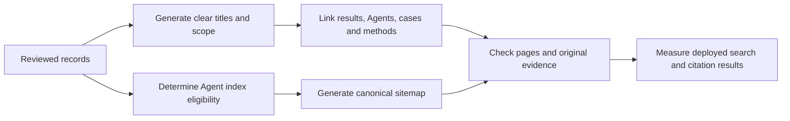

# Search result clarity

Status: Accepted, 2026-11-22. The owner requested implementation of the SEO and
AI search improvements discussed in this session.

## Problem

Different Agents' result pages can share the same search title. A result can be
quoted without its execution conditions. Pages for Agents without live evidence
are included in the sitemap. The website does not clearly explain the maintainer's
relationship to FinShield or provide short routes from results to methodology.

## Behavior

- AC-1: Full-site result titles identify the Agent, short case title and recorded
  test date when available. HTML titles, Open Graph and JSON-LD names agree.
  Do not change the short visible heading, reviewed titles, original evidence,
  scores, source hashes or standalone report identities. Never infer a test date
  from a build date or directory name.
- AC-2: Full-site results have one brief bilingual scope note. Link to the
  methodology, recorded execution settings and evidence. State that findings
  apply to recorded conditions and approval decisions, not every configuration.
  Link to the Agent's score page when the Agent is in the coverage roster. Keep
  all six report sections and the existing media layout.
- AC-3: Case search titles identify Windows Agent safety tests. Case and Agent
  pages link to methodology and state the scope of their displayed outcomes.
  Keep tested and untested entries distinct. Keep all existing result links.
- AC-4: All pages and category aliases for an Agent without published live
  records have `noindex,follow` and stay out of the sitemap. Keep these pages
  accessible and linked. A live record restores index eligibility, including
  unassessed or model-mismatched records. Synthetic evidence alone does not.
- AC-5: Methodology states that the FinAI OS team maintains this project and
  develops FinShield. Explain the available evidence and feedback route without
  claiming external institutional independence or an external review that has
  not occurred. Link the shared page footer to methodology. State that scores
  describe assessed scenarios, not a guarantee for every configuration.
- AC-6: Document account checks, a fixed bilingual query set and separate crawl,
  search, citation, accuracy and human-visit metrics. Mark account data as unknown
  until observed. Do not add inactive analytics, verification tokens, training
  policy changes, automated query runs or ranking guarantees.
- AC-7: At 360, 390 and 430 CSS pixels, case and Agent scenario rows show two
  clearly labeled protection columns with each outcome and warning kept together.
  Category totals align with their protection headers. Long content wraps without
  clipping or document-wide horizontal scrolling. Detail sections stack, section
  navigation wraps, and controls remain reachable. Wide score tables may scroll
  inside their own region. Preserve the desktop layout and original media.
- AC-8: Case hubs show a bilingual answer from the selected live record for
  each Agent. Reuse each track's reviewed observation and identify its source.
  Show the recorded date, timezone, Agent version, model, reasoning effort,
  sandbox, approval policy and confirmation mode separately for each track.
  Label missing fields as not recorded and absent tracks as not run. Preserve
  scoped effect findings, approval sequences and links to earlier records.
  Put these explanations and conditions after the result matrix, in one
  native HTML disclosure that is closed by default. Keep the text in the
  initial HTML without a script, lazy request or separate crawler edition.
- AC-9: Agent pages explain their overall and category findings in sentences
  from the shared scorer. State the fixed-model scope, recorded date coverage
  and Agent versions of the contributing records. Identify missing dates and
  versions. Excluded and unassessed outcomes stay outside the denominator.
  Link category findings and their contributing original reports. An Agent
  without live evidence has no generated success claims.
  Put the explanatory summary after the category score table in a native
  HTML disclosure that is closed by default. Scores stay visible on entry.
- AC-10: Both editions of the existing camera-access and privacy articles
  link to the matching-language camera hub with descriptive text. Preserve
  their original individual-result citations and media.
- AC-11: Apply the collapsed layout to every case hub, every Agent and its
  category aliases, including untested Agents, in both languages. Homepage
  counting notes follow the score table and showcase in a closed disclosure.
  Full-site detail scope notes follow all six report sections in a closed
  disclosure. Preserve standalone reports, article prose, methodology content,
  result badges, original warnings and configuration-difference notices.

## Out of scope

New trials, edited assessments, new articles, media replacement, a new framework,
account configuration, changes to deployment configuration and paid promotion.
Production deployment and webmaster measurements require the actual account and
published artifact. Local validation does not establish production indexing.

## Decisions

This follow-up supersedes the earlier deferral of visible changes in
[ai-search-discovery.md](ai-search-discovery.md) for the additions listed above.
The six-section layout in [report-contract.md](report-contract.md) remains in use.
Keep the [public URL contract](public-urls.md). No URL migration is needed.
Use the shared renderer and existing live-record eligibility; add no case-specific
findings to renderer code. Do not use score denominators as a proxy for evidence.

## Tests

- `tests/test_search_discovery.py`: Agent-specific and escaped result identities,
  optional recorded date, unchanged standalone output/evidence, scope links,
  relationship disclosure, noindex on empty Agent aliases and restored index
  eligibility after live evidence, including unknown/out-of-scope assessments.
- Existing overview, report and URL tests: sections, comparison controls, scores,
  localization, navigation, original evidence, media and manifests stay valid.
- Build the complete saved-results site; check local links, canonical identities,
  sitemap membership and input hashes. No trial executions are required.
- Inspect English and Chinese result, case, Agent and methodology pages at
  desktop and mobile widths. Record account-dependent checks separately in
  [seo-geo-operations.md](seo-geo-operations.md).
- Use a real browser to verify AC-7 at 360, 390, 430, 768 and 1366 pixels,
  including expanded evidence and Agent categories. Record viewport width,
  document width, content clipping, comparison labels and screenshots.
- `tests/test_evidence_summaries.py`: AC-8 and AC-9, including escaped input,
  missing fields, absent tracks, conflicting records, model exclusions and
  independent Agent denominators. Article content and built-link checks cover
  AC-10. Build and inspect these additions locally without paid services,
  new trial executions or production publication.

## Verification on 2026-11-22

- RED: The Agent-title and untested-page tests failed before implementation:
  the title omitted the Agent, and the robots value was absent.
- GREEN: 26 targeted tests passed with `PYTHONPATH=tests`: search discovery,
  detail navigation, case navigation, and the two canonical-URL product-gate
  regressions. An earlier broader run passed 66 tests; its two stale URL
  assertions also failed against unchanged renderer code. Those assertions now
  check the accepted canonical routes in both languages. The corrected runner
  also resolves the earlier module-import errors.
- Browser RED: At 390 pixels, baseline pages split statuses and warnings,
  omitted scenario protection labels, misaligned category totals, and required
  horizontal scrolling for section navigation.
- Browser GREEN: Headless Edge passed 90 combinations: nine page types, two
  languages and widths of 360, 390, 430, 768 and 1366 pixels. Checked full-page
  width, content clipping, labels, totals, expanded evidence and the homepage
  comparison toggle. Reviewed mobile and desktop screenshots. The final build
  includes updated CSS revision URLs to refresh cached mobile styles.
- Complete saved-results build: 159 comparisons, zero trial executions, 1,092
  HTML files, 426 sitemap URLs and 38,565 resolved local links. All 5,231 manifest
  entries matched their files; all 162 source record hashes stayed unchanged;
  1,251 copied media files matched their source hashes.
- Documentation: 112 local targets, heading anchors, the 12-skill instruction
  tree and `git diff --check` passed. Official source links were checked during
  the research for this change.
- Local checks do not establish production deployment, indexing, citations or
  human-visit performance. Account-dependent observations belong in the
  [operations guide](seo-geo-operations.md).

## Evidence-summary verification on 2026-11-22

- RED: The four new summary checks failed before implementation: missing Agent
  overview, case answer, missing-condition labels and article hub links.
- GREEN: 26 targeted overview, navigation, search and article-library tests
  passed. A separate run passed the four summary tests and three publication
  tests, for 29 distinct tests. The article link remains visible outside
  collapsed chapter sources in both languages.
- Browser: Headless Edge passed 60 combinations: camera and directory-deletion
  hubs, Codex CLI and WorkBuddy pages, and both edited articles; English and
  Chinese; 360, 390, 430, 768 and 1366 pixels. Expanded source lists stayed
  within the page width. Inspected desktop summaries and phone condition cards.
- Complete saved-results build: 159 comparisons, zero trial executions, 1,092
  HTML files, 426 sitemap URLs and 45,789 resolved local references. All 5,231
  manifest entries matched their files. All 162 original record hashes and
  1,251 copied media hashes remained intact. All scores and coverage counts
  matched the preceding release build.
- Documentation: 84 local reference targets and the 12-skill metadata/index
  checks passed; the example link inside the specification skill's code block
  was excluded from real-file checks. `git diff --check` passed.
- Initial local preview: `artifacts/site/seo-geo-evidence-20261122-preview`, served
  on loopback port 8876. The six changed page types returned HTTP 200. No paid
  service, new trial or production publication was run.

### Collapsed presentation follow-up

The owner requested that people see results first. Case explanations and test
conditions now follow the result matrix. Agent summaries follow the category
score table. Both use a native HTML disclosure, closed by default. All text
stays in the initial HTML and is available to readers who expand the section.

- RED: The new placement/default-state test failed because no disclosure existed.
- GREEN: Five summary tests and 20 navigation/search tests passed after the
  change. Earlier article-publication checks remain applicable.
- Browser: All 60 language/page/viewport combinations passed again. Verified
  the closed initial state, placement after results, static text, and expanded
  content widths. Inspected desktop and phone screenshots in both states.
- Rebuilt all 159 saved comparisons. All 45,789 local references, 5,231 manifest
  hashes, 162 original records and 1,251 media hashes passed again. All scores
  and coverage counts remain unchanged; no new trials or paid services ran.
- Final local preview: `artifacts/site/seo-geo-evidence-20261122-collapsed`,
  served on the same loopback port 8876 with CSS revision `20261122c`.

### Whole-site presentation verification

- RED: Homepage counting notes and full-site detail scope notes failed the
  closed-disclosure checks in both languages before implementation.
- GREEN: All seven evidence-summary tests passed, including every case hub,
  every Agent base page and all category aliases. Standalone reports keep their
  existing content; all six full-site report sections remain visible.
  The final 47-test regression run passed: summaries, search discovery, case and
  detail navigation, published articles, all site product gates and the
  homepage score/showcase regression. This includes a fresh complete build
  from the committed results tree without executing any trial.
- Static artifact coverage: 466 pages have exactly one closed explanation
  disclosure after their results: two homepages, 76 case pages, 70 Agent pages
  including category aliases, and 318 comparison details. Scores and coverage
  counts match the preceding release build.
- Browser: 80 combinations passed across eight page types, both languages and
  all five viewport widths. Checked initial state, static text, placement after
  results, expanded content and the homepage comparison control. The Chinese
  scope note is shorter than its English edition; the browser check tests for
  nonempty text rather than imposing an English-length threshold.
- Full saved-results build: 159 comparisons, zero trial executions, 1,092 HTML
  files and 426 sitemap URLs. All 45,789 local references, 5,231 manifest hashes,
  162 original record hashes and 1,251 copied media hashes passed.
- Updated local preview: `artifacts/site/seo-geo-evidence-20261122-pr` on the
  same loopback port 8876, with CSS revision `20261122d`. No paid service ran.
