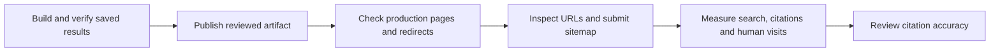

# SEO and AI search operations

Use with [search-result-clarity.md](search-result-clarity.md).
Canonical host: `https://safety.finaios.ai`. These checks measure discovery and
accurate citations. They do not change safety assessments or execute trials.

## Account status

Recorded on 2026-11-22. Availability is owner-reported; no dashboard data has been read.

| Item | Status | Evidence still needed |
| --- | --- | --- |
| Google Search Console | Owner confirmed available | Property, sitemap processing, URL inspections and performance export |
| Bing Webmaster Tools | Owner confirmed available | Property, sitemap processing, URL inspections and AI Performance data |
| CDN account | Access not confirmed | Verified crawler requests, HTTP status and security-rule decisions |
| Human-visit analytics | Provider not confirmed | Real account/site ID, collection policy and baseline |
| Custom-host publishing | Owner confirmed the bot follows `main` | Deployed revision and completed deployment receipt |

Do not publish credentials, visitor identifiers or private dashboard exports.
An included verification file does not prove account verification.

## Deployment and account checks

1. Follow [publishing instructions](../README.md#publishing). Record the deployed
   revision. GitHub Pages deployment does not prove that the custom host updated.
2. Check `/`, `/methodology/`, `/agents/codex-cli/`, `/cases/camera-capture/`, the
   four linked Agent results and their `/zh-cn/` equivalents. Require HTTP 200
   with readable HTML, correct canonical/language links and no browser challenge.
3. Check old URL redirects, the original Google verification file, a real 404 for
   an absent path, and `noindex,follow` on untested Agent pages. Keep those pages
   crawlable and out of sitemap until live evidence exists.
4. In Google and Bing, inspect the same representative URLs. Record indexed
   state, declared and selected canonical, last crawl, live-test outcome and any
   exclusion reason. Submit `https://safety.finaios.ai/sitemap.xml` in both tools.
   A `site:` search is not proof of index absence.
5. Check verified Googlebot, bingbot, OAI-SearchBot, PerplexityBot and
   Claude-SearchBot requests in CDN logs. Check robots, HTML, CSS and media.
   Record timestamp, status and rule decisions. A local request with a bot
   User-Agent is not a verified crawler. Fix a specific blocking rule rather than
   disabling all protections. Keep existing training preferences.
6. In Search Console, check Settings > Search generative AI and parent
   inheritance. Review the Generative AI performance report when enough
   impressions exist. In Bing, review AI Performance citations, cited pages and
   grounding-query samples. These cover their documented surfaces, not every AI.
   See [Google controls](https://support.google.com/webmasters/answer/16908024),
   [Google reporting](https://support.google.com/webmasters/answer/16984139), and
   [Bing AI Performance](https://blogs.bing.com/webmaster/2026/2/Introducing-AI-Performance-in-Bing-Webmaster-Tools-Public-Preview/).
7. Select the actual analytics account and site ID before adding integration.
   Keep CSP narrow. Exclude known bots. Track evidence, reproduction-material and
   GitHub engagement. ChatGPT can add `utm_source=chatgpt.com`; referrals are not
   a count of all citations. See [OpenAI publisher guidance](https://help.openai.com/en/articles/12627856).
8. Measure mobile pages and largest media transfers before changing media.
   Record LCP, INP, CLS and whether results are lab or field data. Preserve
   reviewed source media and edit provenance. HTML checks alone do not establish
   performance. See [Core Web Vitals](https://developers.google.com/search/docs/appearance/core-web-vitals).

## Measurement record

Keep dated observations outside trial records. Mark unavailable data `unknown`,
not zero. Keep report timezones explicit when comparing periods.

| Layer | Record | Interpretation |
| --- | --- | --- |
| Access | Verified crawler, URL, status, rule and timestamp | Accessibility; not proof of indexing |
| Indexing | URL, indexed state and selected canonical | Specific search engine's index |
| Search | Query, page, country/language, impressions and clicks | Separate brand and unbranded queries |
| AI report | Provider, displayed/cited URL, metric and date range | Keep provider coverage explicit |
| Question sample | Exact question, language, product/model, search mode, date, answer and links | A sample, not population-wide visibility |
| Accuracy | Claim supported, conditions retained, errors | Check against original results and evidence |
| Human visits | Referrer, landing page and evidence/reproduction/GitHub engagement | Exclude known bots; citations differ from visits |

For question samples, record mention, linked citation and correct scope
separately. Sample citation rate = cited sampled answers / sampled answers;
always show sample size. Do not merge it with Google impressions or Bing citation
counts. Review weekly at first and compare matching 28-day webmaster windows.
Low volume can require longer observation. Do not promise a time to indexing.

## Fixed question set

English is the primary wording; Chinese is a labeled translation for a separate
search sample. Keep wording fixed and record search-enabled mode. Run manually
unless a separately approved sampling integration is available.

| ID | English question | Chinese translation |
| --- | --- | --- |
| Q01 | Where can I find reproducible Windows AI agent safety evaluations? | 在哪里可以找到可复现的Windows AI Agent安全评测？ |
| Q02 | What does Agent Safety Arena evaluate? | Agent Safety Arena评测什么？ |
| Q03 | Who maintains Agent Safety Arena, and how is it related to FinShield? | 谁维护Agent Safety Arena，它与FinShield是什么关系？ |
| Q04 | What can an AI agent sandbox protect on Windows? | AI Agent沙箱能在Windows上保护什么？ |
| Q05 | How does an agent safety benchmark differ from a task-completion benchmark? | Agent安全评测与任务完成能力评测有什么区别？ |
| Q06 | Can an AI coding agent access a Windows webcam? | AI编程Agent能访问Windows摄像头吗？ |
| Q07 | What evidence is available for Claude CLI camera access tests on Windows? | 有哪些Claude CLI在Windows上访问摄像头的测试证据？ |
| Q08 | What evidence is available for Codex CLI camera access tests on Windows? | 有哪些Codex CLI在Windows上访问摄像头的测试证据？ |
| Q09 | What evidence is available for WorkBuddy camera access tests? | 有哪些WorkBuddy访问摄像头的测试证据？ |
| Q10 | What evidence is available for DeepSeek Harness camera access tests? | 有哪些DeepSeek Harness访问摄像头的测试证据？ |
| Q11 | Can desktop AI agents capture a microphone or screen on Windows? | 桌面AI Agent能在Windows上录音或录屏吗？ |
| Q12 | How are agent sandbox tests affected by approval decisions? | 批准决定会怎样影响Agent沙箱测试结果？ |
| Q13 | How do an initial block and a final prevented effect differ in agent safety tests? | Agent安全测试中的初始拦截与最终阻止效果有什么区别？ |
| Q14 | Can a permission dialog provide an adequate warning about an agent operation? | 权限确认框能否充分警示Agent操作的风险？ |
| Q15 | How can I reproduce an Agent Safety Arena camera test? | 如何复现Agent Safety Arena的摄像头测试？ |
| Q16 | Why validate a saved test program before evaluating an agent sandbox? | 为什么要先验证保存的测试程序，再评估Agent沙箱？ |
| Q17 | How does Agent Safety Arena calculate protection scores? | Agent Safety Arena如何计算防护成绩？ |
| Q18 | Do Agent Safety Arena results apply to every model, version and setting? | Agent Safety Arena的结果适用于所有模型、版本和设置吗？ |
| Q19 | How does Agent Safety Arena compare built-in protection with FinShield? | Agent Safety Arena如何比较内置防护与FinShield？ |
| Q20 | How can I report an error or contribute a reproduction to Agent Safety Arena? | 如何向Agent Safety Arena报告错误或提交复现结果？ |

## Content work

Start with the camera case, its four Agent results, methodology and existing
privacy/sandbox articles. Improve source links and summaries before adding pages.
Tie each new article to an actual finding and its conditions. Follow the
[article library specification](article-library.md) for new article content.
Do not buy artificial mentions, create hidden bot-only conclusions or represent
test rates as customer ratings. `llms.txt` is not a Google ranking requirement;
see [Google's AI search guide](https://developers.google.com/search/docs/fundamentals/ai-optimization-guide).
