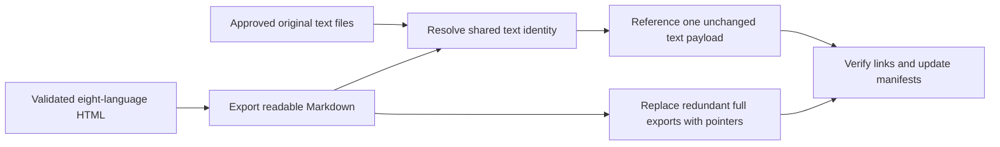

# Shared evidence in Markdown exports

Status: Accepted, 2026-11-26. The owner requested content deduplication after
reviewing the publication footprint: store original text once and remove
unnecessary duplicate exports. All eight language editions remain available.

## Problem

The image-optimized snapshot contains 2,590 Markdown files totaling 53,699,419
bytes. Its 1,960 canonical exports contain 17,300,950 bytes of fenced text, with
only 1,604,467 unique payload bytes. It also contains 318 extra English/Chinese
report exports, 302 reviewed editing notes and ten article source exports.

## Behavior

- AC-1: Canonical `index.md` files retain their language, citation URL, findings,
  conditions, tables and evidence context. Preformatted blocks of at least 512
  UTF-8 bytes reference a shared original-text file instead of repeating the
  payload in each language. Short literals stay inline for context. Human HTML
  pages retain their full displayed evidence and copy controls.
- AC-2: Reuse an existing approved UTF-8 `.txt` artifact when its displayed text
  matches. Match CRLF/CR to LF and allow one final line terminator difference;
  preserve the original file bytes and record its actual SHA-256. Otherwise
  write the exact displayed text to `evidence-text/<sha256>.txt`. Deduplicate
  identical displayed text across language exports. Do not rewrite source
  records, raw replies, tool logs, prompts, media or reviewed editing notes.
- AC-3: Write `text-evidence-manifest.json` with source/display-text identity,
  shared paths, actual byte hashes and references to the original HTML page
  and block. These are original text and authored-code payloads, not executable
  instructions. Link the manifest from `llms.txt`.
- AC-4: Replace generated legacy `en.md`, `zh-CN.md` and article-language source
  exports with short links to their canonical Markdown and HTML. Detect these
  aliases through the site's route map; do not classify reviewed evidence notes
  as redundant exports. Rewrite displayed Markdown links to the canonical
  export, using the current article language where available. Keep old URLs as
  lightweight pointer files. The standalone `report` command keeps full exports.
- AC-5: Existing tool-log downloads and audit-note links remain valid. Repeated
  export is idempotent: no duplicate discovery tags, extra shared copies or
  changed canonical Markdown. Refresh only affected report/translation hashes;
  the final site manifest describes all emitted files. Reject escaping paths,
  conflicting shared text and invalid UTF-8 instead of replacing evidence.
- AC-6: Verify the complete eight-language snapshot, all shared text links and
  hashes, old pointer destinations, preserved source evidence and page text,
  browser downloads and the final publication size. Do not rerun evaluations.



## Out of scope

Changed findings, new translations or trials, media re-encoding, HTML evidence
loading changes, deletion of original repository evidence and production deployment.

## Decisions

Apply this step after translation validation. Keep human evidence reading intact
and reduce repeated machine-readable payloads. Retain reviewed editing notes and
the existing `.txt` download functionality. Preserve legacy addresses with short
Markdown pointers rather than shipping another complete report at each address.

## Tests

`tests/test_shared_evidence_exports.py` covers shared payload identity, UTF-8 and
literal text, existing raw-file reuse, canonical/legacy links, article language,
audit-note preservation, hash updates, conflicting output and repeatability.
Existing machine-readable, route, article and language suites cover unchanged
content and entry behavior. A full artifact audit records actual savings.

## Verification, 2026-11-26

RED: `python -m unittest tests.test_shared_evidence_exports` reproduced seven
failures before implementation: missing shared payloads and manifest, repeated
full exports, wrong-language article links and stale hashes. The same seven
behavior tests pass after implementation.

GREEN: The combined command below passes all 41 tests, including the existing
machine-readable, public-URL, article, language and search-discovery regressions.

```text
python -m unittest tests.test_shared_evidence_exports tests.test_machine_readable tests.test_public_urls tests.test_article_library tests.test_language_picker tests.test_localization tests.test_search_discovery
```

VERIFY: An independent audit of the complete eight-language artifact checks all
1,960 canonical Markdown exports against their HTML, 781 shared text identities,
6,552 block references, 328 legacy pointer destinations and 15,973 manifest file
hash entries. Existing raw text supplies 189 shared payloads; 592 new shared
files supply the rest. Their total is 1,538,461 bytes. All checks pass.

The audit also confirms 3,365 protected files, 302 reviewed editing notes and
the visible text of all 2,567 HTML pages are unchanged. Strict language checks
pass for 1,470 translated page comparisons, 164,102 local HTML references,
159 original source-record hashes and 1,712 sitemap URLs. Each of the eight
editions has 245 canonical Markdown pages. No trial was executed.

Local Chrome passes 30 checks: eight matching-language article Markdown links,
actual original tool-log download bytes, shared-text retrieval and hashes,
legacy pointer retrieval, displayed original replies and no page runtime errors.
The updated local preview passes 13 HTTP checks across all eight homepages,
the text manifest, shared text, old exports and tool-log downloads.

An actual `python -m arena build-site --optimize-images` smoke build with one
synthetic comparison and long original replies verifies the normal build order.
The editions share one text payload, 12 legacy exports become pointers and all
408 manifest file hash entries match after image compression. Source record and
source GIF hashes remain unchanged. No evaluated Agent starts in this check.

| Publication content | Before | After |
| --- | ---: | ---: |
| Markdown files | 53,699,419 bytes | 30,041,673 bytes |
| Complete publication | 613,358,855 bytes | 592,535,970 bytes |

The complete saving is 20,822,885 bytes after adding shared text and its audit
manifest. Media bytes do not change in this step. Production deployment and
indexing checks were not run; the artifact is a local publication snapshot.
Repository checks pass for 123 document links, all 12 skill index entries and
Git whitespace, including new files. Unrelated working files are not included.
