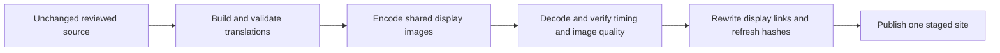

# Website image compression

Status: Accepted, 2026-11-26. The owner requested smaller published screenshots
and GIF previews, with screenshots usually in the tens to hundreds of KB and
animation previews preferably below 1 MB. The owner then requested smaller
preview dimensions and a 200 KB target (one fifth of an approximately 1 MB
video), with capacity reserved for later evaluations.

## Problem

The eight-language site contains one shared image set. Its PNG files total
492 MiB and its GIF files total 168 MiB before compression. Copying source
images directly makes the published site unnecessarily large.

## Behavior

- AC-1: `build-site --optimize-images` creates shared WebP display derivatives
  after translation validation. The default build retains its byte-copy behavior.
  Install the optional `site` dependency group for compression. A requested
  compression build fails clearly if the encoder is unavailable.
- AC-2: Preserve source files in `results/` and `articles/`, original records,
  warnings, replies, videos, image dimensions, transparency, and color profiles.
  Do not crop, resize screenshots, change playback speed, or rerun a trial.
  Screenshot WebP derivatives use quality 90 or better. Prefer a lossless
  screenshot derivative when it is smaller.
  A decoded RGB error check limits each channel's RMS error to 4.5 on the
  0-to-255 scale, across every frame. It can select a higher quality or lossless encoding.
  The automatic check does not replace visual inspection of evidence text.
- AC-3: Decode every candidate. Animation display previews keep their total
  duration, first/last states and loop behavior. Resample to approximately 10 fps
  and at most 640 pixels wide, preserving aspect ratio. Try 560 and 480 pixels
  when required for the 200,000-byte target; prefer quality 80, with a minimum
  of 75. Complex previews can use 384 or 352 pixels, still above the observed
  328-pixel mobile card width. Limit RGB RMS error against the resized reference frames to 8 per
  channel. These previews have up to 100 ms temporal resolution and are not
  frame-accurate evidence. The original GIF and unchanged 20-second videos
  remain the sources for detailed timing. A GIF that plays once must not become
  an infinite loop. Use lossless preview encoding if chroma compression exceeds
  the color-error limit. Keep the
  source copy when a valid derivative does not reduce its size.
- AC-4: Name derivatives `<original-filename>.webp` beside the original staged
  asset. All languages share this one file. Rewrite image and image-link URLs
  in HTML and Markdown, and generated catalog media paths. Preserve query strings,
  fragments, literal evidence text, source JSON records and evidence JSON.
  Omit the replaced PNG/GIF from the publication directory; it remains in Git.
  Old direct image URLs change; page URLs do not change. Source JSON paths name
  the repository evidence; resolve its display equivalent through the image
  manifest instead of changing or presenting the source record as a derivative.
  Link this provenance map from `llms.txt` so readers and AI tools can resolve
  original evidence identities to their compressed display files.
- AC-5: Write `image-manifest.json` with source and display paths, sizes and
  SHA-256 hashes, format, quality/lossless mode, dimensions, timing, loop count,
  and measured RGB error. Record source/display dimensions, selected source
  frames and display frame durations for animation resampling. Source hashes
  refer to originals, never derivatives.
  If an interrupted staged batch is resumed, cached displays must pass independent
  hash, pixel, dimension and timing checks. Record the known accepted quality
  range when the exact encoder setting was not retained; do not invent it.
  Refresh export and translation file hashes, then create the final site hash
  manifest. Corrupt input, invalid timing, escaping paths and output collisions
  fail the build before the staged directory is published.
- AC-6: Report actual totals, screenshots above 1,000,000 bytes, and animations
  above the 250,000-byte upper target. Do not go below the stated dimensions
  or quality limits to satisfy a quota. An optimized build fails before
  publication when its complete artifact exceeds 750,000,000 bytes, reserving
  at least 25 percent of the current 1 GB Pages capacity for later evaluations.
  Verify the full current site, local links, file hashes, originals and selected
  desktop/mobile displays. Enable the flag in the existing Pages workflow.

## Out of scope

Video re-encoding, new recordings, changed findings, localized media, hosting
migration, and a fixed byte limit that makes evidence text unreadable.

## Decisions

Use Pillow with WebP support as an optional publication dependency. Preserve
full screenshot dimensions and use high quality rather than scaling evidence text.
Only short animated display previews use the smaller dimensions and cadence.
Keep one display derivative per source asset. The original source remains in
the repository and retains its evidence identity. The image manifest records
the explicit mapping for readers and tools.

## Tests

`tests/test_image_compression.py` covers AC-1 through AC-6 with controlled PNG,
transparent images, repeated-frame GIFs, finite and infinite loops, external
URLs, literal evidence, nested relative links, source records, manifests,
size fallback, output collisions and source preservation. A complete site build
and selected frame/browser inspection provide the publication acceptance check.

### Verification, 2026-11-26

RED: Regressions reproduced the missing optimizer, a nested Markdown fence
whose source link was changed, a 1280-pixel preview above its display budget,
missing capacity enforcement, stale timing for a retained original GIF, chroma
errors on saturated animation, an oversized complex preview and a short flash
that lost its first state. These failures were corrected before acceptance.

GREEN: `python -m unittest tests.test_image_compression` ran 15 tests: 14 passed;
one symlink test was skipped because this Windows host cannot create a symlink.
The 34 existing language, route, discovery, article and Markdown tests passed.
The combined result is 48 passed and one skipped. A real
`python -m arena build-site --results <controlled-fixture-root> --output <new-output> --optimize-images`
smoke check also passed, with unchanged fixture source hashes and no trial.
The bracketed paths in this command describe the isolated smoke fixture.

VERIFY: A complete assembled eight-language snapshot was optimized. After an
interrupted encoding batch, cached displays were independently decoded and
checked against source hashes, pixels, dimensions, timing and loop behavior.
Accepted encoder ranges are recorded when exact cached settings were unavailable.
The color-intensive Window Flood preview uses a lossless 352-pixel display.
It is 220,766 bytes and passes the real-case regression.

| Files | Count | Source bytes | Display bytes | Mean display | Maximum display |
| --- | ---: | ---: | ---: | ---: | ---: |
| PNG screenshots and illustrations | 786 | 515,898,195 | 134,308,586 | 170,876 | 619,304 |
| GIF animation previews | 160 | 176,044,636 | 20,062,228 | 125,389 | 220,766 |

159 of 160 animations meet the preferred 200,000-byte target. All 160 stay
below 250,000 bytes. Display widths are 640 pixels for 131 previews, 560 for
25, 480 for three and 352 for one. All 317 original MP4 files are byte-identical;
their mean size is 949,920 bytes. Each animation is below one quarter of that
mean video size. All original screenshots retain their full dimensions.

The complete artifact is **613,358,855 bytes**, down **46.7 percent** from
1,149,746,250 bytes. It leaves 386,641,145 bytes against the conservative
1,000,000,000-byte host limit and 136,641,145 bytes before the 750 MB build budget.
No oversized screenshot or animation exception remains under the AC-6 limits.

Checks passed for 946 source/display image identities, 2,418 protected files,
2,567 unchanged HTML text bodies, 1,960 Markdown exports recomputed in memory,
4,443 nested report hash entries, 10,156 root/translation hash entries,
159 source-record hashes and 164,102 local HTML references. All six additional
languages retain 245 pages each, with 1,470 matched language comparisons and
zero unavailable translations. The sitemap retains 1,712 entries.

Local Chrome passed 211 language/layout checks and 37 image/media checks.
The media checks cover desktop/mobile previews, real painted animation frames,
full-resolution evidence images, original MP4 links and 20-second video metadata.
Selected Chinese/Arabic cards, animation states and result screenshots were
visually inspected. No trial execution, production deployment or merge occurred.
