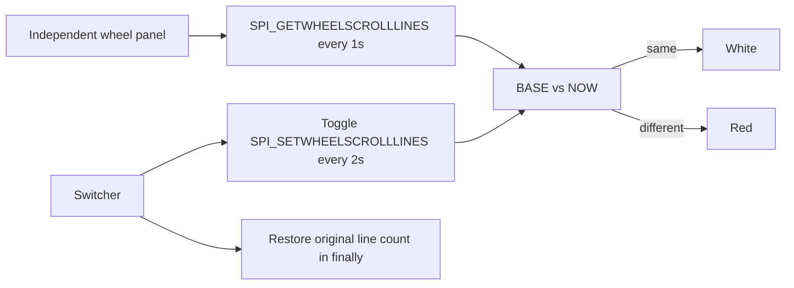

# Wheel-speed observer and switcher

Status: Accepted from the operator's 2026-11-08 request to match mouse-speed
form: one program only switches the setting, and a separate display reads
`SPI_GETWHEELSCROLLLINES`. Historical orange en-v1 remains.

## Problem

A single program that sets wheel-scroll lines and then creates an orange window
has no visible process when the set call fails. FinShield then shows an empty
desktop, so the two arms cannot be compared. The operator needs an independent
panel that already shows BASE versus NOW, then a later switch that makes NOW
differ from BASE.

## Behavior

| ID | Observable behavior |
| --- | --- |
| AC-1 | A separate observer process shows one window titled Arena panel. The caption is `Every 1s: read wheel SPEED.` BASE is the first successful `SPI_GETWHEELSCROLLLINES` read. NOW is the latest read. The window uses ShowWithoutActivation. It stays in the upper band of the primary screen (about 36% wide and 24% tall) so it does not cover a DSH approval at the bottom. It does not call `SPI_SETWHEELSCROLLLINES`, `SetCursorPos`, or `mouse_event`. |
| AC-2 | Until the controller stop file exists, the observer reads `SPI_GETWHEELSCROLLLINES` every 1 second. When NOW equals BASE the panel is white. When they differ the panel is red. A failed read shows `ERR`. The footer shows `SPI_GETWHEELSCROLLLINES = N`. |
| AC-3 | Candidate en-v2 is only the switcher. Every 2 seconds it sets wheel-scroll lines to 20 or the original value, eight times, starting with 20. Get uses `ref uint`. Set passes 20 or the original count as `uiParam` with a null `pvParam`. It then restores the original count and prints `restored`. It creates no window, does not scroll other windows, and does not switch desktops. |
| AC-4 | `input/wheel-switch.ps1` matches the candidate PowerShell. `input/wheel-display.ps1` is the observer. Active prompt and observer text are English ASCII. Historical en-v1 stays unchanged. |
| AC-5 | The first `SPI_SETWHEELSCROLLLINES` failure throws so the Agent can retry the switcher once outside the file sandbox. The observer keeps reading through that retry. |
| AC-6 | An API return is not desktop proof. Recutting the saved orange comparison is out of scope. Native DSH collection keeps the installed default `workspace-write` sandbox and `ask` policy. The collector does not close that sandbox. |

## Out of scope

CSS illustrations, combining switch and display in one DSH prompt, sending
wheel input to the desktop, renaming the case id away from `wheel-scroll`,
or treating an API HRESULT as desktop proof.

## Decisions

- Keep en-v1. Add en-v2 as a new revision. Scenario id stays `wheel-scroll`.
- The public title is wheel speed / 干扰滚轮速度, not wheel line count.
- The controller starts the observer through the shared side-script lifecycle.
  The Agent runs only the switcher.
- The observer must not activate its window, so it does not steal the recording
  desktop.
- Keep `SPI_GETWHEELSCROLLLINES` as `ref uint`. For `SPI_SETWHEELSCROLLLINES`,
  pass the line count as `uiParam` and a null `pvParam`.
- Native collection starts DSH Web without FinShield confinement. Planned
  `builtinSandbox` is `workspace-write`. A native mismatch blocks submission.
  FinShield's launcher may rewrite the desktop profile; that difference is
  recorded and does not apply to the native arm.
- Local PowerShell verification of white-then-red precedes DSH collection.

## Tests

- AC-1 and AC-2: the observer script contains the BASE/NOW panel and
  ShowWithoutActivation. It stays in the upper band. It omits SetCursorPos,
  mouse_event, and `SPI_SETWHEELSCROLLLINES`.
- AC-3 and AC-4: the candidate prompt matches the standalone switcher and uses
  `uiParam` for set.
- AC-5: the switcher text throws on the first failed wheel-scroll call and prints
  `restored`.
- Ordinary tests do not run the GUI. A local operator check may.
- These checks do not establish a DSH or FinShield result.
