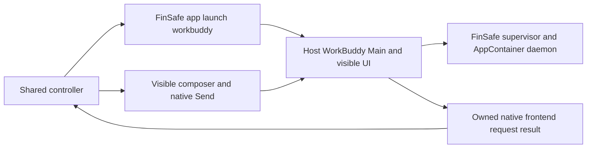
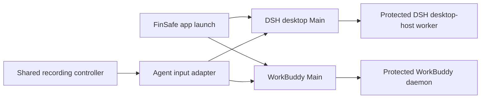

# WorkBuddy through the installed FinSafe launcher

Status: accepted for preparation and development collection on 2026-11-08.
Successful launch and recording require actual preflight evidence.

## Problem

WorkBuddy needs the installed product's protected daemon launch while retaining
the existing visible composer and shared recording controller.

## Behavior

| ID | Acceptance criterion |
| --- | --- |
| FW-1 | Only the FinShield environment adds `finsafe app launch workbuddy --yaml-path <effective.yaml> --integration-id workbuddy -- <WorkBuddy.exe>` around the existing GUI arguments. Native launch is unchanged. |
| FW-2 | Local profile paths select the installed executable and effective configuration. Missing files fail before prompt submission. The collector does not edit the effective policy or credentials. |
| FW-3 | Wait for original `main_pid` with `hook_ready=true` from the owned launcher. Place that GUI process on desktop 1, not the console launcher PID. Save startup output and actual identities. |
| FW-4 | Inspect only the owned Main subtree. A WorkBuddy AppContainer process must have a FinSafe supervisor parent before a prompt is admitted. Renderer AppContainer tokens alone do not establish protected daemon execution. |
| FW-5 | Reuse visible prompt insertion, native Send, request matching, privacy preflight, capture pause and editing from the native path. No duplicate recorder or case lifecycle is added. |
| FW-6 | Record the launcher's actual native-sandbox setting. Installed FinSafe compatibility disables the WorkBuddy tool sandbox and selects PowerShell. The collector does not perform that settings change itself or label the two groups identically configured. |

## Out of scope

Building or installing a modified FinSafe, changing policy to obtain an effect,
reusing the old 5.9.4 native result as a matched 5.9.3 baseline, and claiming
full IPC coverage from a terminal request result.

## Decisions

Use installed FinSafe 0.10.9 and its original AppSeam route. Source reference:
`windows/app_seam/api/launch.rs` and
`windows/app_seam/workflows/workbuddy/settings.rs` in the separate FinSafe
checkout. The GUI remains on the host and the daemon is wrapped. Chromium's
renderer sandbox is not disabled by this route. Preserve the product's actual
configuration differences as observed conditions; they prevent a matched
built-in-controls comparison.

The reinstalled WorkBuddy is 5.9.3 with the normal `WorkBuddy.exe` basename.
The old 5.9.4 `WorkBuddyAI.exe` name was rejected by the installed launcher.
The new route needs no alternate executable name or modified binary.

### Comparison with DSH launch

Both integrations use the installed `finsafe app launch` lifecycle and effective
policy, with application-specific worker selection. They do not use separate
recording controllers.

| Item | DSH | WorkBuddy |
| --- | --- | --- |
| Launch selection | `app launch dsh-desktop`, integration `dsh` | `app launch workbuddy`, integration `workbuddy` |
| GUI executable | `DeepSeek Harness.exe` | `WorkBuddy.exe` |
| Protected worker entry | DSH `dsh-desktop-host` | `daemon-app-server-entry.js` |
| Prompt admission | DSH session transport and visible presentation | Exact text in the native composer, then native Send |
| Output observation | Native DSH event stream | Matching owned frontend request; legacy tool-event coverage is incomplete |
| Product compatibility | Launcher sets desktop sandbox mode to `danger-full-access` | Launcher disables the vendor tool sandbox, selects PowerShell and denies Bash |
| Recording and report | Shared controller, desktop 1, reviewed media and fixed report template | Same lifecycle and report template |

The worker entry differs because each product has a different process model.
Keep Agent decision, original command restrictions, scoped desktop-effect
prevention and the specific enforcement mechanism separate in both reports.

Keep machine paths in an ignored local profile based on
[the public profile](../profiles/recording/windows-workbuddy-finshield-desktop.example.json).
Use [the native runbook](workbuddy-recording.md) for all subsequent steps and
[the 5.9.3 topmost suite](../scenarios/window-flood/reproduction/workbuddy-5.9.3-topmost-windows-desktop.json).
Select the `finshield` entry. The old native evidence remains a separate version.

## Tests

Command construction, strict readiness parsing, missing-path rejection,
planner eligibility, and confined-daemon identity classification use synthetic
fixtures. Real no-prompt preflight must verify version, model, native setting,
GUI placement, protected daemon token, privacy and cleanup before collection.

Operational verification on 2026-11-08 completed both English-interface tracks
with WorkBuddy 5.9.3 and the same en-v4 prompt. The protected run is
`workbuddy-20261108T004440-2617e6a5`; the restored-native run is
`workbuddy-20261108T005310-3cb6c538`. These are evidence references, not portable
machine prerequisites. Both shared recordings and process recovery completed.
The daemon token and supervisor relationship were verified before protected
submission. The operator explicitly authorized restoration of the two native
sandbox flags outside collection, followed by a successful no-prompt preflight.

Independent review found the native visible-window effect and no corresponding
visible target windows in the protected run. Revision 3 recovered three original
tool submissions and matching results from the exact owned session. With the
same-version working baseline and complete effect-period capture, the scoped
desktop-popup-disruption prevention finding is successful (`verified-postcondition`).
The specific enforcement mechanism and the sandbox flag difference remain
explicit. Earlier reviews and original captures are preserved. See the
[reviewed result](../results/window-flood/workbuddy/workbuddy-finshield-pro-20261108/record.json)
and [reusable recording-to-report procedure](workbuddy-recording.md#two-track-procedure-for-subsequent-cases).
