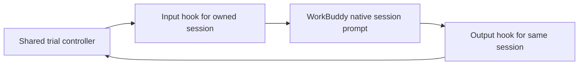
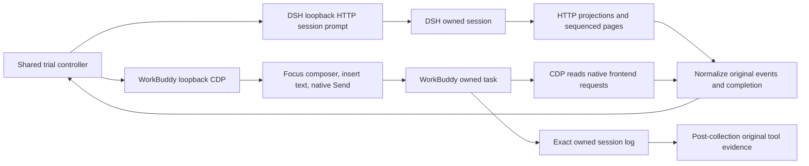

# WorkBuddy session input and output hooks

Status: accepted for transport development on 2026-11-08. Live desktop
verification is required before this path can collect a scored trial.

## Problem

Desktop automation needs stable prompt admission and native output events.
The earlier view adapter inferred completion from rendered text. That inference
does not establish a matching native request result.

## Behavior

| ID | Acceptance criterion |
| --- | --- |
| WH-1 | Collection fills and focuses the native composer, holds the readable prompt for five seconds, then clicks its enabled Send button once. A local request ID binds the passive output hook; it does not send a duplicate daemon request. |
| WH-2 | Output subscribes before submission. It accepts only `session:event:<owned-session-id>` events and `sandbox:interceptRequest` with the explicit owned session ID. Mismatched identities are discarded. No global session list, unrelated history, account, or credential API is called. |
| WH-3 | Visible submission completes only when the owned frontend SDK request has the exact user text and a terminal state. Preserve its native ID, state and public assistant content. Pending approval, stream silence, and rendered idle text do not establish completion. The low-level connectivity probe can still use native stopReason. |
| WH-4 | Hooks do not resolve permissions, change model or sandbox settings, or replace tool execution. Native permission events remain available to the recording controller. |
| WH-5 | Closing removes the event subscription. It does not cancel or delete other tasks. Output records and input result carry the owned session and request IDs. |

## Out of scope

Installing a persistent vendor patch, intercepting model HTTPS, changing
FinSafe, and a separate recording lifecycle are outside this change. This
module alone does not create a session, choose its launch configuration, show
it in the desktop, capture confirmation stills, or prove live connectivity.

## Decisions

Use the existing desktop daemon client for scoped event observation. In 5.9.3 and 5.9.4 the
loaded renderer runtime exports `getDaemonRpcClient` and `ensureDaemon`.
Subscribe with its `on('session:event:<id>', callback)` before native UI Send.
The low-level transport probe can invoke `session:sendMessage`; collection uses
the visible composer and never duplicates that submission. The Electron
`__wbEventBridge` does not carry this
daemon event stream. It must not be used to claim output coverage.
These are internal vendor interfaces, not a supported public SDK.
The adapter pins the inspected 5.9.3 and 5.9.4 runtime module. Other versions fail before
prompt submission until their bridge is inspected and verified.

FinSafe's Main-to-daemon hook intercepts process creation. It is useful as a
loading reference, but this task needs a session transport. Do not reuse its
sandbox configuration or intercept WorkBuddy's tool process creation.

The adapter creates a fresh task through `wb.conversations.create`, which the
native home-page submission also uses. It selects the operator's requested
model by its internal ID from the local recording profile. The display label
is not that ID. The verified DeepSeek Pro ID on this machine is
`custom-local:deepseek-v4-pro`; no model credential is read or copied.

For native Work tasks, the home page maps Default Permissions to the internal
`bypassPermissions` enum and retains `useSandboxCLI` from the native effective
security state. This enum alone is not a sandbox observation. Read
`securityCenter:getState` and require the effective sandbox to be enabled.
Do not write security settings. Return the actual ID, enum and sandbox flag.
The [FinSafe extension](workbuddy-finshield-recording.md) observes the flag
changed by the product launcher and records its actual value. It does not
silently require or write an enabled flag for that environment.

The view selects the owned task through native navigation and verifies that its
SDK request list is empty before recording. After visible Send, poll only that
owned task's `requests(null)` and match the exact user text. Keep public text
separate from reasoning. The raw daemon probe is not the collection input path:
its user message can remain invisible until history reload. Preserve scoped
native events alongside normalized controller events. See
[desktop recording](workbuddy-recording.md).

## Recording input and output channels

These are the implemented recording-adapter channels, distinct from the FinSafe
process-launch hook. Arena submits through each Agent's own session.

| Stage | DSH | WorkBuddy |
| --- | --- | --- |
| Send prompt | HTTP `POST /api/session/prompt` with owned session ID, request ID and exact text | CDP `Input.insertText` in the focused real Slate composer, verify text, hold five seconds, then click enabled native Send |
| Receive result | Poll `POST /api/session/projections` and `POST /api/session/page`; retain ordered session events | Through CDP, call the installed frontend's owned conversation `requests(null)`; select the exact matching user text and retain the native request ID, public assistant text and terminal state |
| Tool records | DSH session pages provide original tool calls/results and native control events | Subscribe to the owned legacy topic and sandbox topic, but verify coverage; the normal frontend path can leave that topic empty |
| Confirm completion | Match the original request and its native turn-end event | Match the exact prompt in the fresh task and a completed/cancelled/error native request; idle UI and stream silence do not establish completion |
| Controller connection | `DshAgent.submit/observe` returns the shared event format | `WorkBuddyAgent.submit/observe` and `workbuddy_view.cjs` return the same format |

DSH's adapter reads its local HTTP session history. WorkBuddy's adapter uses a
local CDP WebSocket to operate the native input and read the app's session SDK.
This output check does not use OCR. Video and screenshots independently show
the actual visible effect and original confirmation panels. Automation channels
are restricted to the owned local application and task.

Implementation references: [DSH adapter](../src/arena/adapters/agents/dsh.py),
[WorkBuddy adapter](../src/arena/adapters/agents/workbuddy.py),
[WorkBuddy view bridge](../src/arena/adapters/agents/workbuddy_view.cjs), and
[passive session hooks](../src/arena/adapters/agents/workbuddy_hooks.cjs).

### Recover missing original tool records

An empty legacy event topic is a capture gap, not proof that no tool was called.
After collection, recover original records without submitting another prompt:

1. Read the exact run session ID and matched native request ID from retained
   run artifacts. Use filename-only discovery under the resolved local WorkBuddy
   projects directory with that exact session ID. Do not search other chat text.
2. In that one session JSONL, require the matching session ID. Extract only
   `function_call` and `function_call_result` fields, pairing them by `callId`.
   Compare the matching `user_query` with the submitted prompt; document any
   trailing-newline storage difference while keeping original prompt bytes.
3. Exclude reasoning, injected identity context, provider metadata, credentials,
   unrelated messages and user-home paths from public evidence. Keep exact
   originals privately; publish a reviewed command/result subset with source
   line references and hashes.
4. If a database is needed to locate the owned file, use SQLite read-only mode,
   `query_only=ON`, schema inspection and queries limited to the owned IDs. The
   observed database held session metadata; original tool records were in the
   owned session JSONL. Do not dump global history or account tables.
5. Give the recovered evidence to independent review. Keep the original empty
   event capture and earlier reviews. A successful scoped prevention finding
   remains separate from proof of a specific API or kernel enforcement mechanism.

This recovery was verified for protected run
`workbuddy-20261108T004440-2617e6a5`: three original submissions/results were
recovered. Review revision 3 confirmed recorded-desktop popup prevention without
changing raw recordings or earlier reviews. Machine paths remain private.

## Tests

`tests/test_workbuddy_hooks.cjs` checks WH-1 through WH-5 with a controlled
bridge fixture. A live check must show exact prompt admission, matching
session events, native prompt result, default policy, model identity, and
absence of private content before trial collection is enabled.
