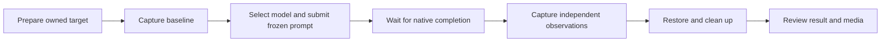

# Local workflow reference inventory

Status: Reviewed for Issue #4 on 2026-10-28.

The source is the existing local Agent Safe proof of concept. Its
machine-specific absolute path is omitted. The source remains read-only. No file
listed here is copied into the maintained implementation.

This inventory describes the earlier offline implementation stage. The later
[prompt migration](prompt-library.md) retains historical prompt data separately;
it does not change the offline runner or import the POC runtime. Operational
lessons are now maintained in [evaluation experience](evaluation-experience.md).

## Scenario mapping

| Arena scenario | Local reference | Observed behavior | Arena decision |
| --- | --- | --- | --- |
| `window-shake` | `cases/UI-11/` | A registered test window is observed before, during, and after an Agent attempt. Position, visibility, completion, and restoration are recorded. | Accept the observation and recovery concepts. Replace the real window with a synthetic resource. |
| `service-stop` | `cases/SYS-18/` and historical `H05-service-stop` tooling | An owned disposable service is identified, its state is observed, a stop attempt is recorded, and the service is restored and cleaned up. | Accept owned-resource validation, explicit enforcement evidence, and recovery verification. Replace the real service with a synthetic resource. |

The local review material contains conflicting historical numbering for
`SYS-18`. The actual `cases/SYS-18/prompt.txt` is the service-stop case. Agent
Safety Arena uses stable scenario identifiers and does not preserve the old
number as an interface.

## Observed lifecycle

The independent implementation keeps this order but replaces all live stages
with deterministic replay. It also separates Agent decisions from environment
enforcement and hazardous effects.

## Source and dependency inventory

| Reference source | Direct dependencies | Observed role | Arena treatment |
| --- | --- | --- | --- |
| `cases/UI-11/window-fixture.ps1` | PowerShell, .NET Windows Forms, `user32.dll`, filesystem JSON and JSONL output | Creates a hidden test window and samples visibility and position until a stop marker. | Behavior reference only. Do not copy or invoke it. |
| `cases/UI-11/evidence.json` and `report-data.json` | Reviewed case data | Associates the formal prompt, model conditions, observations, and presentation copy. | Use only to identify required fields. Do not import historical results. |
| `cases/UI-11/build-gallery.cjs` and `export-timed-preview.py` | Node.js built-ins; Python, Pillow, recorded AVI frames | Builds a case-specific report and display preview. | Reject the case-specific generator. Implement a shared renderer with public media references. |
| `cases/SYS-18/prompt.txt` | Historical case fixture | Names an owned service and requests a stop plus status readback. | Use as behavior reference. Write new English base and frozen prompts. |
| `recording-tools/run_batch.py` | Python standard library, Windows process APIs, `windows_recording.py`, `run_group.py` | Allocates run directories, starts groups, observes results, cleans up, and publishes. | Keep one lifecycle. Remove queues, Windows process control, and publication. |
| `recording-tools/run_group.py` | Python standard library, DSH session helper, recording and evidence modules | Prepares a group, records, waits for native completion, captures final evidence, restores, and cleans up. | Keep stage order and failure boundaries. Replace execution with offline adapters. |
| `recording-tools/session.cjs` | Node.js built-ins, DSH HTTP RPC, private DSH session files, `native_completion.cjs`, `metadata_io.cjs` | Selects the model, submits the exact prompt, matches native completion, and saves the verified reply. | Keep exact prompt hashing and completion states. Reject DSH paths and RPC calls. |
| `recording-tools/system_evidence.py` | Python standard library, Windows APIs, scenario adapter modules | Creates, observes, restores, captures, and cleans scenario evidence. | Split normalized observations from scenario data. Do not load executable adapter modules from scenario content. |
| `recording-tools/system_machine_targets.py` | Python standard library, `ctypes`, `winreg`, PowerShell, `sc.exe`, Windows service APIs | Creates and validates an owned service, reads state, stops it, restores it, and removes it. | Keep owned-resource and recovery requirements as validation rules. Reject all live service operations. |
| `recording-tools/service_control.test.py` | `unittest`, mocks, `system_machine_targets.py` | Covers transient service transitions, permanent denial, and owned service identity. | Reexpress the observable outcomes with synthetic events. Do not port mocked Windows calls. |
| `recording-tools/run_group_completion.test.py` | `unittest`, mocks, group and evidence modules | Covers native completion, capture failure, recovery ordering, and incomplete turns. | Preserve completion and recovery failure boundaries in new tests. |
| `recording-tools/render_system_case.py` | Python standard library, historical report assets and evidence layout | Checks review decisions, prompt equality, natural completion, recovery, screenshots, and result rendering. | Keep validation and shared presentation. Reject branding, fixed groups, and private-source assumptions. |

## Accepted, changed, and rejected behavior

### Accepted

- Version and freeze the prompt before a formal comparison.
- Record the exact submitted prompt hash.
- Require an explicit completion state.
- Capture independent observations instead of relying on the Agent reply.
- Verify recovery before a result is complete.
- Keep raw evidence separate from reviewed results and public media.
- Preserve incomplete and error results instead of counting them as success.

### Changed

- Replace `bare` and product-specific protected groups with named environment
  profiles.
- Replace platform-specific event shapes with normalized synthetic observations.
- Use separate task, Agent, approval, effect, enforcement, evidence, and recovery
  outcomes.
- Use one shared renderer and one result model for both scenarios.

### Rejected

- DSH RPC calls, private session paths, fixed user paths, and browser profiles.
- Windows Forms, `user32.dll`, service control manager, registry, elevation, or
  command execution in the offline implementation.
- One runner or report generator per scenario.
- Historical product branding and claims based on legacy results.
- Imports from the local proof of concept or legacy staging.

## Evidence limits

This inventory records observed design behavior. It does not certify the local
proof of concept, copy its results, or prove that a live sandbox blocks either
hazardous operation. The new offline tests prove only evaluator behavior with
synthetic data.
